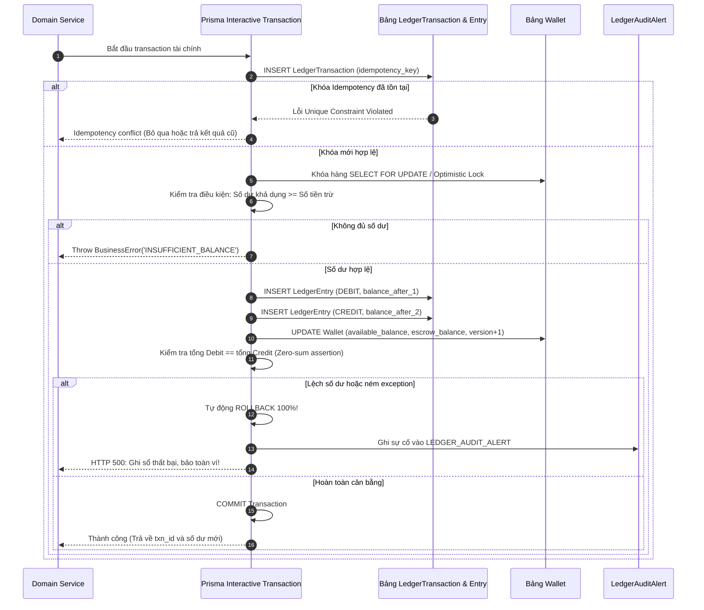
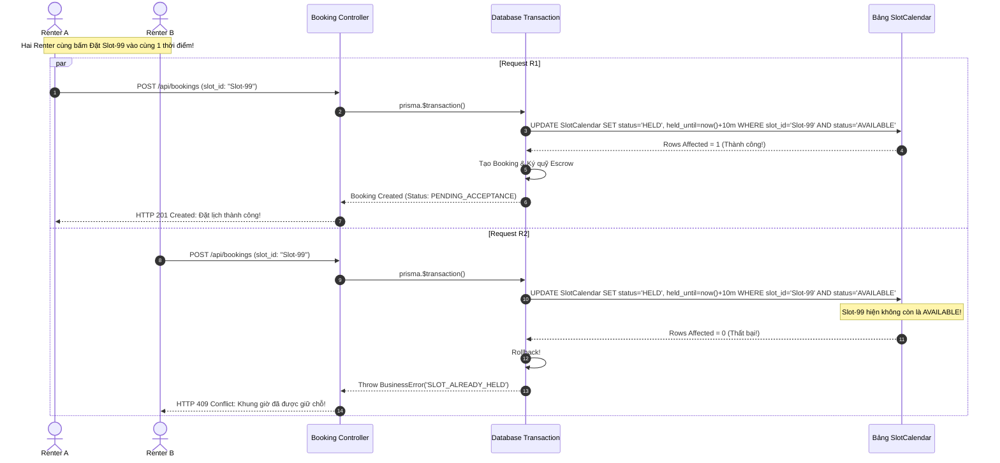
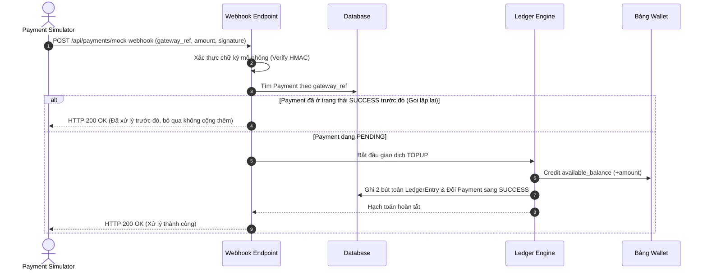
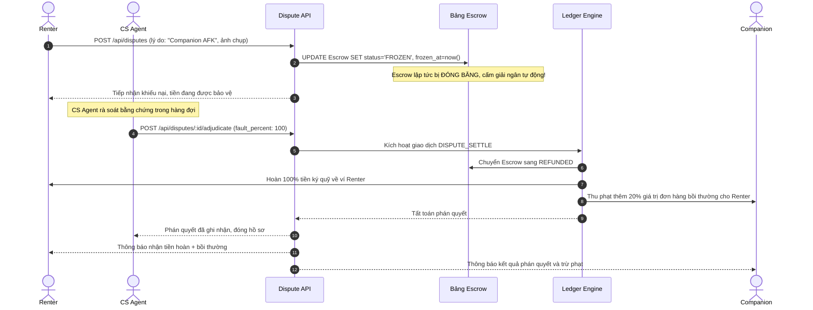

# INSTASQUAD — Đặc tả giao diện lập trình ứng dụng (API Contract)

Tài liệu này quy định chi tiết các API endpoints, cấu trúc DTO (Request/Response), phân quyền vai trò (RBAC), mã lỗi nghiệp vụ chuẩn hóa và các sơ đồ tuần tự (Sequence Diagrams) cho mốc **M2**.

---

## 1. Tiêu chuẩn thiết kế API chung

1. **Giao thức & Định dạng**: RESTful API qua HTTP/1.1 hoặc HTTP/2. Toàn bộ request body và response body sử dụng định dạng JSON UTF-8.
2. **Xác thực & Phân quyền**: Header `Authorization: Bearer <JWT_TOKEN>`.
3. **Cơ chế chống lặp (Idempotency)**:
   - Các API nhạy cảm (`POST /api/bookings`, `POST /api/payments/mock-webhook`, `POST /api/withdrawals`) yêu cầu gửi kèm header `Idempotency-Key: <UUID>` hoặc trường `request_key` trong body.
4. **Bảo vệ dữ liệu riêng tư (Privacy & Security)**:
   - Tuyệt đối không trả về `password_hash`.
   - Số tài khoản ngân hàng luôn được che mặt nạ (`account_no_masked`, e.g. `******5678`).
   - Tin nhắn chứa thông tin liên lạc nhạy cảm bị che bằng `[THÔNG TIN BỊ CHẶN]` khi trả về client thông thường.
5. **Cấu trúc phản hồi chuẩn**:
   - Phản hồi thành công:
     ```json
     {
       "success": true,
       "data": { ... },
       "meta": { "timestamp": "2026-10-24T08:00:00.000Z" }
     }
     ```
   - Phản hồi lỗi nghiệp vụ:
     ```json
     {
       "success": false,
       "error": {
         "code": "SLOT_ALREADY_HELD",
         "message": "Khung giờ này vừa có người khác giữ chỗ.",
         "details": null
       }
     }
     ```

---

## 2. Bảng tổng hợp các API Endpoints cốt lõi

| Nhóm | Method | Đường dẫn (Path) | Quyền tối thiểu | Header Idempotency | Tóm tắt chức năng |
|:---|:---|:---|:---:|:---:|:---|
| **Auth** | `POST` | `/api/auth/register` | Public | Không | Đăng ký tài khoản (Renter / Companion). |
| | `POST` | `/api/auth/login` | Public | Không | Đăng nhập nhận JWT token. |
| | `GET` | `/api/auth/me` | Authenticated | Không | Lấy thông tin user hiện tại và số dư ví. |
| **Catalog** | `GET` | `/api/games` | Public | Không | Danh sách game và rank tier. |
| | `GET` | `/api/companions` | Public | Không | Tìm kiếm & lọc Companion theo game, rank, giá. |
| | `GET` | `/api/companions/:id/slots` | Public | Không | Lấy danh sách slot rảnh còn khả dụng. |
| | `POST` | `/api/companion/slots` | Companion | Không | Tạo khung giờ rảnh mới. |
| **Booking** | `POST` | `/api/bookings` | Renter | **Bắt buộc** (`request_key`) | Tạo đơn đặt lịch, kiểm tra 10h, giữ slot và ký quỹ. |
| | `GET` | `/api/bookings/:id` | Participant | Không | Chi tiết đơn đặt lịch và trạng thái Escrow. |
| | `POST` | `/api/bookings/:id/accept` | Companion | Không | Companion chấp nhận đơn trong 180s. |
| | `POST` | `/api/bookings/:id/reject` | Companion | Không | Companion từ chối đơn $\rightarrow$ Hoàn 100% tiền. |
| | `POST` | `/api/bookings/:id/cancel` | Renter | Không | Renter hủy đơn trước giờ hẹn theo các mốc hoàn/phạt. |
| **Fulfillment** | `GET` | `/api/sessions/:id` | Participant | Không | Lấy thông tin phiên chơi và token kết nối chat WS. |
| | `POST` | `/api/bookings/:id/accept-fulfillment` | Renter | Không | Renter xác nhận nghiệm thu $\rightarrow$ Giải ngân 88/12. |
| **RMA** | `POST` | `/api/disputes` | Renter | Không | Báo sự cố trong 15m $\rightarrow$ Đóng băng Escrow. |
| | `POST` | `/api/disputes/:id/evidence` | Participant | Không | Nộp tệp/ảnh bằng chứng bổ sung. |
| | `POST` | `/api/disputes/:id/adjudicate` | CS / Admin | Không | CS phán quyết tỷ lệ lỗi $\rightarrow$ Hoàn tiền / Giải phóng. |
| **Reviews** | `POST` | `/api/reviews` | Participant | Không | Đánh giá 1–5 sao (Bất biến, không cho sửa/xóa). |
| **Finance** | `GET` | `/api/wallet` | Authenticated | Không | Xem số dư khả dụng, số dư ký quỹ và lịch sử Ledger. |
| | `POST` | `/api/payments/create-topup` | Authenticated | **Bắt buộc** | Tạo link/lệnh nạp tiền qua Simulator. |
| | `POST` | `/api/payments/mock-webhook` | Simulator | **Bắt buộc** (`gateway_ref`) | Webhook cổng mô phỏng trả kết quả nạp tiền. |
| | `POST` | `/api/withdrawals` | Companion | **Bắt buộc** | Yêu cầu rút tiền (Khóa số dư khả dụng ngay). |
| | `POST` | `/api/withdrawals/:id/approve` | Auditor/Admin | Không | Duyệt chuyển khoản rút tiền tất toán. |
| | `POST` | `/api/withdrawals/:id/reject` | Auditor/Admin | Không | Từ chối rút tiền $\rightarrow$ Hoàn trả tiền vào ví. |
| **Audit** | `GET` | `/api/audit/ledger-alerts` | Auditor/Admin | Không | Tra cứu danh sách cảnh báo lệch sổ cái. |

---

## 3. Chi tiết DTOs và Mã lỗi của các Endpoint trọng yếu

### 3.1. `POST /api/bookings` — Tạo đơn đặt lịch & Giữ chỗ Slot
- **Quyền**: `RENTER`
- **Request Headers**:
  - `Authorization: Bearer <token>`
- **Request Body**:
  ```json
  {
    "request_key": "REQ-7b8c2f10-912a-4f56-b810-c12e34567890",
    "slot_id": "SLOT-001",
    "duration_hours": 2
  }
  ```
- **Response thành công (HTTP 201 Created)**:
  ```json
  {
    "success": true,
    "data": {
      "booking_id": "BK-a1b2c3d4-e5f6-7890-1234-56789abcdef0",
      "request_key": "REQ-7b8c2f10-912a-4f56-b810-c12e34567890",
      "status": "PENDING_ACCEPTANCE",
      "slot_id": "SLOT-001",
      "total_fee_snapshot": 200000,
      "response_deadline": "2026-10-24T08:03:00.000Z",
      "escrow": {
        "status": "HELD",
        "amount": 200000
      }
    }
  }
  ```
- **Các lỗi nghiệp vụ (Business Errors)**:
  - `SLOT_ALREADY_HELD` (HTTP 409): Khung giờ đã bị người khác giữ hoặc đã đặt.
  - `INSUFFICIENT_BALANCE` (HTTP 402): Số dư khả dụng không đủ (hướng dẫn sang nạp tiền).
  - `COMPANION_DAILY_LIMIT_EXCEEDED` (HTTP 422): Companion đã đạt hoặc vượt quá trần 10 giờ/ngày.
  - `SLOT_NOT_FOUND` (HTTP 404): Khung giờ không tồn tại hoặc đã bị xóa.

---

### 3.2. `POST /api/payments/mock-webhook` — Callback nạp tiền từ Simulator
- **Quyền**: Hệ thống Simulator (xác thực qua HMAC SHA-256 header `X-Mock-Signature`)
- **Request Body**:
  ```json
  {
    "gateway_ref": "VNPAY-TRANS-987654321",
    "payment_id": "PAY-1234-5678-90ab",
    "amount": 500000,
    "status": "SUCCESS",
    "signature": "a1b2c3d4e5f6789..."
  }
  ```
- **Response thành công (HTTP 200 OK)**:
  ```json
  {
    "success": true,
    "data": {
      "payment_id": "PAY-1234-5678-90ab",
      "status": "SUCCESS",
      "wallet_balance_after": 500000,
      "message": "Nạp tiền thành công và đã ghi sổ cái."
    }
  }
  ```
- **Xử lý Idempotent**: Nếu webhook gửi lại lần thứ 2 với cùng `gateway_ref`, hệ thống trả về HTTP 200 với trạng thái hiện tại, **tuyệt đối không ghi thêm bút toán cộng tiền**.

---

### 3.3. `POST /api/bookings/:id/accept-fulfillment` — Renter nghiệm thu hoàn tất
- **Quyền**: `RENTER` (Chủ đơn đặt lịch)
- **Request Body**: `{}`
- **Response thành công (HTTP 200 OK)**:
  ```json
  {
    "success": true,
    "data": {
      "booking_id": "BK-a1b2c3d4-e5f6-7890-1234-56789abcdef0",
      "status": "COMPLETED",
      "settlement": {
        "companion_received": 176000,
        "platform_fee": 24000,
        "escrow_status": "RELEASED"
      }
    }
  }
  ```
- **Lỗi nghiệp vụ**:
  - `DISPUTE_IN_PROGRESS` (HTTP 409): Đơn hàng đang có khiếu nại chưa xử lý, không thể nghiệm thu.
  - `SESSION_NOT_ENDED` (HTTP 400): Phiên chơi chưa kết thúc thời lượng thuê.
  - `FORBIDDEN_ACTION` (HTTP 403): Người dùng không phải là Renter của đơn hàng.

---

### 3.4. `POST /api/disputes/:id/adjudicate` — CS Agent phán quyết khiếu nại
- **Quyền**: `CS_AGENT`, `ADMIN`
- **Request Body**:
  ```json
  {
    "fault_percent": 100,
    "decision_reason": "Companion vắng mặt không tham gia phiên chơi. Bằng chứng log chat xác nhận không có tương tác."
  }
  ```
- **Response thành công (HTTP 200 OK)**:
  ```json
  {
    "success": true,
    "data": {
      "dispute_id": "DSP-11223344",
      "status": "RESOLVED",
      "fault_percent": 100,
      "refund_amount": 200000,
      "penalty_amount": 40000,
      "decision_reason": "Companion vắng mặt...",
      "resolved_at": "2026-10-24T08:30:00.000Z"
    }
  }
  ```
- **Lỗi nghiệp vụ**:
  - `INVALID_FAULT_PERCENT` (HTTP 422): Tỷ lệ lỗi không nằm trong khoảng 0 - 100%.
  - `DECISION_REASON_TOO_SHORT` (HTTP 422): Lý do phán quyết chưa đủ độ dài quy định ($\ge 10$ ký tự).
  - `DISPUTE_ALREADY_RESOLVED` (HTTP 409): Hồ sơ tranh chấp này đã được phán quyết trước đó.

---

## 4. Sơ đồ tuần tự kỹ thuật chi tiết (Technical Sequence Diagrams)

### 4.1. Sơ đồ 1: Ghi sổ Sổ cái kép an toàn (Posting Double-Entry Ledger)



---

### 4.2. Sơ đồ 2: Giữ chỗ Slot chống Race Condition (Hold Slot Concurrency)



---

### 4.3. Sơ đồ 3: Webhook Cổng nạp tiền mô phỏng (Payment Webhook Callback)



---

### 4.4. Sơ đồ 4: Đóng băng & Giải phóng Escrow khi Khiếu nại (Dispute Lifecycle)



---

## Bổ sung Nâng cấp Đa nền tảng (2026-11-18) — dùng chung Web & Mobile

| Method | Path | Role | Mô tả | Lỗi nghiệp vụ |
|---|---|---|---|---|
| GET | `/api/games?category=GAME\|SOCIAL` | Public | Danh mục dịch vụ; trường mới `category`, `description` (D35) | — |
| GET | `/api/companions?category=SOCIAL` | Public | Lọc Companion theo nhóm dịch vụ | — |
| POST | `/api/analytics/visit` | Public | Thêm `utm_source`, `utm_medium`, `utm_campaign`, `landing_path` (đã làm sạch) | `VALIDATION_ERROR` |
| GET | `/api/legal/terms` | Public | Phiên bản điều khoản hiện hành `TOS-2026.11`, điều khoản chính, bảng vi phạm V01–V08 | — |
| GET | `/api/legal/acceptance` | Đăng nhập | Trạng thái chấp thuận của tôi | — |
| POST | `/api/legal/accept` | Đăng nhập | `{ terms_version, channel: WEB\|MOBILE }` — idempotent | 422 `TERMS_VERSION_MISMATCH` |
| GET | `/api/legal/violations/me` | Đăng nhập | Vi phạm của tôi | — |
| GET | `/api/legal/violations?user_id=` | CS_AGENT, ADMIN | Danh sách vi phạm | 403 |
| POST | `/api/legal/violations` | CS_AGENT, ADMIN | `{ user_id, code: V01..V08, note ≥10 ký tự, booking_id? }` → trừ TrustScore (`PENALTY_VIOLATION_Vxx`), khóa theo bậc thang tái phạm | 422 `VIOLATION_NOT_APPLICABLE`, `VIOLATION_SUBJECT_INVALID` |
| POST | `/api/auth/register` | Public | Trường mới tùy chọn `accept_terms_version`, `channel` | — |
| POST | `/api/auth/login` | Public | Tài khoản tạm khóa còn hạn → 403 `ACCOUNT_SUSPENDED`; hết hạn → tự mở khóa | 403 |
| POST | `/api/bookings` | RENTER | **Mới:** yêu cầu đã chấp thuận điều khoản hiện hành | 403 `TERMS_NOT_ACCEPTED` |
| GET | `/go/{discover\|companion/:id\|booking/:id\|wallet}` | Public (HTML) | Landing/Redirect Deep Link `instasquad://…`, ghi nhận kênh UTM | 404 |
| GET | `/.well-known/assetlinks.json`, `/.well-known/apple-app-site-association` | Public | Android App Links / iOS Universal Links | — |
