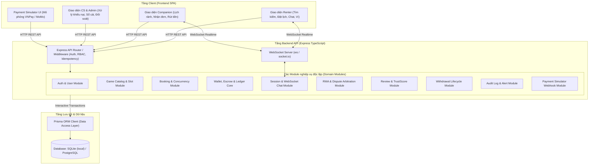
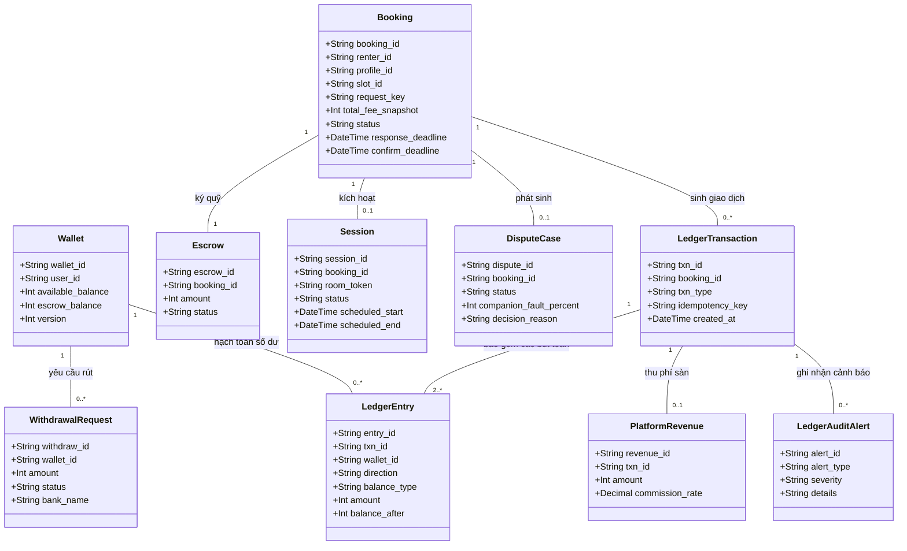

# INSTASQUAD — Thiết kế kiến trúc hệ thống (Architecture Design)

Tài liệu này xác lập kiến trúc tổng thể cho đồ án sinh viên **INSTASQUAD — E-Commerce Game Companion Platform** (Milestone M2), tuân thủ nguyên tắc **Modular Monolith**, tối giản hạ tầng, 100% miễn phí và dễ dàng khởi chạy trên máy local.

---

## 1. Phong cách kiến trúc: Modular Monolith

Thay vì phân tán thành microservices gây phức tạp về mạng, giao dịch phân tán (Saga/2PC) và giám sát, INSTASQUAD được thiết kế dưới dạng **Modular Monolith** đóng gói duy nhất trong một repository:
- **Một ứng dụng Frontend (SPA)**: React 18 + Vite + Tailwind CSS.
- **Một dịch vụ Backend API**: Node.js + Express (TypeScript).
- **Một Cơ sở dữ liệu quan hệ**: SQLite (Zero-config cho local) / PostgreSQL (qua Prisma ORM).
- **Kênh Realtime**: WebSocket nội bộ gắn liền với HTTP Server.



---

## 2. Cấu trúc thư mục mã nguồn (Repository Layout)

Dự án được cấu trúc rõ ràng, phân định ranh giới giữa client, server, database và tài liệu:

```text
INSTASQUAD/
├── docs/                               # Toàn bộ tài liệu chuẩn hóa
│   ├── source/                         # Tài liệu gốc (PDF, Excel WBS)
│   ├── SCOPE_BASELINE.md               # Đường cơ sở phạm vi MVP
│   ├── REQUIREMENTS.md                 # Baseline yêu cầu & State Machines
│   ├── DEMO_POLICY.md                  # 13 chính sách demo đã được PO duyệt
│   ├── FINANCIAL_RULES.md              # Quy tắc Sổ cái & Kiểm thử bảo toàn tiền
│   ├── ARCHITECTURE.md                 # Tài liệu này (Kiến trúc As-Built)
│   ├── DATA_MODEL.md                   # Mô hình thực thể ERD & Prisma Schema
│   ├── API_CONTRACT.md                 # Đặc tả API endpoints & DTOs
│   ├── TRACEABILITY_FINAL.md           # Ma trận truy vết 6 chiều khép kín
│   ├── QA_REPORT.md                    # Báo cáo kiểm thử & kiểm toán 160 TCs
│   ├── DECISION_LOG.md                 # Nhật ký 18 quyết định PO (D01-D18)
│   └── AI_PROGRESS.md                  # Nhật ký tiến độ WBS & Milestones
│
├── prisma/                             # Database schema & migrations
│   ├── schema.prisma                   # Prisma Schema hoàn chỉnh (24 models)
│   ├── seed.ts                         # Script nạp dữ liệu hạt giống (Seed Data)
│   └── migrations/                     # Lịch sử di chuyển cấu trúc DB
│
├── server/                             # Backend API Source Code (Node.js/Express)
│   ├── src/
│   │   ├── config/                     # Cấu hình môi trường (Zod validation, port, JWT secret)
│   │   ├── middleware/                 # Auth JWT, RBAC, Validate Zod, ErrorHandler
│   │   ├── modules/                    # Các module nghiệp vụ phân tầng
│   │   │   ├── auth/                   # Register, Login, Me, Token issuance
│   │   │   ├── catalog/                # Games, SkillRankTiers, Companion discovery
│   │   │   ├── companion/              # Profile, discrete slots (10h/day ceiling)
│   │   │   ├── booking/                # Booking lifecycle, Hold slot, Escrow, Concurrency
│   │   │   ├── ledger/                 # Double-entry Ledger Engine, Wallet, Settlement, Reconciliation
│   │   │   ├── session/                # Session lifecycle, WebSocket Chat, Content filter
│   │   │   ├── dispute/                # DisputeCase, Evidence upload (2MB), CS Adjudication
│   │   │   ├── review/                 # Two-way immutable reviews, TrustScore calculation
│   │   │   ├── withdrawal/             # Withdrawal request lifecycle (Reserve/Complete/Reject)
│   │   │   ├── payment/                # Payment Simulator (SUCCESS/FAILED/TIMEOUT)
│   │   │   ├── dev/                    # Demo reset & seed inspection endpoints
│   │   │   └── health/                 # Health check endpoint
│   │   ├── common/                     # financialMath, logger, errors, response helper
│   │   └── server.ts                   # Entrypoint Express app & WebSocket server
│   └── tsconfig.json                   # Cấu hình TypeScript Backend
│
├── tests/                              # Bộ kiểm thử tự động toàn diện (Vitest 160 TCs)
│   ├── unit/                           # Unit tests toán tài chính, TrustScore & Invariants
│   │   ├── financial_math.test.ts      # 88/12, cancellation & dispute math + 1000 trials
│   │   ├── trust_score.test.ts         # Hand calculations, boundary & clamp [0, 100]
│   │   └── ledger_invariants.test.ts   # Debit=Credit, non-negative, 500-step closed economy
│   └── integration/                    # Integration tests (131 tests, bao phủ TC01-TC70)
│       ├── auth.test.ts, catalog.test.ts, companion_slots.test.ts
│       ├── booking_slots.test.ts, booking_lifecycle.test.ts
│       ├── ledger_wallet_payment.test.ts, session_fulfillment.test.ts
│       ├── dispute_rma_cs.test.ts, review_trust_withdrawal.test.ts
│       ├── rbac_security.test.ts, security_audit.test.ts
│       └── e2e_demo_smoke.test.ts, health.test.ts
│
├── client/                             # Frontend Source Code (React 18 + Vite + Tailwind)
│   ├── src/
│   │   ├── components/                 # Modals (Topup, Hold, Evidence, Dispute, Review, Slot)
│   │   ├── services/                   # Typed API Client (fetch wrapper)
│   │   ├── types/                      # Frontend TypeScript interfaces
│   │   ├── App.tsx                     # Ứng dụng điều hướng vai trò & Dashboard demo
│   │   └── main.tsx
│   ├── package.json
│   └── vite.config.ts
│
├── Dockerfile                          # Cấu hình Docker container hóa độc lập
├── docker-compose.yml                  # Khởi chạy fullstack trong 1 lệnh
├── package.json                        # NPM Scripts gốc (dev, build, test, setup)
└── README.md                           # Hướng dẫn khởi chạy & tài khoản demo
```

---

## 3. Chiến lược giải quyết bài toán đồng thời (Concurrency & Slot Race Condition)

Một trong những yêu cầu kỹ thuật khắt khe nhất của đồ án là **chống đặt trùng slot** khi hai Renter gửi request cùng lúc, mà **không được dùng Redis**.

### Giải pháp kỹ thuật: Atomic Conditional Update & Row Lock trong DB Transaction
1. **Ràng buộc toàn vẹn mức Schema**:
   - `SlotCalendar` có trường `status` mang giá trị: `AVAILABLE`, `HELD`, `BOOKED`.
   - Mỗi `Booking` liên kết với `slot_id` duy nhất (`UNIQUE` constraint trên `slot_id` cho các booking không bị hủy).
2. **Cơ chế Atomic Lock tại thời điểm giữ slot**:
   Thay vì đọc ra rồi mới kiểm tra (dễ bị race condition giữa SELECT và UPDATE), hệ thống thực hiện câu lệnh cập nhật có điều kiện nguyên tử bên trong `prisma.$transaction`:
   ```typescript
   const updated = await tx.slotCalendar.updateMany({
     where: {
       slot_id: slotId,
       status: 'AVAILABLE' // CHỈ CẬP NHẬT NẾU TRẠNG THÁI HIỆN TẠI LÀ AVAILABLE
     },
     data: {
       status: 'HELD',
       held_until: new Date(Date.now() + 10 * 60 * 1000) // TTL 10 phút
     }
   });

   if (updated.count === 0) {
     throw new BusinessError('SLOT_ALREADY_HELD', 'Khung giờ này vừa có người khác giữ chỗ.');
   }
   ```
3. **Kết quả**: Khi 2 request đến cùng một mili-giây, cơ sở dữ liệu sẽ khóa hàng (Row Lock) theo cơ chế cô lập của transaction:
   - Request 1: Cập nhật thành công (`count = 1`), đi tiếp luồng ký quỹ.
   - Request 2: Không thỏa mãn điều kiện `status = 'AVAILABLE'` (`count = 0`), lập tức bị từ chối với mã lỗi `SLOT_ALREADY_HELD`.
   - Không thể xảy ra tình trạng 2 người cùng giữ hoặc đặt một slot.

---

## 4. Thiết kế lõi tài chính & Nghiệp vụ as-built (Domain Class Diagram)

Hệ thống triển khai mô hình nghiệp vụ chặt chẽ, kết nối giữa Đơn đặt lịch (Booking), Phòng phiên chơi (Session), Khiếu nại (Dispute), Rút tiền (Withdrawal) và Lõi Sổ cái ghi kép (Double-Entry Ledger):



### Nguyên tắc vận hành:
1. **Khóa chống lặp (Idempotency Key)**: Mỗi `LedgerTransaction` bắt buộc có một `idempotency_key` duy nhất (`UNIQUE`). Nếu một yêu cầu nạp tiền, ký quỹ hay giải ngân bị gọi lại lần thứ 2, hệ thống nhận diện khóa trùng và bỏ qua việc hạch toán lại.
2. **Quy tắc ghi kép cân bằng**: Trong mỗi `LedgerTransaction`:
   $$\sum \text{Amount}_{\text{DEBIT}} \equiv \sum \text{Amount}_{\text{CREDIT}}$$
3. **Cập nhật số dư ví đồng thời (Atomic Balance Cache Update)**:
   - Số dư `available_balance` và `escrow_balance` trên bảng `Wallet` đóng vai trò là snapshot được cập nhật trong cùng transaction với các `LedgerEntry`.
   - Khi ghi sổ, hệ thống tính toán:
     $$\text{balance\_after} = \text{balance\_before} \pm \text{amount}$$
     và lưu `balance_after` vào `LedgerEntry`.
   - Khi chạy kiểm toán đối soát, hệ thống so sánh:
     $$\text{Wallet.available\_balance} \equiv \sum \text{LedgerEntry}_{\text{Credit}} - \sum \text{LedgerEntry}_{\text{Debit}}$$
     Nếu có sai lệch dù chỉ 1 đồng, phát cảnh báo ngay cho `AUDITOR`.

---

## 5. Môi trường Cơ sở dữ liệu & Chiến lược Migration

### 5.1. Lựa chọn Cơ sở dữ liệu: SQLite (Mặc định local) & PostgreSQL Ready
- **Môi trường cục bộ**: Sử dụng **SQLite 3** (`file:./prisma/dev.db`).
  - *Ưu điểm tuyệt đối*: Chạy ngay lập tức với Node.js, không cần cấu hình user/password, không cần cài server daemon, dễ dàng xóa và reset seed data trong 1 giây để demo lại từ đầu.
- **Tính tương thích PostgreSQL**: Prisma ORM đóng vai trò trừu tượng hóa tầng dữ liệu. Toàn bộ kiểu dữ liệu được thiết kế tương thích song song với PostgreSQL (chỉ cần đổi `provider = "postgresql"` trong file schema nếu chuyển sang môi trường Docker).

### 5.2. Quy trình Migrate, Seed và Kiểm thử
1. **Tạo và cập nhật cấu trúc bảng**:
   ```bash
   npx prisma migrate dev --name init
   ```
2. **Nạp dữ liệu hạt giống (Seed Data)**:
   ```bash
   npx prisma db seed
   ```
   Script `prisma/seed.ts` sẽ khởi tạo đầy đủ:
   - 7 tài khoản mẫu thuộc 5 vai trò.
   - Danh mục 3 Game và các bậc Rank.
   - Hồ sơ Companion và lịch rảnh (Slots) hôm nay/ngày mai.
   - Bút toán nạp tiền ban đầu cho ví của Renter để sẵn sàng demo đặt lịch.
3. **Chạy kiểm thử tự động toàn diện**:
   ```bash
   npm test
   ```
   Thực thi bộ 70 kịch bản kiểm thử nghiệm thu (`TC01` – `TC70`).
