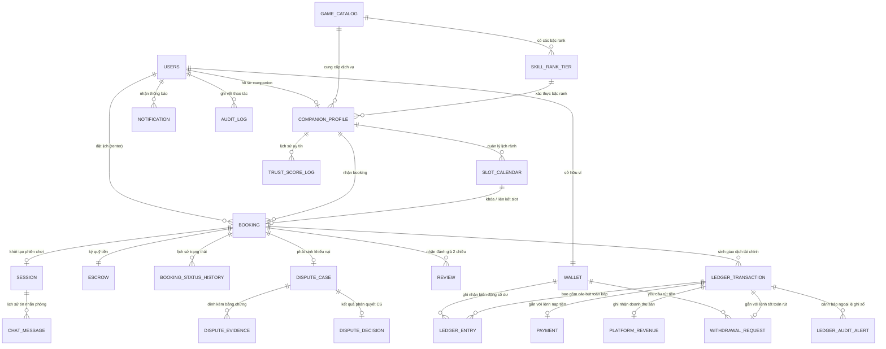

# INSTASQUAD — Mô hình dữ liệu quan hệ (Data Model & Schema Design)

Tài liệu này đặc tả chi tiết mô hình dữ liệu thực thể quan hệ (ERD as-built) cho hệ thống **INSTASQUAD**, khắc phục hoàn toàn khoảng trống dữ liệu (ERD Gap) giữa sơ đồ thiết kế ban đầu (`BT3_INSTASQUAD.pdf`) và quy trình nghiệp vụ thực tế (`INSTASQUAD_BPMN_TKHT.pdf`).

---

## 1. Sơ đồ thực thể liên kết (Entity-Relationship Diagram - ERD)

---

## 2. Danh mục 20 Thực thể & Cấu trúc Bảng dữ liệu

### 2.1. Nhóm Người dùng, Hồ sơ & Danh mục Game

#### 1. `users` (Tài khoản người dùng & Phân quyền)
| Tên cột | Kiểu dữ liệu | Ràng buộc | Mô tả |
|:---|:---|:---|:---|
| `user_id` | `VARCHAR(36)` | `PRIMARY KEY` | Định danh UUID của người dùng. |
| `email` | `VARCHAR(255)` | `NOT NULL, UNIQUE` | Email đăng nhập. |
| `password_hash` | `VARCHAR(255)` | `NOT NULL` | Mật khẩu băm (Bcrypt). Không bao giờ trả về API. |
| `display_name` | `VARCHAR(100)` | `NOT NULL` | Tên hiển thị công khai trên sàn. |
| `phone_number` | `VARCHAR(20)` | `NULL` | Số điện thoại (chỉ phục vụ liên hệ nội bộ). |
| `role` | `VARCHAR(20)` | `NOT NULL, DEFAULT 'RENTER'` | Vai trò: `RENTER`, `COMPANION`, `CS_AGENT`, `AUDITOR`, `ADMIN`. |
| `status` | `VARCHAR(20)` | `NOT NULL, DEFAULT 'ACTIVE'` | Trạng thái: `ACTIVE`, `SUSPENDED`, `BANNED`. |
| `created_at` | `DATETIME` | `NOT NULL, DEFAULT CURRENT_TIMESTAMP` | Thời điểm tạo tài khoản. |

#### 2. `companion_profiles` (Hồ sơ dịch vụ Companion)
| Tên cột | Kiểu dữ liệu | Ràng buộc | Mô tả |
|:---|:---|:---|:---|
| `profile_id` | `VARCHAR(36)` | `PRIMARY KEY` | Định danh UUID hồ sơ Companion. |
| `user_id` | `VARCHAR(36)` | `NOT NULL, UNIQUE, FK(users)` | Khóa ngoại liên kết 1-1 với tài khoản user. |
| `game_id` | `VARCHAR(50)` | `NOT NULL, FK(game_catalog)` | Game dịch vụ chính. |
| `verified_tier_id` | `VARCHAR(50)` | `NOT NULL, FK(skill_rank_tier)` | Bậc Rank kỹ năng đã được xác thực. |
| `hourly_rate` | `INTEGER` | `NOT NULL` | Đơn giá thuê theo giờ (Số nguyên VND, e.g. 100000). |
| `verification_status` | `VARCHAR(20)` | `NOT NULL, DEFAULT 'UNVERIFIED'` | `UNVERIFIED`, `PENDING_REVIEW`, `VERIFIED`. |
| `availability` | `VARCHAR(20)` | `NOT NULL, DEFAULT 'OFFLINE'` | Trạng thái sẵn sàng: `ONLINE`, `BUSY`, `OFFLINE`. |
| `trust_score` | `DECIMAL(5,2)` | `NOT NULL, DEFAULT 80.00` | Điểm tín nhiệm uy tín (0.00 đến 100.00). |
| `audio_bio_url` | `VARCHAR(500)` | `NULL` | Đường dẫn file ghi âm giới thiệu (demo metadata). |
| `game_account_id` | `VARCHAR(100)` | `NOT NULL` | Tên nhân vật/In-game ID trong game. |
| `created_at` | `DATETIME` | `NOT NULL, DEFAULT CURRENT_TIMESTAMP` | Thời điểm tạo hồ sơ. |

#### 3. `game_catalog` (Danh mục Game hỗ trợ)
| Tên cột | Kiểu dữ liệu | Ràng buộc | Mô tả |
|:---|:---|:---|:---|
| `game_id` | `VARCHAR(50)` | `PRIMARY KEY` | Mã game (e.g. `LMHT`, `VALORANT`, `TFT`). |
| `game_name` | `VARCHAR(100)` | `NOT NULL` | Tên đầy đủ của trò chơi. |
| `publisher` | `VARCHAR(100)` | `NOT NULL` | Nhà phát hành (Riot Games, VNG, Valve). |
| `genre` | `VARCHAR(50)` | `NOT NULL` | Thể loại: MOBA, FPS, Battle Royale, v.v. |
| `is_active` | `BOOLEAN` | `NOT NULL, DEFAULT TRUE` | Trạng thái hoạt động của game. |

#### 4. `skill_rank_tier` (Bảng bậc xếp hạng kỹ năng)
| Tên cột | Kiểu dữ liệu | Ràng buộc | Mô tả |
|:---|:---|:---|:---|
| `tier_id` | `VARCHAR(50)` | `PRIMARY KEY` | Mã bậc xếp hạng (e.g. `LMHT_GOLD`, `VAL_IMMORTAL`). |
| `game_id` | `VARCHAR(50)` | `NOT NULL, FK(game_catalog)` | Thuộc game nào. |
| `tier_name` | `VARCHAR(50)` | `NOT NULL` | Tên bậc (Vàng, Kim Cương, Cao Thủ, Thách Đấu). |
| `rank_weight` | `INTEGER` | `NOT NULL` | Trọng số thứ hạng phục vụ lọc và sắp xếp. |

---

### 2.2. Nhóm Lịch rảnh, Đặt lịch & Phiên chơi

#### 5. `slot_calendar` (Khung giờ rảnh của Companion)
| Tên cột | Kiểu dữ liệu | Ràng buộc | Mô tả |
|:---|:---|:---|:---|
| `slot_id` | `VARCHAR(36)` | `PRIMARY KEY` | Định danh UUID của khung giờ. |
| `profile_id` | `VARCHAR(36)` | `NOT NULL, FK(companion_profiles)` | Thuộc về Companion nào. |
| `start_time` | `DATETIME` | `NOT NULL` | Giờ bắt đầu ca (UTC+7). |
| `end_time` | `DATETIME` | `NOT NULL` | Giờ kết thúc ca (UTC+7). |
| `status` | `VARCHAR(20)` | `NOT NULL, DEFAULT 'AVAILABLE'` | `AVAILABLE`, `HELD`, `BOOKED`. |
| `held_until` | `DATETIME` | `NULL` | Hạn chót giữ slot tạm thời (TTL 10 phút theo D01). |
| `created_at` | `DATETIME` | `NOT NULL, DEFAULT CURRENT_TIMESTAMP` | Thời điểm tạo slot. |

#### 6. `bookings` (Đơn đặt lịch Companion)
| Tên cột | Kiểu dữ liệu | Ràng buộc | Mô tả |
|:---|:---|:---|:---|
| `booking_id` | `VARCHAR(36)` | `PRIMARY KEY` | Định danh UUID đơn đặt lịch. |
| `renter_id` | `VARCHAR(36)` | `NOT NULL, FK(users)` | Người thuê. |
| `profile_id` | `VARCHAR(36)` | `NOT NULL, FK(companion_profiles)` | Companion được thuê. |
| `slot_id` | `VARCHAR(36)` | `NOT NULL, UNIQUE, FK(slot_calendar)` | Khung giờ đặt (1 booking gắn duy nhất 1 slot). |
| `request_key` | `VARCHAR(100)` | `NOT NULL, UNIQUE` | Khóa chống đặt trùng lặp (Idempotency Key). |
| `start_time` | `DATETIME` | `NOT NULL` | Thời gian bắt đầu chơi. |
| `duration_hours` | `INTEGER` | `NOT NULL` | Số giờ thuê. |
| `total_fee_snapshot` | `INTEGER` | `NOT NULL` | Tổng chi phí chốt tại thời điểm đặt (Số nguyên VND). |
| `status` | `VARCHAR(25)` | `NOT NULL, DEFAULT 'PENDING_ACCEPTANCE'` | `PENDING_ACCEPTANCE`, `ACCEPTED`, `IN_SESSION`, `COMPLETED`, `CANCELLED`, `DISPUTED`, `REFUNDED`. |
| `response_deadline` | `DATETIME` | `NOT NULL` | Hạn chót Companion phản hồi (180 giây kể từ lúc tạo). |
| `confirm_deadline` | `DATETIME` | `NULL` | Hạn chót Renter nghiệm thu (15 phút sau khi phiên kết thúc). |
| `cancel_reason` | `VARCHAR(255)` | `NULL` | Lý do hủy đơn (nếu có). |
| `cancelled_by` | `VARCHAR(36)` | `NULL, FK(users)` | Ai thực hiện hủy (Renter, Companion, System). |
| `cancelled_at` | `DATETIME` | `NULL` | Thời điểm hủy đơn. |
| `created_at` | `DATETIME` | `NOT NULL, DEFAULT CURRENT_TIMESTAMP` | Thời điểm tạo đơn đặt lịch. |

#### 7. `booking_status_history` (Nhật ký biến động trạng thái đơn)
| Tên cột | Kiểu dữ liệu | Ràng buộc | Mô tả |
|:---|:---|:---|:---|
| `history_id` | `INTEGER` | `PRIMARY KEY, AUTOINCREMENT` | Mã nhật ký tự tăng. |
| `booking_id` | `VARCHAR(36)` | `NOT NULL, FK(bookings)` | Thuộc đơn đặt lịch nào. |
| `from_status` | `VARCHAR(25)` | `NULL` | Trạng thái trước khi chuyển. |
| `to_status` | `VARCHAR(25)` | `NOT NULL` | Trạng thái mới sau khi chuyển. |
| `reason` | `VARCHAR(255)` | `NULL` | Nguyên nhân đổi trạng thái. |
| `changed_by` | `VARCHAR(36)` | `NULL, FK(users)` | Tác nhân thực hiện thay đổi (User ID hoặc SYSTEM). |
| `changed_at` | `DATETIME` | `NOT NULL, DEFAULT CURRENT_TIMESTAMP` | Thời điểm ghi nhận. |

#### 8. `sessions` (Phiên chơi dịch vụ thực tế — ERD Gap fix)
| Tên cột | Kiểu dữ liệu | Ràng buộc | Mô tả |
|:---|:---|:---|:---|
| `session_id` | `VARCHAR(36)` | `PRIMARY KEY` | Định danh UUID của phiên chơi. |
| `booking_id` | `VARCHAR(36)` | `NOT NULL, UNIQUE, FK(bookings)` | Liên kết 1-1 với đơn đặt lịch. |
| `status` | `VARCHAR(20)` | `NOT NULL, DEFAULT 'SCHEDULED'` | `SCHEDULED`, `ACTIVE`, `ENDED`, `CLOSED`. |
| `start_time` | `DATETIME` | `NOT NULL` | Thời điểm thực tế mở phòng. |
| `end_time` | `DATETIME` | `NOT NULL` | Thời điểm dự kiến kết thúc phiên. |
| `room_token` | `VARCHAR(100)` | `NOT NULL, UNIQUE` | Token xác thực vào phòng chat WebSocket. |
| `created_at` | `DATETIME` | `NOT NULL, DEFAULT CURRENT_TIMESTAMP` | Thời điểm khởi tạo phòng. |

#### 9. `chat_messages` (Nhật ký tin nhắn phòng chơi — ERD Gap fix)
| Tên cột | Kiểu dữ liệu | Ràng buộc | Mô tả |
|:---|:---|:---|:---|
| `message_id` | `INTEGER` | `PRIMARY KEY, AUTOINCREMENT` | Mã tin nhắn tự tăng. |
| `session_id` | `VARCHAR(36)` | `NOT NULL, FK(sessions)` | Thuộc phiên chơi nào. |
| `sender_id` | `VARCHAR(36)` | `NOT NULL, FK(users)` | Người gửi tin nhắn (Renter hoặc Companion). |
| `content` | `TEXT` | `NOT NULL` | Nội dung tin nhắn (đã qua kiểm duyệt regex). |
| `is_censored` | `BOOLEAN` | `NOT NULL, DEFAULT FALSE` | Đánh dấu nếu tin nhắn chứa SĐT/URL/STK bị che. |
| `original_content` | `TEXT` | `NULL` | Nội dung gốc (chỉ CS/Admin có quyền xem phục vụ đối soát). |
| `created_at` | `DATETIME` | `NOT NULL, DEFAULT CURRENT_TIMESTAMP` | Thời điểm gửi tin nhắn. |

---

### 2.3. Nhóm Ví, Thanh toán, Escrow & Sổ cái kép (Ledger Core)

#### 10. `wallets` (Ví tài khoản người dùng)
| Tên cột | Kiểu dữ liệu | Ràng buộc | Mô tả |
|:---|:---|:---|:---|
| `wallet_id` | `VARCHAR(36)` | `PRIMARY KEY` | Định danh UUID của ví. |
| `user_id` | `VARCHAR(36)` | `NOT NULL, UNIQUE, FK(users)` | Thuộc về người dùng nào. |
| `wallet_type` | `VARCHAR(20)` | `NOT NULL, DEFAULT 'STANDARD'` | Phân loại ví. |
| `available_balance`| `INTEGER` | `NOT NULL, DEFAULT 0` | Số dư khả dụng (Số nguyên VND, $\ge 0$). |
| `escrow_balance` | `INTEGER` | `NOT NULL, DEFAULT 0` | Số dư đang bị ký quỹ giữ chỗ (Số nguyên VND, $\ge 0$). |
| `version` | `INTEGER` | `NOT NULL, DEFAULT 1` | Phiên bản bản ghi phục vụ Optimistic Concurrency Control. |
| `updated_at` | `DATETIME` | `NOT NULL, DEFAULT CURRENT_TIMESTAMP` | Thời điểm biến động số dư gần nhất. |

#### 11. `escrows` (Khoản ký quỹ đơn hàng)
| Tên cột | Kiểu dữ liệu | Ràng buộc | Mô tả |
|:---|:---|:---|:---|
| `escrow_id` | `VARCHAR(36)` | `PRIMARY KEY` | Định danh UUID khoản ký quỹ. |
| `booking_id` | `VARCHAR(36)` | `NOT NULL, UNIQUE, FK(bookings)` | Thuộc đơn đặt lịch nào. |
| `amount` | `INTEGER` | `NOT NULL` | Số tiền ký quỹ (Số nguyên VND). |
| `status` | `VARCHAR(20)` | `NOT NULL, DEFAULT 'HELD'` | Trạng thái: `HELD`, `FROZEN`, `RELEASED`, `REFUNDED`. |
| `held_at` | `DATETIME` | `NOT NULL, DEFAULT CURRENT_TIMESTAMP` | Thời điểm khóa ký quỹ. |
| `frozen_at` | `DATETIME` | `NULL` | Thời điểm đóng băng do khiếu nại RMA. |
| `released_at` | `DATETIME` | `NULL` | Thời điểm giải ngân cho Companion. |
| `refunded_at` | `DATETIME` | `NULL` | Thời điểm hoàn trả cho Renter. |

#### 12. `ledger_transactions` (Giao dịch Sổ cái tổng hợp)
| Tên cột | Kiểu dữ liệu | Ràng buộc | Mô tả |
|:---|:---|:---|:---|
| `txn_id` | `VARCHAR(36)` | `PRIMARY KEY` | Định danh UUID của giao dịch sổ cái. |
| `booking_id` | `VARCHAR(36)` | `NULL, FK(bookings)` | Gắn với đơn booking (nếu có). |
| `escrow_id` | `VARCHAR(36)` | `NULL, FK(escrows)` | Gắn với khoản ký quỹ (nếu có). |
| `txn_type` | `VARCHAR(30)` | `NOT NULL` | `TOPUP`, `ESCROW_HOLD`, `ESCROW_RELEASE`, `ESCROW_REFUND`, `CANCEL_PENALTY`, `DISPUTE_SETTLE`, `WITHDRAW_RESERVE`, `WITHDRAW_SETTLE`, `WITHDRAW_REJECT`. |
| `idempotency_key` | `VARCHAR(100)` | `NOT NULL, UNIQUE` | Khóa chống ghi sổ lặp lại. |
| `created_at` | `DATETIME` | `NOT NULL, DEFAULT CURRENT_TIMESTAMP` | Thời điểm phát sinh giao dịch. |

#### 13. `ledger_entries` (Bút toán Sổ cái kép ghi nhận Debit/Credit)
| Tên cột | Kiểu dữ liệu | Ràng buộc | Mô tả |
|:---|:---|:---|:---|
| `entry_id` | `VARCHAR(36)` | `PRIMARY KEY` | Định danh UUID bút toán. |
| `txn_id` | `VARCHAR(36)` | `NOT NULL, FK(ledger_transactions)` | Thuộc giao dịch sổ cái nào. |
| `wallet_id` | `VARCHAR(36)` | `NOT NULL, FK(wallets)` | Tác động lên ví nào. |
| `direction` | `VARCHAR(10)` | `NOT NULL` | Chiều biến động: `DEBIT`, `CREDIT`. |
| `balance_type` | `VARCHAR(20)` | `NOT NULL` | Loại số dư biến động: `AVAILABLE`, `ESCROW`. |
| `amount` | `INTEGER` | `NOT NULL` | Số tiền (Số nguyên VND dương, $> 0$). |
| `balance_after` | `INTEGER` | `NOT NULL` | Số dư của ví ngay sau khi áp dụng bút toán này. |
| `created_at` | `DATETIME` | `NOT NULL, DEFAULT CURRENT_TIMESTAMP` | Thời điểm ghi sổ. |

#### 14. `payments` (Lệnh nạp tiền qua Simulator)
| Tên cột | Kiểu dữ liệu | Ràng buộc | Mô tả |
|:---|:---|:---|:---|
| `payment_id` | `VARCHAR(36)` | `PRIMARY KEY` | Định danh UUID của lệnh nạp. |
| `txn_id` | `VARCHAR(36)` | `NULL, UNIQUE, FK(ledger_transactions)`| Giao dịch sổ cái sinh ra khi nạp thành công. |
| `wallet_id` | `VARCHAR(36)` | `NOT NULL, FK(wallets)` | Nạp vào ví nào. |
| `provider` | `VARCHAR(30)` | `NOT NULL, DEFAULT 'MOCK_VNPAY'` | Cổng mô phỏng: `MOCK_VNPAY`, `MOCK_MOMO`. |
| `gateway_ref` | `VARCHAR(100)` | `NOT NULL, UNIQUE` | Mã giao dịch tham chiếu của cổng mô phỏng. |
| `amount` | `INTEGER` | `NOT NULL` | Số tiền nạp (Số nguyên VND). |
| `status` | `VARCHAR(20)` | `NOT NULL, DEFAULT 'PENDING'` | `PENDING`, `SUCCESS`, `FAILED`, `EXPIRED`. |
| `created_at` | `DATETIME` | `NOT NULL, DEFAULT CURRENT_TIMESTAMP` | Thời điểm tạo lệnh nạp. |
| `processed_at` | `DATETIME` | `NULL` | Thời điểm webhook trả về kết quả. |

#### 15. `platform_revenues` (Doanh thu hoa hồng 12% của sàn)
| Tên cột | Kiểu dữ liệu | Ràng buộc | Mô tả |
|:---|:---|:---|:---|
| `revenue_id` | `VARCHAR(36)` | `PRIMARY KEY` | Định danh UUID bản ghi doanh thu. |
| `txn_id` | `VARCHAR(36)` | `NOT NULL, UNIQUE, FK(ledger_transactions)` | Giao dịch giải ngân sinh doanh thu. |
| `amount` | `INTEGER` | `NOT NULL` | Số tiền hoa hồng sàn thu được (Số nguyên VND). |
| `commission_rate`| `DECIMAL(5,4)` | `NOT NULL, DEFAULT 0.1200` | Tỷ lệ hoa hồng (mặc định 12%). |
| `created_at` | `DATETIME` | `NOT NULL, DEFAULT CURRENT_TIMESTAMP` | Thời điểm ghi nhận doanh thu. |

#### 16. `withdrawal_requests` (Yêu cầu rút tiền của Companion)
| Tên cột | Kiểu dữ liệu | Ràng buộc | Mô tả |
|:---|:---|:---|:---|
| `withdraw_id` | `VARCHAR(36)` | `PRIMARY KEY` | Định danh UUID lệnh rút. |
| `wallet_id` | `VARCHAR(36)` | `NOT NULL, FK(wallets)` | Rút từ ví của ai. |
| `txn_id` | `VARCHAR(36)` | `NULL, FK(ledger_transactions)` | Giao dịch sổ cái hạch toán rút tiền. |
| `amount` | `INTEGER` | `NOT NULL` | Số tiền muốn rút (Số nguyên VND). |
| `bank_name` | `VARCHAR(100)` | `NOT NULL` | Tên ngân hàng nhận (e.g. Vietcombank). |
| `account_no_masked`| `VARCHAR(50)` | `NOT NULL` | Số tài khoản đã che (e.g. `******1234`). |
| `status` | `VARCHAR(20)` | `NOT NULL, DEFAULT 'PENDING'` | `PENDING`, `PROCESSING`, `COMPLETED`, `REJECTED`. |
| `processed_at` | `DATETIME` | `NULL` | Thời điểm Admin xử lý duyệt/từ chối. |
| `created_at` | `DATETIME` | `NOT NULL, DEFAULT CURRENT_TIMESTAMP` | Thời điểm tạo lệnh rút. |

---

### 2.4. Nhóm Khiếu nại, Đánh giá, Uy tín & Kiểm toán

#### 17. `dispute_cases` (Hồ sơ tranh chấp RMA — ERD Gap fix)
| Tên cột | Kiểu dữ liệu | Ràng buộc | Mô tả |
|:---|:---|:---|:---|
| `dispute_id` | `VARCHAR(36)` | `PRIMARY KEY` | Định danh UUID hồ sơ tranh chấp. |
| `booking_id` | `VARCHAR(36)` | `NOT NULL, UNIQUE, FK(bookings)` | Khiếu nại của đơn nào (chống tạo trùng theo BR-26). |
| `renter_id` | `VARCHAR(36)` | `NOT NULL, FK(users)` | Người khởi tạo khiếu nại. |
| `reason_category` | `VARCHAR(50)` | `NOT NULL` | Phân loại: `NO_SHOW`, `HARASSMENT`, `SKILL_MISMATCH`, `TECHNICAL_ISSUE`. |
| `description` | `TEXT` | `NOT NULL` | Mô tả chi tiết sự cố của Renter. |
| `status` | `VARCHAR(25)` | `NOT NULL, DEFAULT 'OPENED'` | `OPENED`, `EVIDENCE_PENDING`, `UNDER_REVIEW`, `RESOLVED`, `CLOSED`. |
| `created_at` | `DATETIME` | `NOT NULL, DEFAULT CURRENT_TIMESTAMP` | Thời điểm mở khiếu nại. |
| `resolved_at` | `DATETIME` | `NULL` | Thời điểm đóng hồ sơ khiếu nại. |

#### 18. `dispute_evidences` (Tệp bằng chứng khiếu nại — ERD Gap fix)
| Tên cột | Kiểu dữ liệu | Ràng buộc | Mô tả |
|:---|:---|:---|:---|
| `evidence_id` | `VARCHAR(36)` | `PRIMARY KEY` | Định danh UUID bằng chứng. |
| `dispute_id` | `VARCHAR(36)` | `NOT NULL, FK(dispute_cases)` | Thuộc hồ sơ tranh chấp nào. |
| `uploader_id` | `VARCHAR(36)` | `NOT NULL, FK(users)` | Người tải lên (Renter hoặc Companion). |
| `file_url` | `VARCHAR(500)` | `NOT NULL` | Đường dẫn ảnh demo hoặc metadata mẫu. |
| `file_type` | `VARCHAR(50)` | `NOT NULL` | `IMAGE_PNG`, `IMAGE_JPEG`, `LOG_TEXT`. |
| `description` | `VARCHAR(255)` | `NULL` | Chú thích ngắn gọn cho bằng chứng. |
| `created_at` | `DATETIME` | `NOT NULL, DEFAULT CURRENT_TIMESTAMP` | Thời điểm nộp bằng chứng. |

#### 19. `dispute_decisions` (Phán quyết của CS Agent — ERD Gap fix)
| Tên cột | Kiểu dữ liệu | Ràng buộc | Mô tả |
|:---|:---|:---|:---|
| `decision_id` | `VARCHAR(36)` | `PRIMARY KEY` | Định danh UUID phán quyết. |
| `dispute_id` | `VARCHAR(36)` | `NOT NULL, UNIQUE, FK(dispute_cases)`| Thuộc hồ sơ khiếu nại nào. |
| `cs_agent_id` | `VARCHAR(36)` | `NOT NULL, FK(users)` | Nhân viên CS ra phán quyết. |
| `fault_percent` | `INTEGER` | `NOT NULL` | Tỷ lệ lỗi của Companion (0% đến 100%). |
| `refund_amount` | `INTEGER` | `NOT NULL, DEFAULT 0` | Số tiền hoàn lại cho Renter (Số nguyên VND). |
| `penalty_amount` | `INTEGER` | `NOT NULL, DEFAULT 0` | Số tiền phạt thu thêm của Companion (Số nguyên VND). |
| `decision_reason`| `TEXT` | `NOT NULL` | Lý do phán quyết bắt buộc theo D15. |
| `created_at` | `DATETIME` | `NOT NULL, DEFAULT CURRENT_TIMESTAMP` | Thời điểm ban hành phán quyết. |

#### 20. `reviews` (Đánh giá hai chiều giữa Renter & Companion)
| Tên cột | Kiểu dữ liệu | Ràng buộc | Mô tả |
|:---|:---|:---|:---|
| `review_id` | `INTEGER` | `PRIMARY KEY, AUTOINCREMENT` | Mã đánh giá tự tăng. |
| `booking_id` | `VARCHAR(36)` | `NOT NULL, FK(bookings)` | Thuộc đơn đặt lịch nào. |
| `reviewer_id` | `VARCHAR(36)` | `NOT NULL, FK(users)` | Người viết đánh giá. |
| `reviewee_id` | `VARCHAR(36)` | `NOT NULL, FK(users)` | Người nhận đánh giá. |
| `rating` | `INTEGER` | `NOT NULL` | Điểm đánh giá (1 đến 5 sao). |
| `comment` | `VARCHAR(500)` | `NULL` | Lời nhận xét. |
| `created_at` | `DATETIME` | `NOT NULL, DEFAULT CURRENT_TIMESTAMP` | Thời điểm gửi đánh giá. |
| **Ràng buộc** | `UNIQUE(booking_id, reviewer_id)` | | Mỗi người chỉ được đánh giá 1 lần duy nhất trên 1 đơn. |

#### 21. `trust_score_logs` (Nhật ký biến động điểm tín nhiệm uy tín)
| Tên cột | Kiểu dữ liệu | Ràng buộc | Mô tả |
|:---|:---|:---|:---|
| `log_id` | `INTEGER` | `PRIMARY KEY, AUTOINCREMENT` | Mã nhật ký tự tăng. |
| `profile_id` | `VARCHAR(36)` | `NOT NULL, FK(companion_profiles)` | Thuộc Companion nào. |
| `booking_id` | `VARCHAR(36)` | `NULL, FK(bookings)` | Gắn với đơn hàng nào (nếu có). |
| `reason_code` | `VARCHAR(30)` | `NOT NULL` | `COMPANION_TIMEOUT_180S`, `FULFILLMENT_SUCCESS`, `DISPUTE_FAULT_GE_80`, `REVIEW_RATING_CHANGE`. |
| `delta` | `DECIMAL(5,2)` | `NOT NULL` | Số điểm thay đổi (e.g. `-3.00`, `+0.50`). |
| `score_after` | `DECIMAL(5,2)` | `NOT NULL` | Điểm tín nhiệm ngay sau khi áp dụng thay đổi. |
| `created_at` | `DATETIME` | `NOT NULL, DEFAULT CURRENT_TIMESTAMP` | Thời điểm ghi log. |

#### 22. `notifications` (Thông báo In-app)
| Tên cột | Kiểu dữ liệu | Ràng buộc | Mô tả |
|:---|:---|:---|:---|
| `notification_id`| `INTEGER` | `PRIMARY KEY, AUTOINCREMENT` | Mã thông báo tự tăng. |
| `user_id` | `VARCHAR(36)` | `NOT NULL, FK(users)` | Người nhận thông báo. |
| `title` | `VARCHAR(150)` | `NOT NULL` | Tiêu đề thông báo. |
| `message` | `TEXT` | `NOT NULL` | Nội dung chi tiết. |
| `type` | `VARCHAR(30)` | `NOT NULL` | `BOOKING_NEW`, `BOOKING_ACCEPTED`, `BOOKING_CANCELLED`, `PAYMENT_SUCCESS`, `DISPUTE_OPENED`, `WITHDRAW_UPDATE`. |
| `is_read` | `BOOLEAN` | `NOT NULL, DEFAULT FALSE` | Đã đọc hay chưa. |
| `created_at` | `DATETIME` | `NOT NULL, DEFAULT CURRENT_TIMESTAMP` | Thời điểm tạo thông báo. |

#### 23. `audit_logs` (Nhật ký kiểm toán hệ thống)
| Tên cột | Kiểu dữ liệu | Ràng buộc | Mô tả |
|:---|:---|:---|:---|
| `audit_id` | `INTEGER` | `PRIMARY KEY, AUTOINCREMENT` | Mã kiểm toán tự tăng. |
| `actor_id` | `VARCHAR(36)` | `NULL, FK(users)` | Ai thực hiện thao tác. |
| `action` | `VARCHAR(50)` | `NOT NULL` | Tên hành động: `LOGIN`, `UPDATE_PRICE`, `ADJUDICATE_DISPUTE`, `REJECT_WITHDRAWAL`. |
| `entity_type` | `VARCHAR(30)` | `NOT NULL` | Đối tượng bị tác động (`Booking`, `Wallet`, `DisputeCase`). |
| `entity_id` | `VARCHAR(36)` | `NOT NULL` | ID của đối tượng bị tác động. |
| `payload_json` | `TEXT` | `NULL` | Dữ liệu đầu vào chi tiết. |
| `ip_address` | `VARCHAR(45)` | `NULL` | Địa chỉ IP (hoặc localhost). |
| `created_at` | `DATETIME` | `NOT NULL, DEFAULT CURRENT_TIMESTAMP` | Thời điểm thao tác. |

#### 24. `ledger_audit_alerts` (Cảnh báo ngoại lệ và lỗi Sổ cái)
| Tên cột | Kiểu dữ liệu | Ràng buộc | Mô tả |
|:---|:---|:---|:---|
| `alert_id` | `INTEGER` | `PRIMARY KEY, AUTOINCREMENT` | Mã cảnh báo tự tăng. |
| `txn_id` | `VARCHAR(36)` | `NULL` | Mã giao dịch phát sinh lỗi (nếu có). |
| `error_code` | `VARCHAR(50)` | `NOT NULL` | Mã lỗi ngoại lệ (e.g. `LEDGER_UNBALANCED_ENTRIES`, `INSUFFICIENT_ESCROW`). |
| `error_message` | `TEXT` | `NOT NULL` | Chi tiết lỗi hệ thống. |
| `context_json` | `TEXT` | `NULL` | Snapshot dữ liệu lúc phát sinh lỗi phục vụ Auditor rà soát. |
| `is_resolved` | `BOOLEAN` | `NOT NULL, DEFAULT FALSE` | Đã được Auditor xử lý chưa. |
| `resolved_by` | `VARCHAR(36)` | `NULL, FK(users)` | Auditor nào đã xử lý đối soát. |
| `created_at` | `DATETIME` | `NOT NULL, DEFAULT CURRENT_TIMESTAMP` | Thời điểm phát sinh cảnh báo. |

---

## 3. Quy ước Kế toán kép trên Sổ cái (Double-Entry Accounting Sign Convention)

Mọi biến động số dư phải tuân thủ bảng quy ước định khoản kế toán sau:

| Loại nghiệp vụ | Bút toán 1 (Tài khoản nguồn) | Bút toán 2 (Tài khoản đích) | Bút toán 3 (Phí/Hoa hồng nếu có) | Đẳng thức cân bằng |
|:---|:---|:---|:---|:---:|
| **Nạp tiền (Top-up)** | `CREDIT` Ví Renter (AVAILABLE): $+X$ | `DEBIT` Tài khoản trung gian nạp tiền: $-X$ | — | $\sum \text{Debit} = \sum \text{Credit} = X$ |
| **Ký quỹ (Escrow Hold)** | `DEBIT` Ví Renter (AVAILABLE): $-X$ | `CREDIT` Ví Renter (ESCROW): $+X$ | — | $\sum \text{Debit} = \sum \text{Credit} = X$ |
| **Giải ngân (Fulfillment 88/12)** | `DEBIT` Ví Renter (ESCROW): $-X$ | `CREDIT` Ví Companion (AVAILABLE): $+88\%X$ | `CREDIT` Doanh thu sàn (REVENUE): $+12\%X$ | $\text{Debit}(X) = \text{Credit}(88\% + 12\%)$ |
| **Hoàn tiền 100% (Refund)** | `DEBIT` Ví Renter (ESCROW): $-X$ | `CREDIT` Ví Renter (AVAILABLE): $+X$ | — | $\sum \text{Debit} = \sum \text{Credit} = X$ |
| **Hủy mốc 10–29m (70/30)** | `DEBIT` Ví Renter (ESCROW): $-X$ | `CREDIT` Ví Renter (AVAILABLE): $+70\%X$ | `CREDIT` Ví Companion (AVAILABLE): $+30\%X$ | $\text{Debit}(X) = \text{Credit}(70\% + 30\%)$ |
| **Phạt hủy < 10m (Phạt 100%)** | `DEBIT` Ví Renter (ESCROW): $-X$ | `CREDIT` Ví Companion (AVAILABLE): $+88\%X$ | `CREDIT` Doanh thu sàn (REVENUE): $+12\%X$ | $\text{Debit}(X) = \text{Credit}(88\% + 12\%)$ |
| **Thu phạt khiếu nại (20%)** | `DEBIT` Ví Companion (AVAILABLE): $-20\%X$ | `CREDIT` Ví Renter (AVAILABLE): $+20\%X$ | — | $\sum \text{Debit} = \sum \text{Credit} = 20\%X$ |
| **Yêu cầu rút tiền (Reserve)** | `DEBIT` Ví Companion (AVAILABLE): $-Y$ | `CREDIT` Quỹ tạm giữ rút tiền: $+Y$ | — | $\sum \text{Debit} = \sum \text{Credit} = Y$ |
| **Từ chối rút tiền (Reject)** | `DEBIT` Quỹ tạm giữ rút tiền: $-Y$ | `CREDIT` Ví Companion (AVAILABLE): $+Y$ | — | $\sum \text{Debit} = \sum \text{Credit} = Y$ |
| **Tất toán rút tiền (Complete)** | `DEBIT` Quỹ tạm giữ rút tiền: $-Y$ | `CREDIT` Tiền ra khỏi sàn (WITHDRAWN): $+Y$ | — | $\sum \text{Debit} = \sum \text{Credit} = Y$ |
