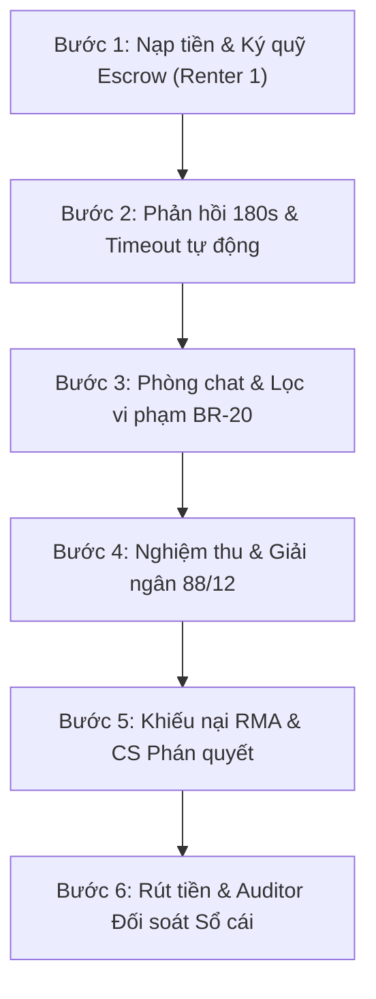

# INSTASQUAD — CẨM NANG HƯỚNG DẪN BẢO VỆ ĐỒ ÁN (DEMO RUNBOOK)
## HỆ THỐNG THƯƠNG MẠI ĐIỆN TỬ DỊCH VỤ GAME COMPANION (INSTASQUAD)

> **Dành cho**: Nhóm sinh viên thực hiện bảo vệ đồ án trước Hội đồng chấm thi.  
> **Thời lượng đề xuất**: 10 – 12 phút.  
> **Nguyên tắc cốt lõi**: Minh bạch, trực quan, giải thích rõ các cơ chế bảo toàn tài chính và tự động hóa nền.

---

## 1. CÁC LỆNH KHỞI CHẠY HỆ THỐNG (STARTUP COMMANDS)

Mở **PowerShell** tại thư mục gốc của dự án (`C:\INSTASQUAD\INSTASQUAD`):

### 1.1. Khởi chạy toàn bộ (Khuyến nghị cho Demo)
```powershell
npm run dev
```
- Lệnh này khởi chạy song song cả máy chủ Backend (`PORT: 4000`) và giao diện Web Frontend (`PORT: 5173`).
- **Địa chỉ truy cập Web UI**: [http://localhost:5173](http://localhost:5173)
- **Kiểm tra trạng thái Backend**: [http://localhost:4000/api/health](http://localhost:4000/api/health) (Trả về `status: "UP"`, `database: "CONNECTED"`).

### 1.2. Hoặc khởi chạy riêng từng phần (nếu mở 2 terminal độc lập)
- **Terminal 1 (Backend)**: `npm run dev:server`
- **Terminal 2 (Frontend)**: `npm run dev:client`

---

## 2. DANH SÁCH TÀI KHOẢN MẪU TỪ SEED DATA (SEED CREDENTIALS)

Toàn bộ tài khoản sử dụng **Mật khẩu dùng chung**: `Demo@123456`

| Vai trò | Email đăng nhập | Tên hiển thị mẫu | Số dư ví ban đầu | Mục đích trình diễn |
|:---|:---|:---|:---:|:---|
| **RENTER 1** | `renter1@instasquad.test` | Minh Hoàng (Renter Có Sẵn Tiền) | **500.000 VND** | Đặt lịch, ký quỹ Escrow, chat, nghiệm thu hoặc khiếu nại. |
| **RENTER 2** | `renter2@instasquad.test` | Khánh Vy (Renter Ví 0đ) | **0 VND** | Trình diễn luồng nạp tiền mô phỏng (Top-up Simulator) tức thì. |
| **COMPANION 1** | `companion1@instasquad.test` | Bảo Ngọc (Companion Uy Tín 95) | **0 VND** | Chấp nhận/từ chối đơn, chat, nhận giải ngân 88%, rút tiền. |
| **COMPANION 2** | `companion2@instasquad.test` | Tuấn Anh (Companion Mới 80) | **0 VND** | Tạo khung giờ rảnh (Discrete Slots), demo cạnh tranh giá. |
| **CS AGENT** | `cs_agent@instasquad.test` | Nguyễn Văn CS (Nhân Viên CS) | — | Xem bằng chứng khiếu nại (RMA) và ra phán quyết hoàn tiền/phạt. |
| **AUDITOR** | `auditor@instasquad.test` | Trần Thị Kiểm Toán (Auditor) | — | Phê duyệt lệnh rút tiền, kiểm tra đối soát Sổ cái kép toàn sàn. |
| **ADMIN** | `admin@instasquad.test` | Quản Trị Viên (Admin) | — | Quản trị danh mục Game, Rank tiers và cấu hình hệ thống. |

> **Mẹo Demo**: Trên giao diện thanh điều hướng Header có thanh chuyển đổi vai trò nhanh (Role Switcher), cho phép nhấp 1 chạm để đổi phiên đăng nhập giữa các vai trò mà không cần gõ lại mật khẩu.

---

## 3. KỊCH BẢN TRÌNH DIỄN 6 BƯỚC CHI TIẾT (10 PHÚT)



---

### BƯỚC 1: ĐẶT LỊCH, KHÓA SLOT & KÝ QUỸ ESCROW (2 Phút)
- **Tài khoản**: `renter1@instasquad.test`
- **Thao tác**:
  1. Trên trang chủ, chọn Game **Liên Minh Huyền Thoại**.
  2. Chọn hồ sơ Companion **Bảo Ngọc** (100.000 VND/h).
  3. Chọn một khung giờ rảnh khả dụng (`AVAILABLE`) và bấm **Đặt lịch ngay**. Khung giờ chuyển sang trạng thái tạm giữ `HELD`.
  4. Nhấp nút **Ký quỹ Escrow (100.000 đ)**.
- **Thuyết minh cho Hội đồng**:
  - Số dư khả dụng của Renter giảm: `500.000 VND ➔ 400.000 VND`.
  - Số dư ký quỹ Escrow tăng: `0 VND ➔ 100.000 VND`.
  - Toàn bộ thay đổi diễn ra trong **1 Transaction DB nguyên tử** ghi nhận 2 dòng bút toán Sổ cái kép đối ứng cân bằng tuyệt đối.
  - Đơn chuyển sang trạng thái `PENDING_ACCEPTANCE`, bắt đầu đếm ngược 180 giây.

---

### BƯỚC 2: PHẢN HỒI 180S & AUTO-TIMEOUT NỀN (2 Phút)
- **Thuyết minh về cơ chế Background Automation**:
  - *"Hệ thống có Background Worker chạy nền mỗi 5 giây quét các đơn quá hạn 180 giây."*
- **Cách trình diễn mà không phải chờ 180 giây**:
  - Trên màn hình hiển thị đồng hồ đếm ngược trực quan.
  - Khi hết hạn 180s, hệ thống cho phép kích hoạt nút **"Xử lý Timeout (Hết 180s)"** hoặc để Background Worker tự động quét:
    - Trạng thái đơn chuyển sang `CANCELLED`.
    - Escrow chuyển sang `REFUNDED` $\rightarrow$ 100% tiền cọc (100.000 VND) hoàn về ví khả dụng của Renter.
    - Khung giờ slot được mở lại `AVAILABLE` để người khác thuê.
    - Companion bị phạt **-3.0 điểm TrustScore** ghi nhận vào nhật ký kiểm toán uy tín.

---

### BƯỚC 3: PHÒNG CHƠI & BỘ LỌC KIỂM DUYỆT TIN NHẮN BR-20 (1.5 Phút)
- **Tài khoản**: `companion1@instasquad.test` và `renter1@instasquad.test`
- **Thao tác**:
  1. Companion bấm **Chấp nhận (Accept)** đơn hàng $\rightarrow$ Phòng chơi được mở (`IN_SESSION`).
  2. Tại khung chat, nhập tin nhắn vi phạm nhằm giao dịch chui:
     - Thử gửi: `"Alo bạn ơi ck qua số tk VCB 0123456789 nhé"` hoặc `"Inbox Zalo mình 0901234567"`.
  3. Tin nhắn lập tức bị bộ lọc Regex BR-20 bắt giữ, hiển thị cảnh báo `[BỊ CHẶN: PHÁT HIỆN THÔNG TIN LIÊN LẠC NGOÀI SÀN]`.
  4. Nhập tin nhắn hợp lệ: `"Chào bạn, mình vào game mời bạn nhé"` $\rightarrow$ Gửi thành công tức thì.

---

### BƯỚC 4: KẾT THÚC PHIÊN & GIẢI NGÂN 88/12 (2 Phút)
- **Thao tác**:
  1. Companion bấm **Kết thúc phiên chơi (End Session)**.
  2. Hệ thống kích hoạt thời hạn nghiệm thu 15 phút.
  3. Renter bấm **Xác nhận hoàn tất dịch vụ (Accept Fulfillment)**.
- **Thuyết minh tài chính 88/12**:
  - Tiền ký quỹ Escrow (100.000 VND) được giải phóng (`RELEASED`).
  - Companion nhận **88% = 88.000 VND** vào ví khả dụng.
  - Sàn ghi nhận **12% = 12.000 VND** vào quỹ doanh thu nền tảng (`PLATFORM_REVENUE`).
  - Tổng tiền: `88.000 + 12.000 = 100.000 VND` (Bảo toàn số nguyên VND, không trôi số thập phân).
  - *Lưu ý*: Nếu Renter không bấm, sau 15 phút Background Worker sẽ tự động giải ngân đúng tỷ lệ 88/12 này.

---

### BƯỚC 5: BÁO SỰ CỐ (RMA), ĐÓNG BĂNG ESCROW & CS PHÁN QUYẾT (2 Phút)
- **Kịch bản**: Renter gặp sự cố Companion treo máy (AFK).
- **Thao tác**:
  1. Renter bấm **Báo sự cố (Report Issue)**, chọn lý do `NO_SHOW` (Không xuất hiện), tải ảnh bằng chứng.
  2. Khoản ký quỹ Escrow lập tức chuyển sang trạng thái **`FROZEN` (Đóng băng)**. Cả Renter và Companion đều bị cấm can thiệp tài chính.
  3. Chuyển sang tài khoản **CS Agent** (`cs_agent@instasquad.test`), vào mục **Hồ sơ khiếu nại**.
  4. CS Agent xem bằng chứng và ra phán quyết:
     - Nhập tỷ lệ lỗi của Companion: **100%** (Lỗi $\ge 80\%$).
     - Nhấp **Chấp thuận phán quyết**.
- **Kết quả**:
  - Renter được hoàn trả 100% (100.000 VND).
  - Companion bị phạt thêm 20% (áp dụng cơ chế **Anti-Negative Balance** bảo đảm ví không bị âm) và bị trừ 10 điểm uy tín TrustScore.

---

### BƯỚC 6: RÚT TIỀN & AUDITOR ĐỐI SOÁT SỔ CÁI KÉP TOÀN SÀN (1.5 Phút)
- **Thao tác**:
  1. Companion (đang có số dư khả dụng) tạo yêu cầu **Rút 50.000 VND** về ngân hàng. Số tiền chuyển sang trạng thái bảo lưu `PENDING_WITHDRAWAL`.
  2. Đăng nhập tài khoản **Auditor** (`auditor@instasquad.test`), vào mục **Kiểm toán & Rút tiền**.
  3. Auditor bấm **Phê duyệt lệnh rút (Approve)**.
  4. Auditor bấm nút **Chạy đối soát Sổ cái toàn sàn (Run Reconciliation Audit)**:
     - Hệ thống quét toàn bộ các tài khoản ví, quỹ ký quỹ, doanh thu sàn, tiền rút và tiền nạp.
     - Hiển thị thông báo: `✅ Báo cáo đối soát: HỆ THỐNG CÂN BẰNG TUYỆT ĐỐI (Phương sai = 0 VND, 100% Balanced)`.

---

## 4. CÁCH KHÔI PHỤC DỮ LIỆU DEMO SẠCH (RESET DEMO STATE)

> [!CAUTION]
> **CẢNH BÁO TÁC ĐỘNG DỮ LIỆU**: Hành động Reset Demo sẽ **XÓA TOÀN BỘ** các đơn đặt lịch, giao dịch phát sinh, tin nhắn chat và khiếu nại đã tạo trong phiên demo, khôi phục database về trạng thái seed ban đầu. CHỈ thực hiện khi bạn muốn bắt đầu một lượt demo mới từ đầu. Tính năng này bị máy chủ chặn tuyệt đối trên môi trường `production`.

Khi muốn khôi phục lại database về trạng thái ban đầu sạch sẽ giữa các lượt demo mà không cần khởi động lại máy chủ:
- **Cách 1 (Qua API / Nút trên Web)**:
  - Gửi request: `POST http://localhost:4000/api/dev/reset-demo` (chỉ khả dụng trong môi trường development).
- **Cách 2 (Qua dòng lệnh)**:
  ```powershell
  npm run prisma:seed
  ```

---

## 5. CÁC ĐIỂM CẦN NÊU TRUNG THỰC VỚI HỘI ĐỒNG (TRANSPARENCY NOTES)

Khi hội đồng hỏi sâu về kỹ thuật, hãy trả lời tự tin và minh bạch:
1. **Cổng thanh toán**: Dự án sử dụng **Mock Simulator** có ký mã HMAC SHA-256 nội bộ để mô phỏng luồng VNPay/MoMo an toàn, không kết nối tài khoản ngân hàng thật.
2. **Kênh Chat**: Dự án sử dụng cơ chế **HTTP Short-Polling (3s)** trên Web Client để bảo đảm tính tương thích cao và ổn định trong môi trường demo.
3. **Background Worker**: Hoạt động in-process bên trong máy chủ Node.js với chu kỳ 5 giây, có cơ chế khóa nguyên tử `updateMany` và `idempotency_key` chống xử lý trùng. Nếu triển khai quy mô phân tán đa máy chủ (Multi-server cluster), hệ thống sẽ cần bổ sung Redis Distributed Lock.
