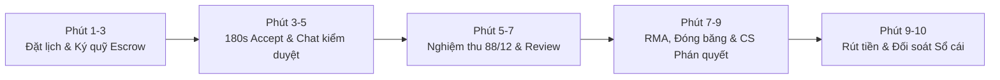

# KỊCH BẢN THỰC THI DEMO BẢO VỆ ĐỒ ÁN (DEMO SCRIPT)
## HỆ THỐNG THƯƠNG MẠI ĐIỆN TỬ DỊCH VỤ GAME COMPANION (INSTASQUAD)

> **Thời lượng đề xuất**: 8 – 12 phút (Khung chuẩn: 10 phút)  
> **Mục tiêu**: Trình diễn trọn vẹn luồng nghiệp vụ C2C cốt lõi, cơ chế bảo vệ tài chính bằng Ký quỹ Escrow và Sổ cái ghi kép bất biến, khả năng xử lý tranh chấp RMA, và tính năng đối soát thời gian thực.  
> **Nguyên tắc demo**: Minh bạch, trực quan, nói rõ các tính năng mô phỏng (Simulator) và cơ chế phòng thủ kỹ thuật.

---

## 1. Chuẩn bị trước buổi Demo (Pre-Demo Checklist)

1. **Khởi động hệ thống**:
   ```powershell
   npm run setup && npm run dev
   ```
   Xác nhận 2 dịch vụ đã sẵn sàng:
   - Web UI: `http://localhost:5173`
   - Backend API: `http://localhost:4000/api/health` (trả về `status: "UP"`, `database: "CONNECTED"`)
2. **Chuẩn bị 2 cửa sổ trình duyệt**:
   - **Cửa sổ 1 (Chính)**: Dùng để đăng nhập luân phiên Renter (`renter1@instasquad.test`) và CS Agent (`cs_agent@instasquad.test`).
   - **Cửa sổ 2 (Ẩn danh / Incognito)**: Dùng để đăng nhập Companion (`companion1@instasquad.test`) và Auditor (`auditor@instasquad.test`).
3. **Mật khẩu dùng chung cho tất cả tài khoản**: `Demo@123456`

---

## 2. Kịch bản Demo chi tiết từng phút



---

### PHẦN 1: TÌM KIẾM, ĐẶT LỊCH VÀ KÝ QUỸ ESCROW (Phút 1 – 3)
*Người thực hiện: Renter 1 (`renter1@instasquad.test`)*

1. **Đăng nhập & Duyệt danh mục**:
   - Chọn vai trò **Renter** trên thanh điều hướng hoặc đăng nhập tài khoản `renter1@instasquad.test`.
   - **Thuyết minh**: *"Hệ thống hỗ trợ 5 vai trò phân quyền. Renter 1 hiện có sẵn 500.000 VND trong ví khả dụng."*
   - Lọc Companion theo Game (ví dụ: `LMHT` hoặc `VALORANT`).
   - Nhấp vào hồ sơ Companion **Bảo Ngọc** (`companion1@instasquad.test`) với đơn giá 100.000 VND/giờ, điểm uy tín TrustScore 95.0.
2. **Chọn Khung giờ & Chốt Snapshot giá**:
   - Nhấp vào một khung giờ rảnh khả dụng (`AVAILABLE`) hôm nay.
   - **Thuyết minh**: *"Hệ thống sử dụng các khung giờ rời rạc (Discrete Slots) và kiểm soát trần tối đa 10 giờ/ngày ở phía máy chủ. Giá thuê được chốt cứng thành `total_fee_snapshot` tại thời điểm đặt, bất biến kể cả khi Companion đổi giá sau đó."*
   - Nhấp **Đặt lịch ngay**. Khung giờ lập tức chuyển sang trạng thái tạm giữ `HELD` với thời hạn đếm ngược 10 phút.
3. **Ký quỹ Escrow (Escrow Hold)**:
   - Trên danh sách đơn đặt lịch, nhấp nút **Ký quỹ Escrow (100.000 đ)**.
   - Modal hiển thị cam kết tài chính và kiểm tra số dư. Nhấp **Xác nhận Ký quỹ**.
   - **Điểm cần chỉ ra cho Hội đồng**:
     - Số dư khả dụng của Renter giảm từ **500.000 VND ➔ 400.000 VND**.
     - Số dư ký quỹ Escrow tăng từ **0 VND ➔ 100.000 VND**.
     - Đơn chuyển sang trạng thái `PENDING_ACCEPTANCE`, đồng hồ 180s bắt đầu đếm ngược.
     - **Thuyết minh**: *"Hệ thống vừa thực thi 1 transaction nguyên tử: trừ ví khả dụng, ghi tăng ví ký quỹ và tạo 2 bút toán Sổ cái kép đối ứng cân bằng."*

---

### PHẦN 2: COMPANION PHẢN HỒI 180S & PHÒNG CHƠI CHAT KIỂM DUYỆT (Phút 3 – 5)
*Người thực hiện: Companion 1 (`companion1@instasquad.test`)*

1. **Tiếp nhận đơn trong 180 giây**:
   - Chuyển sang cửa sổ trình duyệt thứ 2, chọn vai trò **Companion**.
   - Thẻ *"Đơn đặt lịch đang chờ phản hồi"* hiển thị đơn của Renter 1 kèm đồng hồ đếm ngược 180 giây và 2 nút hành động: **Chấp nhận** và **Từ chối**.
   - **Thuyết minh**: *"Nếu Companion bấm Từ chối hoặc để quá hạn 180 giây, hệ thống sẽ tự động hủy đơn và hoàn trả 100% tiền ký quỹ về ví khả dụng cho Renter ngay lập tức."*
   - Nhấp nút **Chấp nhận (Accept)**.
2. **Khởi tạo Phiên chơi (Session Room) & Chat Realtime**:
   - Trạng thái đơn chuyển sang `ACCEPTED`, slot chuyển thành `BOOKED`.
   - Hệ thống tự động tạo phòng chơi với `room_token` duy nhất. Nhấp nút **Vào phòng chơi**.
   - Tại khung chat, nhập tin nhắn thử nghiệm chứa thông tin nhạy cảm:  
     `"Alo bạn ơi kết bạn Zalo số 0912345678 chuyển khoản ngoài cho rẻ nhé!"`
   - Bấm **Gửi**.
   - **Điểm cần chỉ ra cho Hội đồng**:
     - Tin nhắn hiển thị trên màn hình người dùng đã bị bộ lọc Regex kiểm duyệt tự động che giấu:  
       `"Alo bạn ơi kết bạn Zalo số ***[NỘI DUNG ĐÃ BỊ KIỂM DUYỆT]*** chuyển khoản ngoài cho rẻ nhé!"`
     - **Thuyết minh**: *"Hệ thống kiểm duyệt tự động các từ khóa lôi kéo giao dịch ngoài sàn để bảo vệ an toàn cho cả hai bên và bảo vệ doanh thu sàn."*

---

### PHẦN 3: NGHIỆM THU 15 PHÚT, TẤT TOÁN 88/12 & ĐÁNH GIÁ SAO (Phút 5 – 7)
*Người thực hiện: Renter 1 & Companion 1*

1. **Kết thúc phiên & Cửa sổ Nghiệm thu 15 phút**:
   - Trong phòng chơi, nhấp nút **Bắt đầu phiên** ➔ **Kết thúc phiên**.
   - Hệ thống đóng kênh chat và mở đồng hồ đếm ngược thời hạn nghiệm thu 15 phút.
   - **Thuyết minh**: *"Theo chính sách D02, nếu Renter không phản hồi sau 15 phút, hệ thống sẽ kích hoạt Auto-Accept để tránh treo tiền của Companion vô thời hạn."*
2. **Nghiệm thu thủ công & Tất toán 88/12**:
   - Renter nhấp nút **Nghiệm thu (88/12)**. Modal hiển thị chi tiết phân rã số tiền:
     - Companion nhận **88% = 88.000 VND**.
     - Nền tảng thu phí sàn **12% = 12.000 VND**.
   - Nhấp **Xác nhận Nghiệm thu**.
   - **Điểm cần chỉ ra cho Hội đồng**:
     - Ví ký quỹ của Renter giải phóng về **0 VND**.
     - Ví khả dụng của Companion tăng thêm đúng **88.000 VND**.
     - Tài khoản doanh thu sàn ghi nhận đúng **12.000 VND**.
     - Tổng các khoản: $88.000 + 12.000 = 100.000 \text{ VND}$ (Bảo toàn tuyệt đối, zero-cent rounding).
3. **Đánh giá hai chiều bất biến**:
   - Renter nhấp nút **⭐ Đánh giá (Review)**, chọn **5 sao**, nhập nhận xét *"Companion chơi rất nhiệt tình!"*.
   - Bấm **Gửi đánh giá**.
   - Thử bấm lại nút Đánh giá ➔ Hệ thống khóa và báo lỗi: *"Mỗi người chỉ được đánh giá 1 lần duy nhất cho mỗi đơn hàng (Review bất biến theo D17)"*.
   - Xem thẻ TrustScore của Companion: Điểm uy tín tự động được tính toán lại theo công thức chuẩn.

---

### PHẦN 4: SỰ CỐ, KHIẾU NẠI RMA & PHÁN QUYẾT CS AGENT (Phút 7 – 9)
*Người thực hiện: Renter 2 & CS Agent*

1. **Tạo đơn khiếu nại (Báo sự cố)**:
   - Đăng nhập tài khoản Renter 2 (`renter2@instasquad.test`, ví 0 VND).
   - Nhấp nút nạp tiền qua **Payment Simulator**, chọn kịch bản **SUCCESS (+300.000 VND)** ➔ Ví Renter 2 lập tức có 300.000 VND.
   - Tạo đơn mới với Companion 2, Ký quỹ Escrow và bắt đầu phiên chơi.
   - Renter 2 nhấp nút **Báo sự cố (Report Issue)**, chọn danh mục *"Companion không tham gia chơi (NO_SHOW)"*, nhập mô tả sự cố.
   - **Điểm cần chỉ ra cho Hội đồng**:
     - Tiền Escrow lập tức chuyển sang trạng thái **`FROZEN` (Đóng băng)**.
     - Toàn bộ nút giải ngân hay hoàn tiền tự động đều bị vô hiệu hóa.
2. **CS Agent Thẩm định Dossier & Ban hành Phán quyết**:
   - Chuyển sang vai trò **CS Agent** (`cs_agent@instasquad.test`).
   - Vào tab **Hàng đợi Khiếu nại RMA**, nhấp **Xem Dossier** của vụ việc vừa tạo.
   - CS Agent xem toàn bộ dòng thời gian, xem log chat gốc (chưa che để phục vụ điều tra) và các chứng cứ.
   - Nhấp **Phán quyết (Adjudicate)**: Chọn kịch bản **Lỗi Companion $\ge 80\%$** (nhập 100%), lý do phán quyết: *"Xác minh qua chat log Companion vắng mặt không lý do"*.
   - **Điểm cần chỉ ra cho Hội đồng**:
     - Renter được hoàn lại **100% tiền ký quỹ**.
     - Companion bị phạt thêm **20% giá trị đơn hàng** (ghi nhận công nợ phạt `PENALTY_DEBT`, không làm âm ví vật lý).
     - Companion bị **trừ 10.0 điểm TrustScore**, lưu vết kiểm toán đầy đủ trong `TrustScoreLog`.

---

### PHẦN 5: RÚT TIỀN MÔ PHỎNG & ĐỐI SOÁT SỔ CÁI KÉP (Phút 9 – 10)
*Người thực hiện: Companion & Auditor*

1. **Rút tiền mô phỏng (Withdrawal Lifecycle)**:
   - Companion nhấp nút **Yêu cầu rút tiền**, nhập số tiền 50.000 VND, chọn ngân hàng Techcombank.
   - Số dư khả dụng của Companion lập tức bị khóa 50.000 VND chuyển sang quỹ chờ rút.
   - Đăng nhập Admin/CS, nhấp **Từ chối (Reject)** với lý do *"Thông tin tài khoản không trùng khớp"*.
   - **Điểm cần chỉ ra**: Sổ cái kép tự động thực thi bút toán đối ứng hoàn trả lại đúng 50.000 VND về ví khả dụng của Companion.
2. **Kiểm toán Đối soát Sổ cái thời gian thực (Auditor View)**:
   - Đăng nhập vai trò **Auditor** (`auditor@instasquad.test`).
   - Mở màn hình **Kiểm toán & Đối soát Sổ cái kép**:
     - Bảng phương trình bảo toàn dòng tiền:
       $$\sum \text{Khả dụng} + \sum \text{Ký quỹ} + \sum \text{Doanh thu} + \sum \text{Đã rút} \equiv \sum \text{Đã nạp vào}$$
     - Độ lệch phương sai: **$\text{Variance} = 0 \text{ VND}$ (100% CÂN BẰNG)**.
     - Bảng cảnh báo ngoại lệ `LedgerAuditAlert`: Hiển thị các sự cố giả lập đã được xử lý an toàn.
   - **Thuyết minh kết luận**: *"Sổ cái ghi kép đảm bảo tính toàn vẹn tuyệt đối về mặt kế toán, không thất thoát dù chỉ 1 đồng trong toàn bộ vòng đời giao dịch."*

---

## 3. Kế hoạch Dự phòng rủi ro khi Demo trực tiếp (Fallback Plan)

| Sự cố bất ngờ | Nguyên nhân có thể | Thao tác khắc phục tức thì (< 5 giây) |
|:---|:---|:---|
| Thao tác nhầm làm mất luồng dữ liệu | Bấm nhầm nút hủy hoặc nhập sai số tiền | Nhấp nút **`[MOCK] Reset DB`** trên Header màu vàng để khôi phục toàn bộ database về trạng thái mẫu ban đầu trong đúng 1 giây. |
| Màn hình báo lỗi cổng bận khi khởi động lại | Tiến trình cũ chưa giải phóng port 4000/5173 | Mở PowerShell chạy: `Stop-Process -Id (Get-NetTCPConnection -LocalPort 4000).OwningProcess -Force` |
| Token hết hạn do để màn hình quá lâu | JWT token mặc định 7 ngày nhưng có thể bị xóa cookie/storage | Bấm đăng xuất và đăng nhập lại bằng một nhấp chuột trên thanh chuyển vai trò nhanh. |
| Hội đồng yêu cầu xem code kiểm tra tính bảo toàn | Muốn xem công thức làm tròn hoặc bút toán kép | Mở file [`server/src/common/financialMath.ts`](file:///c:/Users/pc/Documents/INSTASQUAD/server/src/common/financialMath.ts) và [`server/src/modules/ledger/ledger.service.ts`](file:///c:/Users/pc/Documents/INSTASQUAD/server/src/modules/ledger/ledger.service.ts). |
| Hội đồng hỏi về kết quả kiểm thử tự động | Muốn thấy bằng chứng test chạy thật | Mở terminal gõ: `npm test` để trình diễn 16 test files với 160 tests PASS trong 20 giây. |
