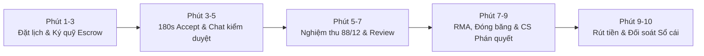

# KỊCH BẢN THỰC THI DEMO BẢO VỆ ĐỒ ÁN (DEMO SCRIPT)
## HỆ THỐNG THƯƠNG MẠI ĐIỆN TỬ DỊCH VỤ GAME COMPANION (INSTASQUAD)

> **Thời lượng đề xuất**: 8 – 12 phút (Khung chuẩn: 10 phút)  
> **Mục tiêu**: Trình diễn trọn vẹn luồng nghiệp vụ C2C cốt lõi, cơ chế bảo vệ tài chính bằng Ký quỹ Escrow và Sổ cái ghi kép bất biến, khả năng xử lý tranh chấp RMA, và tính năng đối soát thời gian thực.  
> **Nguyên tắc demo**: Minh bạch, trực quan, nói rõ các tính năng mô phỏng (Simulator) và cơ chế phòng thủ kỹ thuật.

---

## 1. Chuẩn bị trước buổi Demo (Pre-Demo Checklist)

1. **Khởi động hệ thống**:
   ```powershell
   npm run setup && npm run dev
   ```
   Xác nhận 2 dịch vụ đã sẵn sàng:
   - Web UI: `http://localhost:5173`
   - Backend API: `http://localhost:4000/api/health` (trả về `status: "UP"`, `database: "CONNECTED"`)
2. **Chuẩn bị 2 cửa sổ trình duyệt**:
   - **Cửa sổ 1 (Chính)**: Dùng để đăng nhập luân phiên Renter (`renter1@instasquad.test`) và CS Agent (`cs_agent@instasquad.test`).
   - **Cửa sổ 2 (Ẩn danh / Incognito)**: Dùng để đăng nhập Companion (`companion1@instasquad.test`) và Auditor (`auditor@instasquad.test`).
3. **Mật khẩu dùng chung cho tất cả tài khoản**: `Demo@123456`

---

## 2. Kịch bản Demo chi tiết từng phút



---

### PHẦN 0: NẠP TIỀN TỰ ĐỘNG BẰNG MÃ VIETQR QUA WEBHOOK SEPAY (0Đ) & DỰ PHÒNG SIMULATOR (REF-TOPUP-01 ĐẾN 06)
*Người thực hiện: Renter 1 (`renter1@instasquad.test`) hoặc Renter 2 (`renter2@instasquad.test`)*

1. **Mở Modal Nạp tiền**:
   - Nhấp vào nút **Nạp tiền** ở thanh Sidebar hoặc Topbar (hoặc khi đặt lịch nếu số dư khả dụng không đủ, hệ thống tự động điền số tiền còn thiếu theo `REF-TOPUP-03`).
   - Chọn hạn mức nạp nhanh (ví dụ: `100.000 đ` hoặc nhập `10.000 đ` để test thực tế).
2. **Quét mã VietQR Compact2**:
   - Giao diện hiển thị mã VietQR kèm số tài khoản, ngân hàng nhận, tên chủ tài khoản và cú pháp chuyển khoản chuẩn dạng `INSQxxxxxxxx`.
   - Đồng hồ đếm ngược 15 phút hiển thị rõ ràng.
3. **Thực thi xác nhận tiền vào**:
   - **Chế độ 1 (Khuyến nghị - SePay Thật qua Tunnel)**: Dùng app ngân hàng thật trên điện thoại chuyển khoản 10.000đ từ tài khoản cá nhân B sang tài khoản A của nhóm đúng cú pháp. Sau 1–3 giây, SePay Webhook kích hoạt `confirmPaymentInflow`, WebSocket đẩy sự kiện `TOPUP_SUCCESS` về client. Giao diện tự động thông báo thành công và cập nhật số dư ví khả dụng tức thì mà **KHÔNG cần F5 trang**. Nếu Renter đang giữ slot đặt lịch thì hệ thống tự động hoàn tất ký quỹ Escrow.
   - **Chế độ 2 (Dự phòng Offline / Dev)**: Trong môi trường phát triển (`NODE_ENV=development` và `PAYMENT_PROVIDER=simulator`), nút **"Mô phỏng chuyển khoản (DEV ONLY)"** xuất hiện. Bấm nút này để kích hoạt Mock Webhook có chữ ký HMAC-SHA256, số dư ví tự động nhảy ngay lập tức.
4. **Kiểm tra Sổ cái & Giới hạn Quota**:
   - Vào mục **Lịch sử ví**: Nhấp xem chi tiết bút toán nạp tiền, chứng minh Sổ cái kép ghi nhận đúng `DEBIT CLEARING_WALLET` và `CREDIT RENTER_AVAILABLE` với sai lệch bằng 0.
   - Chuyển sang vai trò **Admin**: Tại Admin Dashboard, chỉ rõ Card **Nạp SePay tháng này (0đ)** đếm số giao dịch thành công (ví dụ `5/50`) và cơ chế cảnh báo quota khi $\ge 40/50$.

---

### PHẦN 1: TÌM KIẾM, ĐẶT LỊCH VÀ KÝ QUỸ ESCROW (Phút 1 – 3)
*Người thực hiện: Renter 1 (`renter1@instasquad.test`)*

1. **Đăng nhập & Duyệt danh mục**:
   - Chọn vai trò **Renter** trên thanh điều hướng hoặc đăng nhập tài khoản `renter1@instasquad.test`.
   - **Thuyết minh**: *"Hệ thống hỗ trợ 5 vai trò phân quyền. Renter 1 hiện có sẵn 500.000 VND trong ví khả dụng."*
   - Lọc Companion theo Game (ví dụ: `LMHT` hoặc `VALORANT`).
   - Nhấp vào hồ sơ Companion **Bảo Ngọc** (`companion1@instasquad.test`) với đơn giá 100.000 VND/giờ, điểm uy tín TrustScore 95.0.
2. **Chọn Khung giờ & Chốt Snapshot giá**:
   - Nhấp vào một khung giờ rảnh khả dụng (`AVAILABLE`) hôm nay.
   - **Thuyết minh**: *"Hệ thống sử dụng các khung giờ rời rạc (Discrete Slots) và kiểm soát trần tối đa 10 giờ/ngày ở phía máy chủ. Giá thuê được chốt cứng thành `total_fee_snapshot` tại thời điểm đặt, bất biến kể cả khi Companion đổi giá sau đó."*
   - Nhấp **Đặt lịch ngay**. Khung giờ lập tức chuyển sang trạng thái tạm giữ `HELD` với thời hạn đếm ngược 10 phút.
3. **Ký quỹ Escrow (Escrow Hold)**:
   - Trên danh sách đơn đặt lịch, nhấp nút **Ký quỹ Escrow (100.000 đ)**.
   - Modal hiển thị cam kết tài chính và kiểm tra số dư. Nhấp **Xác nhận Ký quỹ**.
   - **Điểm cần chỉ ra cho Hội đồng**:
     - Số dư khả dụng của Renter giảm từ **500.000 VND ➔ 400.000 VND**.
     - Số dư ký quỹ Escrow tăng từ **0 VND ➔ 100.000 VND**.
     - Đơn chuyển sang trạng thái `PENDING_ACCEPTANCE`, đồng hồ 180s bắt đầu đếm ngược.
     - **Thuyết minh**: *"Hệ thống vừa thực thi 1 transaction nguyên tử: trừ ví khả dụng, ghi tăng ví ký quỹ và tạo 2 bút toán Sổ cái kép đối ứng cân bằng."*

---

### PHẦN 2: COMPANION PHẢN HỒI 180S & PHÒNG CHƠI CHAT KIỂM DUYỆT (Phút 3 – 5)
*Người thực hiện: Companion 1 (`companion1@instasquad.test`)*

1. **Tiếp nhận đơn trong 180 giây**:
   - Chuyển sang cửa sổ trình duyệt thứ 2, chọn vai trò **Companion**.
   - Thẻ *"Đơn đặt lịch đang chờ phản hồi"* hiển thị đơn của Renter 1 kèm đồng hồ đếm ngược 180 giây và 2 nút hành động: **Chấp nhận** và **Từ chối**.
   - **Thuyết minh**: *"Nếu Companion bấm Từ chối hoặc để quá hạn 180 giây, hệ thống sẽ tự động hủy đơn và hoàn trả 100% tiền ký quỹ về ví khả dụng cho Renter ngay lập tức."*
   - Nhấp nút **Chấp nhận (Accept)**.
2. **Khởi tạo Phiên chơi (Session Room) & Chat Realtime**:
   - Trạng thái đơn chuyển sang `ACCEPTED`, slot chuyển thành `BOOKED`.
   - Hệ thống tự động tạo phòng chơi với `room_token` duy nhất. Nhấp nút **Vào phòng chơi**.
   - Tại khung chat, nhập tin nhắn thử nghiệm chứa thông tin nhạy cảm:  
     `"Alo bạn ơi kết bạn Zalo số 0912345678 chuyển khoản ngoài cho rẻ nhé!"`
   - Bấm **Gửi**.
   - **Điểm cần chỉ ra cho Hội đồng**:
     - Tin nhắn hiển thị trên màn hình người dùng đã bị bộ lọc Regex kiểm duyệt tự động che giấu:  
       `"Alo bạn ơi kết bạn Zalo số ***[NỘI DUNG ĐÃ BỊ KIỂM DUYỆT]*** chuyển khoản ngoài cho rẻ nhé!"`
     - **Thuyết minh**: *"Hệ thống kiểm duyệt tự động các từ khóa lôi kéo giao dịch ngoài sàn để bảo vệ an toàn cho cả hai bên và bảo vệ doanh thu sàn."*

3. **Thực thi Gọi thoại WebRTC 1-1 trong phiên (FR-006, UC04)**:
   - **Kịch bản kiểm tra bằng 2 tab trình duyệt trên localhost**:
     - **Tab 1 (Renter)**: Mở phòng phiên chơi của đơn đặt lịch đang ở trạng thái `ACTIVE`.
     - **Tab 2 (Companion)**: Mở cùng phòng phiên chơi đó trên cửa sổ ẩn danh (Incognito).
   - Tại thanh điều khiển Gọi thoại WebRTC (nền đen đỏ):
     - Nhấp nút **"Gọi thoại"** màu đỏ (`#E11D2E`).
     - Trình duyệt yêu cầu quyền truy cập microphone (lưu ý: WebRTC Audio yêu cầu giao thức an toàn `localhost` hoặc `https://`). Nhấp **Cho phép**.
     - Hệ thống trao đổi thông điệp tín hiệu (Offer, Answer, ICE candidate) qua kênh WebSocket nội bộ và kết nối trực tiếp Peer-to-Peer.
     - Trạng thái cuộc gọi chuyển sang: `Đang kết nối...` ➔ `Đang gọi (00:12)` kèm đồng hồ đếm giây tăng dần.
     - Nhấp nút **"Tắt Mic" / "Bật Mic"**: Microphone chuyển đổi trạng thái tức thì, icon đổi sang `MicOff` màu đỏ.
     - Nhấp nút **"Kết thúc"** (`PhoneOff`): Cuộc gọi đóng lại, hệ thống ghi nhận bản ghi nhật ký `CallLog` vào cơ sở dữ liệu.
   - **Kiểm tra luồng ngoại lệ (UC04 Luồng 3a)**:
     - Nếu một bên tắt quyền microphone hoặc thiết bị không có mic, giao diện hiển thị thông báo nhẹ nhàng: *"Không thể truy cập microphone. Bạn vẫn có thể tiếp tục trao đổi qua kênh chat."* Kênh chat văn bản vẫn hoạt động 100% trơn tru, không gây treo phiên chơi.
   - **Thuyết minh**: *"Hệ thống tuân thủ nghiêm ngặt nguyên tắc chỉ mở kênh thoại khi phiên đang ACTIVE, người ngoài không thể gửi tín hiệu, và toàn bộ siêu dữ liệu cuộc gọi được lưu trữ trong CallLog để phục vụ giải quyết tranh chấp."*

---

### PHẦN 3: NGHIỆM THU 15 PHÚT, TẤT TOÁN 88/12 & ĐÁNH GIÁ SAO (Phút 5 – 7)
*Người thực hiện: Renter 1 & Companion 1*

1. **Kết thúc phiên & Cửa sổ Nghiệm thu 15 phút**:
   - Trong phòng chơi, nhấp nút **Bắt đầu phiên** ➔ **Kết thúc phiên**.
   - Hệ thống đóng kênh chat và mở đồng hồ đếm ngược thời hạn nghiệm thu 15 phút.
   - **Thuyết minh**: *"Theo chính sách D02, nếu Renter không phản hồi sau 15 phút, hệ thống sẽ kích hoạt Auto-Accept để tránh treo tiền của Companion vô thời hạn."*
2. **Nghiệm thu thủ công & Tất toán 88/12**:
   - Renter nhấp nút **Nghiệm thu (88/12)**. Modal hiển thị chi tiết phân rã số tiền:
     - Companion nhận **88% = 88.000 VND**.
     - Nền tảng thu phí sàn **12% = 12.000 VND**.
   - Nhấp **Xác nhận Nghiệm thu**.
   - **Điểm cần chỉ ra cho Hội đồng**:
     - Ví ký quỹ của Renter giải phóng về **0 VND**.
     - Ví khả dụng của Companion tăng thêm đúng **88.000 VND**.
     - Tài khoản doanh thu sàn ghi nhận đúng **12.000 VND**.
     - Tổng các khoản: $88.000 + 12.000 = 100.000 \text{ VND}$ (Bảo toàn tuyệt đối, zero-cent rounding).
3. **Đánh giá hai chiều bất biến**:
   - Renter nhấp nút **⭐ Đánh giá (Review)**, chọn **5 sao**, nhập nhận xét *"Companion chơi rất nhiệt tình!"*.
   - Bấm **Gửi đánh giá**.
   - Thử bấm lại nút Đánh giá ➔ Hệ thống khóa và báo lỗi: *"Mỗi người chỉ được đánh giá 1 lần duy nhất cho mỗi đơn hàng (Review bất biến theo D17)"*.
   - Xem thẻ TrustScore của Companion: Điểm uy tín tự động được tính toán lại theo công thức chuẩn.

---

### PHẦN 4: SỰ CỐ, KHIẾU NẠI RMA, DOSSIER 2 CỘT & PHÁN QUYẾT CS (Phút 7 – 9)
*Người thực hiện: Renter 1, Companion 1, CS Agent & Admin*

1. **Tạo đơn khiếu nại (Báo sự cố & Đóng băng Escrow)**:
   - Đăng nhập tài khoản Renter 1 (`renter1@instasquad.test`, ví 500.000 VND).
   - Đặt lịch với Companion 1 (`companion1@instasquad.test`), Companion nhận đơn.
   - Hai bên vào phòng chat: một bên gửi tin nhắn thử chứa số điện thoại cá nhân (ví dụ `0912345678`). Hệ thống tự động phát hiện, che `***[NỘI DUNG ĐÃ BỊ KIỂM DUYỆT]***`, đồng thời ẩn `original_content` khỏi cả hai người dùng thường.
   - Kết thúc phiên chơi, Renter 1 nhấp **Báo sự cố (Report Issue)**, chọn danh mục vi phạm, đính kèm ảnh bằng chứng (được kiểm tra Magic Bytes nhị phân PNG/JPEG/WebP và dung lượng $\le 2$MB).
   - **Điểm cần chỉ ra cho Hội đồng**:
     - Khoản tiền Escrow lập tức chuyển sang trạng thái **`FROZEN` (Đóng băng toàn phần)**.
     - Toàn bộ nút giải ngân hay nghiệm thu tự động đều bị khóa chặt.

2. **CS Agent & Admin Thẩm định Dossier 2 Cột & Yêu cầu Bổ sung (D25, D29)**:
   - Đăng nhập tài khoản **Admin** (`admin@instasquad.test`) hoặc **CS Agent** (`cs_agent@instasquad.test`).
   - Vào tab **Quản lý CS / RMA**, nhấp nút **Xem Dossier** của khiếu nại vừa tạo.
   - **Giao diện Dossier 2 cột rõ rệt**:
     - **Cột Trái (Phía Renter)**: Hiển thị lý do sự cố, mô tả, ảnh thumbnail nạp an toàn bằng luồng Blob không lộ token trên URL, nút phóng to và tải về qua `signed_token` 60 giây.
     - **Cột Phải (Phía Companion)**: Hiển thị lời giải trình chính thức D29 và ảnh đối chứng.
     - **Nhật ký Chat Kiểm toán**: Chỉ nhân viên CS Agent và Admin được cung cấp nội dung gốc chưa che (`original_content`) kèm nhật ký kiểm toán append-only `AuditLog(VIEW_DISPUTE_CHAT_AUDIT)`.
   - CS Agent nhấp nút **Yêu cầu thêm chứng cứ**: Nhập ghi chú yêu cầu, hệ thống cấp hạn chót bổ sung 24 giờ (`evidence_deadline`) và tạm dừng đồng hồ SLA 45 phút của CS (`paused_sla_ms`).

3. **Hai bên nhận Thông báo In-App, Nộp Bổ sung & Companion Giải trình (D29)**:
   - Cả Renter và Companion đều nhận được **Chuông thông báo in-app** (Notification Bell có badge đếm số chưa đọc) thông báo yêu cầu chứng cứ từ CS.
   - **Phía Companion**: Thẻ đơn hiển thị rõ nhãn **"Giải trình"** (theo D29) kèm thời hạn nộp còn lại. Companion mở modal nộp bản giải trình và ảnh đối chứng.
   - **Phía Renter**: Thẻ đơn hiển thị nhãn **"Nộp chứng cứ bổ sung"** kèm hạn nộp. Renter tải thêm ảnh chụp màn hình phòng game.
   - Khi có chứng cứ hoặc giải trình mới, bộ phận CS Agent và Admin lập tức nhận được thông báo in-app realtime.

4. **CS Phán quyết Tranh chấp & Cập nhật Sổ cái Kép (D22 & D23)**:
   - CS Agent mở lại Dossier (đã cập nhật đầy đủ thông tin của cả hai phía), nhấp **Tiến hành phán quyết**:
     - **Kịch bản Lỗi Companion $\ge 80\%$ (ví dụ 85%) theo D22**: Renter được hoàn lại **100% tiền ký quỹ**; Companion bị phạt thêm **20% giá trị đơn hàng** (trừ từ ví khả dụng hoặc ghi nhận công nợ `PENALTY_DEBT` nếu ví không đủ, tuyệt đối không làm âm ví); Companion bị trừ 10 điểm TrustScore.
     - **Kịch bản Lỗi Companion $< 80\%$ (ví dụ 50%) theo D23**: Giải ngân 88% cho Companion và 12% cho Sàn.
   - **Điểm cần chỉ ra cho Hội đồng**:
     - Bút toán sổ cái ghi kép thực thi hai dòng đối ứng đồng thời trong một giao dịch cơ sở dữ liệu duy nhất.
     - Hai bên nhận thông báo kết quả phán quyết và số dư ví được cập nhật ngay lập tức.
     - Màn hình đối soát của Auditor kiểm chứng sai lệch phương sai $\text{Variance} = 0 \text{ VND}$.

---

### PHẦN 5: RÚT TIỀN MÔ PHỎNG & ĐỐI SOÁT SỔ CÁI KÉP (Phút 9 – 10)
*Người thực hiện: Companion & Auditor*

1. **Rút tiền mô phỏng (Withdrawal Lifecycle)**:
   - Companion nhấp nút **Yêu cầu rút tiền**, nhập số tiền 50.000 VND, chọn ngân hàng Techcombank.
   - Số dư khả dụng của Companion lập tức bị khóa 50.000 VND chuyển sang quỹ chờ rút.
   - Đăng nhập Admin/CS, nhấp **Từ chối (Reject)** với lý do *"Thông tin tài khoản không trùng khớp"*.
   - **Điểm cần chỉ ra**: Sổ cái kép tự động thực thi bút toán đối ứng hoàn trả lại đúng 50.000 VND về ví khả dụng của Companion.
2. **Kiểm toán Đối soát Sổ cái thời gian thực (Auditor View)**:
   - Đăng nhập vai trò **Auditor** (`auditor@instasquad.test`).
   - Mở màn hình **Kiểm toán & Đối soát Sổ cái kép**:
     - Bảng phương trình bảo toàn dòng tiền:
       $$\sum \text{Khả dụng} + \sum \text{Ký quỹ} + \sum \text{Doanh thu} + \sum \text{Đã rút} \equiv \sum \text{Đã nạp vào}$$
     - Độ lệch phương sai: **$\text{Variance} = 0 \text{ VND}$ (100% CÂN BẰNG)**.
     - Bảng cảnh báo ngoại lệ `LedgerAuditAlert`: Hiển thị các sự cố giả lập đã được xử lý an toàn.
   - **Thuyết minh kết luận**: *"Sổ cái ghi kép đảm bảo tính toàn vẹn tuyệt đối về mặt kế toán, không thất thoát dù chỉ 1 đồng trong toàn bộ vòng đời giao dịch."*

---

### PHẦN 6: HỒ SƠ CÁ NHÂN, AVATAR AN TOÀN & DASHBOARD THEO VAI TRÒ (ĐỢT E1 / REF-PROF-01)
*Người thực hiện: Renter, Companion & Admin*

1. **Dashboard chuyên biệt theo vai trò (Role-Based Segregation)**:
   - **Renter (Minh Hoàng)**: Thẻ "Đơn hẹn đang hoạt động", "Đơn của tôi" (5 tab lọc), nạp tiền QR SePay, Companion online có nút "Thuê".
   - **Companion (Bảo Ngọc)**: "Đơn hẹn đang hoạt động" chuẩn hóa (không còn đơn REFUNDED), yêu cầu nhận đơn chờ (countdown 180s), thu nhập & ví, lịch rảnh. **Không có** nút Thuê hay danh sách Companion online.
   - **CS Agent (Thu Hà)**: Hàng chờ khiếu nại RMA, đồng hồ SLA 45m. **Ẩn hoàn toàn** ví cá nhân, nạp tiền, đơn của tôi, nút Thuê.
   - **Auditor (Kiểm Toán Viên)**: Đối soát sổ cái kép ($\text{Variance} = 0$), xuất CSV. **Ẩn hoàn toàn** ví cá nhân, đơn của tôi, nút Thuê.
   - **Admin (Quản Trị Viên)**: Menu "Tổng quan quản trị" (đã gỡ sạch mã nội bộ BR-002), 7 chỉ số kinh doanh chính + 4 thẻ vận hành mở rộng (Đơn sàn đang hoạt động, Khiếu nại đang mở, KYC chờ duyệt, Rút tiền chờ duyệt). Màn hình "Quản lý đơn hàng" xem toàn bộ đơn của sàn, không còn hiển thị nhầm là "Đơn của tôi".
2. **Hồ sơ cá nhân & Bảo mật Avatar (REF-PROF-01)**:
   - Bấm vào Avatar góc trên cùng bên phải -> chọn **"Hồ sơ của tôi"**.
   - **Companion (Bảo Ngọc)**: Hiển thị avatar, tên, bio tự nhiên, rank Thách Đấu, game LMHT, giá 100.000đ/giờ, số giờ tối đa 10h/ngày, Riot ID, trình ghi âm giọng nói (VoiceIntroRecorder), huy hiệu eKYC.
   - **Thao tác tải ảnh đại diện an toàn**: Chọn ảnh PNG/JPG hợp lệ -> hệ thống kiểm tra Magic Bytes nhị phân, tự động xóa sạch dữ liệu EXIF/GPS, crop vuông 256x256 pixel và cập nhật avatar tức thì.
   - **Thử nghiệm phòng thủ tải file độc hại**: Tải tệp text/exe đổi đuôi hoặc tệp $> 2\text{MB}$ -> hệ thống lập tức từ chối và hiển thị thông báo lỗi bảo mật màu đỏ rõ ràng một lần duy nhất.
   - **Đổi mật khẩu an toàn**: Kiểm tra mật khẩu cũ, độ phức tạp, chống trùng mật khẩu cũ và rate limit.

---

## 3. Kế hoạch Dự phòng rủi ro khi Demo trực tiếp (Fallback Plan)

| Sự cố bất ngờ | Nguyên nhân có thể | Thao tác khắc phục tức thì (< 5 giây) |
|:---|:---|:---|
| Thao tác nhầm làm mất luồng dữ liệu | Bấm nhầm nút hủy hoặc nhập sai số tiền | Nhấp nút **`[MOCK] Reset DB`** trên Header màu vàng để khôi phục toàn bộ database về trạng thái mẫu ban đầu trong đúng 1 giây. |
| Màn hình báo lỗi cổng bận khi khởi động lại | Tiến trình cũ chưa giải phóng port 4000/5173 | Mở PowerShell chạy: `Stop-Process -Id (Get-NetTCPConnection -LocalPort 4000).OwningProcess -Force` |
| Token hết hạn do để màn hình quá lâu | JWT token mặc định 7 ngày nhưng có thể bị xóa cookie/storage | Bấm đăng xuất và đăng nhập lại bằng một nhấp chuột trên thanh chuyển vai trò nhanh. |
| Hội đồng yêu cầu xem code kiểm tra tính bảo toàn | Muốn xem công thức làm tròn hoặc bút toán kép | Mở file [`server/src/common/financialMath.ts`](file:///c:/Users/pc/Documents/INSTASQUAD/server/src/common/financialMath.ts) và [`server/src/modules/ledger/ledger.service.ts`](file:///c:/Users/pc/Documents/INSTASQUAD/server/src/modules/ledger/ledger.service.ts). |
| Hội đồng hỏi về kết quả kiểm thử tự động | Muốn thấy bằng chứng test chạy thật | Mở terminal gõ: `npm test` để trình diễn 29 test files với 300 tests PASS (100% GREEN) trong ~75 giây. |
