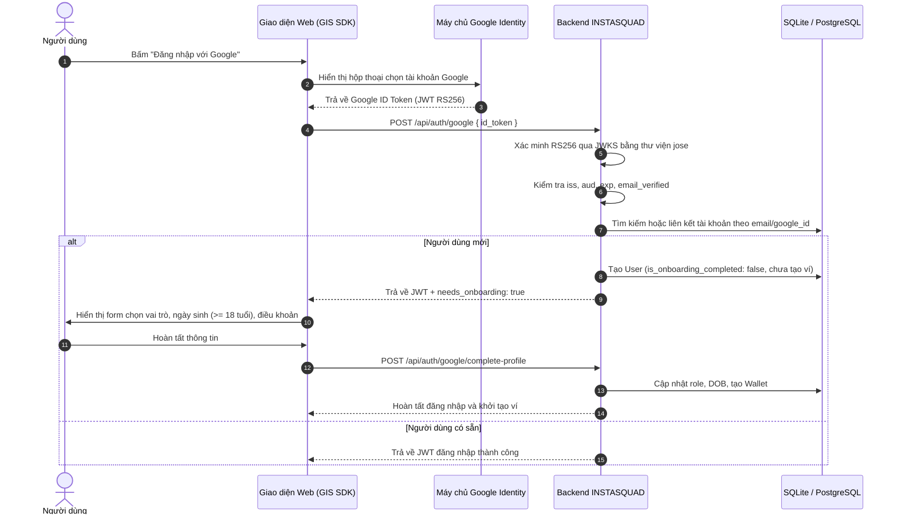

# HƯỚNG DẪN CẤU HÌNH VÀ TÍCH HỢP ĐĂNG NHẬP GOOGLE OAUTH2 (FR-001)

Tài liệu này hướng dẫn chi tiết quy trình thiết lập và kiểm thử tính năng đăng nhập Google OAuth2 (Google Identity Services) cho nền tảng INSTASQUAD theo yêu cầu FR-001.

---

## 1. Cơ chế kỹ thuật (Kiến trúc phân tầng)



### Các nguyên tắc an ninh cốt lõi:
1. **Xác minh chữ ký RS256 chuẩn mật mã học**: Phía server trực tiếp tải và xác minh chữ ký từ bộ chứng chỉ công khai của Google (`https://www.googleapis.com/oauth2/v3/certs`) bằng thư viện `jose` độc lập, nhẹ và tương thích hoàn toàn Node 18, không sử dụng `google-auth-library` cồng kềnh.
2. **Kiểm tra Audience (`aud`) và Issuer (`iss`)**: Bắt buộc `aud` khớp với `GOOGLE_CLIENT_ID` của dự án và `iss` thuộc `accounts.google.com` hoặc `https://accounts.google.com`.
3. **Kiểm tra trạng thái xác thực email (`email_verified = true`)**: Chỉ chấp nhận các tài khoản Google đã xác minh email chính chủ để bảo vệ an toàn danh tính.
4. **Bảo vệ quyền lợi và trách nhiệm pháp lý (Điều khoản & Tuổi tác)**: Người dùng đăng nhập qua Google phải hoàn tất bước xác nhận độ tuổi ($\ge 18$ tuổi) và đồng ý điều khoản dịch vụ trước khi hệ thống kích hoạt ví và cho phép đặt lịch / nạp tiền.

---

## 2. Hướng dẫn thiết lập Google OAuth Client ID trên Google Cloud Console (Miễn phí)

### Bước 1: Tạo dự án trên Google Cloud Console
1. Truy cập [Google Cloud Console](https://console.cloud.google.com/).
2. Đăng nhập bằng tài khoản Google cá nhân hoặc doanh nghiệp.
3. Tạo một dự án mới (ví dụ: `INSTASQUAD E-Commerce Game`).

### Bước 2: Cấu hình Màn hình chấp thuận OAuth (OAuth Consent Screen)
1. Trong menu bên trái, vào **APIs & Services** > **OAuth consent screen**.
2. Chọn loại người dùng **External** (Bên ngoài) và bấm **Create**.
3. Điền các trường thông tin cơ bản:
   - **App name**: `INSTASQUAD`
   - **User support email**: Email hỗ trợ của bạn.
   - **Developer contact information**: Email quản trị kỹ thuật.
4. Bấm **Save and Continue** qua các bước Scopes (chỉ cần các scope mặc định: `email`, `profile`, `openid`).
5. Ở mục **Test users** (Người dùng thử nghiệm):
   - Thêm địa chỉ email Google mà bạn sẽ sử dụng để kiểm thử đăng nhập trên localhost (ví dụ: email sinh viên hoặc email cá nhân của bạn).
   - Bấm **Save and Continue**.

### Bước 3: Tạo Khóa OAuth Client ID
1. Vào mục **Credentials** (Thông tin xác thực) > Bấm **+ CREATE CREDENTIALS** > Chọn **OAuth client ID**.
2. Chọn **Application type** là **Web application**.
3. Điền thông tin cấu hình:
   - **Name**: `INSTASQUAD Local Web Client`
   - **Authorized JavaScript origins** (Nguồn gốc JavaScript được ủy quyền):
     - Thêm URL: `http://localhost:5173`
     - (Nếu test bản production local: thêm `http://localhost:4000`)
   - **Authorized redirect URIs**: Để trống nếu sử dụng Google Identity Services popup/button.
4. Bấm **CREATE**.
5. Hộp thoại hiển thị **Your Client ID** (có định dạng kết thúc bằng `.apps.googleusercontent.com`).
6. Sao chép Client ID này.

---

## 3. Cấu hình biến môi trường trong dự án

Dán Client ID đã tạo vào tệp `.env` của dự án:

```env
# Backend Google OAuth2 verification
GOOGLE_CLIENT_ID="your-client-id-here.apps.googleusercontent.com"

# Frontend Vite client
VITE_GOOGLE_CLIENT_ID="your-client-id-here.apps.googleusercontent.com"
```

> [!NOTE]
> Khi biến `VITE_GOOGLE_CLIENT_ID` được cấu hình, nút "Đăng nhập với Google" sẽ tự động hiển thị trên giao diện đăng nhập và đăng ký. Nếu chưa cấu hình, giao diện sẽ ẩn nút này và hỗ trợ đăng nhập bằng tài khoản nội bộ / tài khoản mẫu để đảm bảo trải nghiệm người dùng liền mạch.

---

## 4. Hướng dẫn kiểm thử tự động và thủ công

### Kiểm thử tự động (Unit / Integration Test)
Dự án đã tích hợp bộ kiểm thử `tests/integration/google_oauth.test.ts` sử dụng cặp khóa RSA và JWKS giả lập theo chuẩn RFC 7517:
- Kiểm tra chữ ký RS256 hợp lệ.
- Kiểm tra từ chối khi sai chữ ký, sai audience, token hết hạn.
- Kiểm tra từ chối khi `email_verified: false`.
- Kiểm tra liên kết tài khoản có sẵn theo email.
- Kiểm tra ngăn chặn người dùng dưới 18 tuổi ở bước hoàn thiện hồ sơ.

### Kiểm thử thủ công trên trình duyệt
1. Khởi động server và client: `npm run dev`.
2. Mở trình duyệt tại `http://localhost:5173`.
3. Bấm **Đăng nhập** > Chọn **Đăng nhập với Google**.
4. Chọn tài khoản Google thử nghiệm đã cấu hình tại Bước 2.
5. Nếu là tài khoản mới, hệ thống chuyển hướng đến màn hình hoàn thiện hồ sơ (chọn vai trò Renter/Companion, nhập ngày sinh $\ge 18$, đồng ý điều khoản).
6. Sau khi xác nhận, người dùng được cấp ví, số dư 0đ và có thể nạp tiền hoặc trải nghiệm dịch vụ bình thường.
