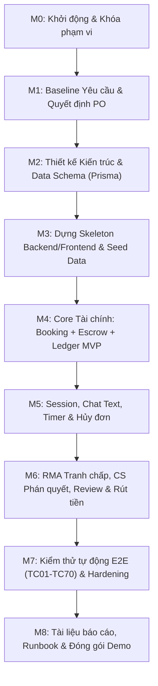

# INSTASQUAD — Kế hoạch triển khai kỹ thuật (Implementation Plan)

Kế hoạch này vạch ra lộ trình thực hiện đồ án **INSTASQUAD — E-Commerce Game Companion Platform** qua 9 cột mốc (Milestones M0 – M8), bám sát 195 gói công việc (WBS), 28 quy tắc nghiệp vụ (BR) và 70 ca kiểm thử nghiệm thu (TC01 – TC70).

---

## 1. Nguyên tắc lập kế hoạch & Rào cản học thuật

1. **Tuân thủ kỷ luật từng mốc**: Hoàn thành dứt điểm từng Milestone, kiểm tra exit criteria trước khi chuyển sang mốc tiếp theo. Không tự ý nhảy cóc sang code tính năng khi chưa chốt thiết kế.
2. **Không phụ thuộc dịch vụ ngoài/trả phí**: Mọi tính năng chạy 100% trên môi trường local (Windows / Node v24 / npm 11). Dịch vụ ngoài (Payment Gateway, WebRTC Voice, SMS/Email) được thay bằng simulator và mock nội bộ.
3. **Ưu tiên an toàn tài chính**: Luồng Booking – Escrow – Ledger là trọng tâm bảo vệ đồ án. Các thao tác thay đổi số dư phải qua Sổ cái ghi kép bất biến, có transaction, idempotency và test case phủ kín các nhánh lỗi.
4. **Định lượng công việc tương đối**: Sử dụng thang đo nỗ lực tương đối S / M / L / XL thay vì tự đoán ngày deadline tuyệt đối.

---

## 2. Lộ trình Milestones chi tiết (M0 – M8)

---

### M0 — Khởi động, Kiểm tra Repository & Khóa phạm vi (Current Milestone)
- **Mục tiêu**: Thống nhất hiểu đúng bản chất sàn dịch vụ C2C (không hàng vật lý), kiểm tra môi trường, phân loại phạm vi MVP (REQUIRED, MOCKED, DEFERRED, DEMO_POLICY) và xác lập nguồn sự thật.
- **Sản phẩm bàn giao**:
  - `docs/SCOPE_BASELINE.md`
  - `docs/DECISION_LOG.md` (bao gồm D01–D18)
  - `docs/AI_PROGRESS.md`
  - `docs/IMPLEMENTATION_PLAN.md`
  - Cấu trúc tài liệu nguồn chuẩn tại `docs/source/`.
- **Điều kiện nghiệm thu (Exit Criteria)**:
  - Kiểm tra đầy đủ 4 tài liệu nguồn;
  - Phân loại phạm vi rõ ràng, xác định rõ các nhánh lỗi không được bỏ qua;
  - Người dùng/PO phê duyệt scope và định hướng công nghệ Modular Monolith.
- **WBS IDs**: `01.01.01` đến `01.01.10`, `02.01.01` đến `02.01.05`.
- **Nỗ lực tương đối**: **S**

---

### M1 — Baseline Yêu cầu & Quyết định PO
- **Mục tiêu**: Đóng băng các quy tắc nghiệp vụ (BR-01 đến BR-28), chốt chính sách cho các quyết định ảnh hưởng đường tiền (D01–D05, D11, D13, D14, D18), hoàn thiện bảng đặc tả trạng thái (State Machines) cho Booking, Escrow, Payment, Withdrawal, Dispute.
- **Sản phẩm bàn giao**:
  - `docs/REQUIREMENTS_SPEC.md` (Catalog 28 BR, State Machine diagrams).
  - Ma trận truy vết yêu cầu (Traceability Matrix cập nhật).
  - Bản ghi nhận phản hồi của PO cho danh mục D01–D18.
- **Điều kiện nghiệm thu (Exit Criteria)**:
  - Toàn bộ quyết định `REQUIRED` được PO phê duyệt hoặc áp dụng chính sách an toàn `DEMO_POLICY`;
  - Mỗi BR mức P0 đều có tiêu chí kiểm thử nghiệm thu cụ thể.
- **WBS IDs**: `02.01.06` đến `02.01.15`, `04.01.01` đến `04.01.06`.
- **Nỗ lực tương đối**: **M**

---

### M2 — Thiết kế Kiến trúc, API Contract & Prisma Data Schema
- **Mục tiêu**: Hoàn thiện thiết kế hệ thống, khắc phục gap giữa ERD và BPMN (bổ sung Session, ChatMessage, DisputeCase, DisputeEvidence, DisputeDecision), thiết kế API contract (REST DTOs) và Prisma Schema có kiểm tra ràng buộc toàn vẹn.
- **Sản phẩm bàn giao**:
  - `prisma/schema.prisma` (Mô hình dữ liệu hoàn chỉnh tương thích SQLite / PostgreSQL).
  - `docs/API_CONTRACT.md` (Đặc tả các endpoint của 4 luồng nghiệp vụ).
  - `docs/ARCHITECTURE_DESIGN.md` (Sơ đồ kiến trúc phân lớp Modular Monolith).
- **Điều kiện nghiệm thu (Exit Criteria)**:
  - Prisma Schema validate thành công (`prisma validate`);
  - ERD as-built bao phủ 100% thực thể của cả Luồng 1, Luồng 2 và RMA;
  - Cơ chế Transaction và Idempotency được thiết kế rõ ở tầng service.
- **WBS IDs**: `04.01.07` đến `04.01.13`, `05.01.01` đến `05.01.12`.
- **Nỗ lực tương đối**: **L**

---

### M3 — Nền tảng Kỹ thuật, Skeleton & Seed Data
- **Mục tiêu**: Khởi tạo project repository hoàn chỉnh (Backend Express + Frontend React/Vite), thiết lập Prisma migrations, bộ lọc CORS/Auth token, và script nạp dữ liệu hạt giống (Seed Data).
- **Sản phẩm bàn giao**:
  - Mã nguồn Backend skeleton (`src/server.ts`, middleware, router).
  - Mã nguồn Frontend skeleton (React app, router 3 phân hệ, layout cơ bản).
  - Database migration script ban đầu.
  - Script nạp dữ liệu `prisma/seed.ts` (Users, Games, Rank tiers, Companion profiles, Slots, Initial Wallets).
- **Điều kiện nghiệm thu (Exit Criteria)**:
  - Chạy `npm run build` và `npm run seed` thành công không lỗi;
  - Đăng nhập được các tài khoản mẫu (Renter, Companion, CS, Auditor, Admin);
  - Danh mục game và lịch rảnh Companion hiển thị được qua API và UI.
- **WBS IDs**: `06.01.01` đến `06.01.12`, `03.01.01` đến `03.01.05`.
- **Nỗ lực tương đối**: **L**

---

### M4 — Core Tài chính: Booking + Escrow + Ledger MVP
- **Mục tiêu**: Triển khai trọn vẹn luồng cốt lõi Luồng A và Luồng D: Đặt lịch có chống trùng (`request_key`), kiểm tra slot, giữ chỗ (`held_until`), kiểm tra trần 10h/ngày, nạp tiền mô phỏng (Payment Simulator), trừ tiền khả dụng, cộng tiền ký quỹ, ghi Sổ cái kép (`LEDGER_ENTRY`), rollback khi có sự cố.
- **Sản phẩm bàn giao**:
  - Booking Service & Controller.
  - Wallet & Double-entry Ledger Engine (hỗ trợ `prisma.$transaction`).
  - Payment Simulator với UI mô phỏng VNPay/MoMo và webhook callback.
  - Test suites cho TC01 – TC38.
- **Điều kiện nghiệm thu (Exit Criteria)**:
  - Đặt lịch thành công có ghi sổ cái chính xác (DEBIT ví khả dụng, CREDIT ví ký quỹ);
  - Hai request cùng đặt 1 slot không bị trùng (chống race condition);
  - Webhook nạp tiền gọi lặp lại không cộng tiền 2 lần (Idempotent callback);
  - Kiểm tra đối chiếu sổ cái (Ledger Reconciliation) số dư luôn cân bằng.
- **WBS IDs**: `07.01.01` đến `07.01.05`, `07.02.01` đến `07.02.11`, `08.01.01` đến `08.01.06`, `08.02.01` đến `08.02.08`.
- **Nỗ lực tương đối**: **XL**

---

### M5 — Session, Chat Text, Timer, Nghiệm thu & Hủy trước giờ
- **Mục tiêu**: Triển khai luồng thực hiện dịch vụ (Luồng B): Kích hoạt phiên chơi đến giờ hẹn, phòng chat text thời gian thực (có regex chặn thông tin liên lạc nhạy cảm theo BR-20), đồng hồ đếm ngược, tự kết thúc phiên, cửa sổ nghiệm thu 15 phút, giải ngân 88/12, các nhánh hủy trước giờ hẹn (100% / 70-30% / 100% penalty).
- **Sản phẩm bàn giao**:
  - Session Engine & WebSocket Chat Server.
  - Fast-forward Timer Service phục vụ demo nhanh các mốc thời gian.
  - Settlement Service (Giải ngân 88% Companion, 12% Nền tảng).
  - Cancellation Service (Tính toán tiền hoàn/phạt theo mốc 30m, 10-29m, <10m).
  - Test suites cho TC39 – TC48.
- **Điều kiện nghiệm thu (Exit Criteria)**:
  - Phiên tự động đóng khi hết thời lượng thuê;
  - Renter hủy trước $\ge 30$ phút hoàn 100%; hủy 10–29 phút hoàn 70% và Companion nhận 30%; hủy $< 10$ phút phạt 100%;
  - Nghiệm thu thành công kích hoạt giải ngân đúng 88/12, không lệch 1 đồng VND;
  - Lỗi ghi sổ tự rollback và phát cảnh báo kiểm toán.
- **WBS IDs**: `09.01.01` đến `09.01.11`, `10.01.01` đến `10.01.06`.
- **Nỗ lực tương đối**: **XL**

---

### M6 — RMA Tranh chấp, CS Phán quyết, Review, TrustScore & Rút tiền
- **Mục tiêu**: Triển khai luồng khiếu nại (Luồng C): Báo sự cố, lập tức đóng băng Escrow `FROZEN`, giao diện CS xem bằng chứng và ra phán quyết (nhánh lỗi $\ge 80\%$ hoàn 100% + phạt 20%; nhánh lỗi $< 80\%$ giải ngân 88/12); Đánh giá 2 chiều, tính TrustScore tự động; Vòng đời yêu cầu rút tiền của Companion.
- **Sản phẩm bàn giao**:
  - Dispute Service & CS Management Dashboard.
  - Review & TrustScore Calculation Engine (khóa hồ sơ nếu điểm < 40).
  - Withdrawal Lifecycle Service (PENDING / PROCESSING / COMPLETED / REJECTED).
  - Test suites cho TC49 – TC64.
- **Điều kiện nghiệm thu (Exit Criteria)**:
  - Tiền ký quỹ bị đóng băng ngay khi có khiếu nại, không thể giải ngân tự động;
  - CS phán quyết lỗi $\ge 80\%$ hạch toán hoàn 100% và trừ phạt 20% chính xác;
  - Review không thể gửi trùng hoặc sửa/xóa;
  - Điểm TrustScore cập nhật tự động sau mỗi phiên và đánh giá;
  - Rút tiền vượt số dư bị từ chối; rút tiền bị từ chối hoàn trả số dư nguyên vẹn.
- **WBS IDs**: `10.02.01` đến `10.02.10`, `11.01.01` đến `11.01.09`, `12.01.01` đến `12.01.07`.
- **Nỗ lực tương đối**: **L**

---

### M7 — Kiểm thử Tích hợp Toàn diện (TC01 – TC70) & Hardening
- **Mục tiêu**: Chạy toàn bộ 70 kịch bản kiểm thử nghiệm thu tự động, kiểm tra bảo mật (RBAC, SQL injection, IDOR, regex chat filter, chống race condition), tối ưu hiệu năng tìm kiếm và độ ổn định local.
- **Sản phẩm bàn giao**:
  - Bộ kiểm thử tự động Vitest bao phủ trọn vẹn TC01 đến TC70.
  - `docs/TEST_REPORT.md` (Ghi nhận kết quả thực thi và bằng chứng log của 70 TCs).
  - Ma trận truy vết kiểm thử hoàn chỉnh (`WBS → Code → Test Case → Evidence`).
- **Điều kiện nghiệm thu (Exit Criteria)**:
  - 100% test case P0 (56/56 TCs) đạt kết quả **PASS**;
  - Không có lỗ hổng rò rỉ số dư ví hoặc đặt trùng slot;
  - Hệ thống khởi động sạch sẽ và chạy ổn định từ lệnh `npm test`.
- **WBS IDs**: `14.01.01` đến `14.01.20`, `13.01.01` đến `13.01.10`.
- **Nỗ lực tương đối**: **L**

---

### M8 — Đóng gói Sản phẩm, Runbook Demo & Bảo vệ Đồ án
- **Mục tiêu**: Chuẩn bị bộ kịch bản demo trực quan cho buổi bảo vệ đồ án, tài liệu hướng dẫn vận hành (Runbook), README hướng dẫn cài đặt trong 1 câu lệnh (`npm run setup && npm run dev`), đối soát minh chứng thiết kế khớp mã nguồn thực tế.
- **Sản phẩm bàn giao**:
  - `README.md` hướng dẫn chạy local chi tiết, không phụ thuộc dịch vụ ngoài.
  - `docs/DEMO_RUNBOOK.md` (Kịch bản demo từng bước: Đặt lịch, Nạp tiền, Chấp nhận, Chat, Hủy, Tranh chấp, CS phán quyết, Đối soát sổ cái).
  - `docs/SYSTEM_DOCUMENTATION.md` (Tài liệu kiến trúc và hướng dẫn giải trình đồ án).
- **Điều kiện nghiệm thu (Exit Criteria)**:
  - Demo trọn vẹn cả 4 luồng nghiệp vụ trên máy local sạch mà không gặp lỗi;
  - Bảng đối chiếu số dư sổ cái và bằng chứng kiểm toán được trực quan hóa rõ ràng.
- **WBS IDs**: `15.01.01` đến `15.01.15`.
- **Nỗ lực tương đối**: **M**
