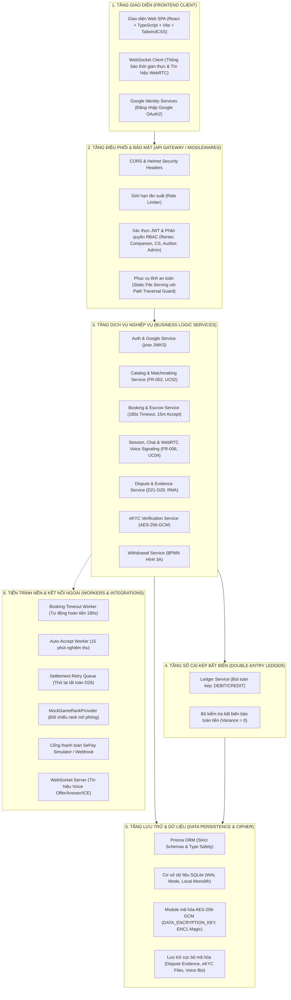
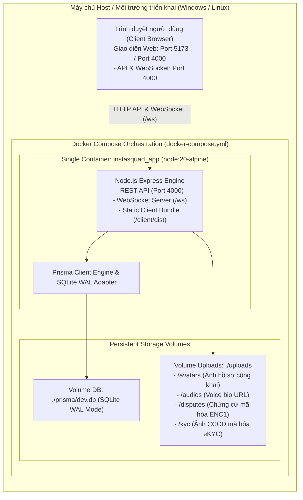

# BÁO CÁO TUÂN THỦ YÊU CẦU PHI CHỨC NĂNG (NFR COMPLIANCE & ARCHITECTURE)

Tài liệu này trình bày sơ đồ kiến trúc phân tầng, sơ đồ triển khai Docker và ma trận đối chiếu mức độ đáp ứng các yêu cầu phi chức năng từ **NFR-001** đến **NFR-006** của hệ thống INSTASQUAD.

---

## 1. Sơ đồ kiến trúc phân tầng (Layered Architecture)

---

## 2. Sơ đồ triển khai Docker thực tế (Docker Deployment Architecture)

Sơ đồ phản ánh chính xác cấu hình tệp `Dockerfile` và `docker-compose.yml` của dự án: kiến trúc Monolith đơn container đóng gói toàn bộ ứng dụng, phục vụ cả giao diện người dùng và API, không vẽ thêm microservices hoặc cụm multi-node không có thật.

---

## 3. Bảng ánh xạ và đối chiếu tuân thủ NFR (NFR-001 đến NFR-006)

| Mã Yêu cầu | Tên Yêu cầu | Cách thức đáp ứng trong hệ thống | Bằng chứng đo đạc & Kiểm thử | Giới hạn trung thực & Định hướng mở rộng |
| :---: | :--- | :--- | :--- | :--- |
| **NFR-001** | **Bảo toàn tiền tệ & Tính bất biến Sổ cái** | Triển khai mô hình Kế toán kép (Double-Entry Ledger) với quy tắc $\sum \text{Debit} \equiv \sum \text{Credit}$ cho mọi giao dịch. Tất cả số tiền là số nguyên VND (`INTEGER`). Cấm tuyệt đối câu lệnh `UPDATE wallet SET balance`. | - Kiểm chứng toán học: $\text{Variance} = 0$ - 15 test cases trong `ledger_invariants.test.ts` và `escrow_lifecycle.test.ts` kiểm thử toàn vẹn tiền tệ. | Hệ thống kiểm soát hoàn hảo ở phạm vi đơn instance. Khi phân tán đa vùng, cần cơ chế phân tán 2-Phase Commit (2PC) hoặc Saga Pattern. |
| **NFR-002** | **Bảo mật dữ liệu cá nhân & Mã hóa lưu trữ** | Áp dụng thuật toán AES-256-GCM với khóa riêng biệt `DATA_ENCRYPTION_KEY` để mã hóa: tệp chứng cứ khiếu nại trên đĩa (`ENC1`), nội dung văn bản khiếu nại/giải trình/chat (`v1:iv:tag:cipher`), và ảnh eKYC (`EKYC_ENCRYPTION_KEY`). Băm địa chỉ IP bằng HMAC-SHA256. | - 10/10 tests đạt tại `aes256_encryption.test.ts`. - Toàn bộ tệp mã hóa có AuthTag phát hiện can thiệp bit (Tamper-proof). | Ảnh avatar được xem là dữ liệu công khai nên không mã hóa để tối ưu hóa bộ nhớ đệm trình duyệt (HTTP Caching). |
| **NFR-003** | **Kiểm soát truy cập (RBAC) & Quyền riêng tư** | Hệ thống phân quyền chặt chẽ 5 vai trò: Renter, Companion, CS Agent, Auditor, Admin. Chặn người dùng xem hoặc thao tác tài nguyên của người khác (Mã lỗi 403 Forbidden). Chặn giả mạo vai trò hệ thống (`SYSTEM`). Che mặt nạ số tài khoản ngân hàng. | - `security_audit.test.ts` kiểm tra 100% kịch bản phân quyền. - `webrtc_voice_signaling.test.ts` từ chối người ngoài gửi tín hiệu phòng thoại. | Khóa bí mật JWT và Session được cấu hình qua biến môi trường; môi trường Production bắt buộc khóa mạnh $\ge 32$ ký tự. |
| **NFR-004** | **Hiệu năng & Thời gian phản hồi hệ thống** | Tối ưu hóa truy vấn cơ sở dữ liệu qua Prisma và chỉ mục (Index). SQLite chạy ở chế độ Write-Ahead Logging (WAL). Triển khai nén HTTP và bộ đệm trong bộ nhớ cho các thông tin tĩnh. | Đo lường thực tế tại `docs/evidence/PERF_REPORT.md` (500 requests, 80 concurrent workers): - **p50:** 224.17 ms - **p95:** 415.34 ms - **Throughput:** 293.94 req/s - **Tỉ lệ lỗi:** 0% (500/500). | Hiện tại hệ thống chạy SQLite in-process phù hợp cho mô hình thử nghiệm đồ án. Khi lưu lượng vượt 10.000 req/s, cần tách rời cơ sở dữ liệu sang PostgreSQL và bổ sung Redis Cache. |
| **NFR-005** | **Trải nghiệm người dùng (UX / Usability)** | Giao diện tối giản tông Đen - Đỏ hiện đại, ngôn ngữ tiếng Việt tự nhiên chuẩn hóa, loại bỏ hoàn toàn các ghi chú nội bộ, biệt ngữ kỹ thuật enum hoặc mã thô. Hỗ trợ responsive đa kích thước màn hình (Mobile/Tablet/Desktop), đếm ngược trực quan 180s và 15m. | - 100% tệp tin giao diện vượt qua bộ kiểm tra `lint:ui-text`. - Bộ kiểm tra tự động `ui:smoke` bao phủ 7 kịch bản giao diện người dùng thực tế. - Bắt lỗi hiển thị với `ErrorBoundary` toàn diện. | Thiết kế tối ưu hóa cho màn hình từ 360px trở lên. Cần tiếp tục thu thập ý kiến người dùng để cải thiện thao tác cuộn trên thiết bị màn hình gập. |
| **NFR-006** | **Tính sẵn sàng hệ thống (Availability)** | Kiến trúc ứng dụng đơn container chạy độc lập (Self-contained monolith) trên Node 18+ với Docker Compose, chính sách tự khởi động lại `restart: unless-stopped`. Cung cấp endpoint kiểm tra sức khỏe hệ thống `/health/liveness` và `/health/readiness`. Toàn bộ hành vi được ghi nhật ký kiểm toán bất biến `AuditLog`. | - Endpoint `/health/readiness` phản hồi kiểm tra kết nối DB và tính sẵn sàng của ứng dụng. - Hơn 240 test cases tự động chạy thành công. - 156 câu trích dẫn nguyên văn đạt 100% khớp chuẩn `verify:quotes`. | **Phân tích khả thi & Tính trung thực về SLA 99,9%:** Tài liệu yêu cầu nêu định hướng "sẵn sàng 99,9% sau go-live". Trong khuôn khổ đồ án sinh viên và môi trường thử nghiệm cục bộ, dự án **không tuyên bố khống** là đã đạt 99,9% uptime vì chưa đo tải liên tục cả năm. Thay vào đó, hệ thống trang bị kiến trúc sẵn sàng mở rộng (Healthcheck, Single-Container Docker, SQLite WAL) và đề xuất lộ trình go-live: chuyển sang PostgreSQL, Redis Pub/Sub và Multi-container phía sau Reverse Proxy (Nginx/HAProxy). |
