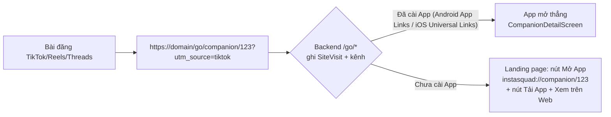

# INSTASQUAD — Chiến lược Tăng trưởng: Thu hút Người không mê game & Social Media → App

> Phiên bản 1.0 · 2026-11-18 · Nhãn: `DEMO_POLICY` (đề xuất chiến lược của nhóm; các con số mục tiêu là giả định để đo lường, chưa có dữ liệu thị trường thực).

## 1. Vấn đề
Tệp khách hàng hiện tại giới hạn trong người chơi game có nhu cầu tìm bạn chơi cùng/leo rank. Nhóm người **không mê game** (sinh viên xa nhà, người làm việc từ xa, người cần một người lắng nghe, người thích xem phim/nghe nhạc nhưng không có bạn cùng sở thích) có cùng nhu cầu cốt lõi: **có người đồng hành theo giờ, an toàn, có bảo đảm tiền**. Hạ tầng Escrow + TrustScore + khiếu nại của INSTASQUAD giải quyết đúng nỗi lo lớn nhất của nhóm này: *sợ bị lừa, sợ gặp người xấu*.

## 2. Danh mục dịch vụ Non-gamer (category `SOCIAL`, D35)

| Mã | Dịch vụ | Mô tả | Hình thức | Giá gợi ý/giờ |
|---|---|---|---|---|
| `social-talk` | Tâm sự & Lắng nghe | Trò chuyện, chia sẻ áp lực học tập/công việc. **Không** thay thế tư vấn tâm lý chuyên môn; có banner đường dây nóng hỗ trợ khi phát hiện từ khóa nguy cơ (DEFERRED). | Chat chữ trong phòng phiên | 40.000–80.000 đ |
| `social-movie` | Xem phim cùng | Cùng mở một phim trên nền tảng hợp pháp của mỗi người, bình luận realtime. INSTASQUAD **không** phát lại nội dung có bản quyền. | Chat chữ đồng bộ thời điểm | 50.000–90.000 đ |
| `social-music` | Nghe nhạc cùng | Chia sẻ playlist, bình luận, học hát. | Chat chữ | 40.000–70.000 đ |
| `social-party` | Party game nhẹ | Trò chơi trên web không cần kỹ năng: đố vui, vẽ đoán chữ, Ma Sói online. | Chat chữ + link game miễn phí bên thứ 3 | 50.000–100.000 đ |

Toàn bộ dùng chung luồng 8 bước ([`UNIFIED_WORKFLOW.md`](UNIFIED_WORKFLOW.md)): ký quỹ, 180s, nghiệm thu 15p, 88/12. Không có quy tắc tiền mới. Chế tài V08 (dịch vụ biến tướng) áp dụng nghiêm cho nhóm SOCIAL.

### 2.1 Thiết kế trải nghiệm cho người mới
- **Onboarding 3 câu hỏi** trên App: "Bạn muốn làm gì hôm nay?" (Chơi game / Trò chuyện / Xem phim / Nghe nhạc / Chơi party) → lọc sẵn danh mục.
- **Gói thử 30 phút** (`DEFERRED` — cần thay đổi đơn vị slot 1 giờ; đề xuất cho giai đoạn sau).
- **Huy hiệu an toàn** trên thẻ Companion: eKYC ✓, TrustScore, số đơn hoàn tất, tỷ lệ khiếu nại.
- Ngôn ngữ giao diện không dùng thuật ngữ game cho tab SOCIAL ("rank", "carry" → "chủ đề", "phong cách").

## 3. Chiến lược nội dung Social Media

> Lịch triển khai chi tiết 4 tuần (74 bài, mỗi bài một link `/go/...` với `utm_campaign` riêng): [`CONTENT_CALENDAR_4W.md`](CONTENT_CALENDAR_4W.md).

| Kênh | Định dạng | Trụ cột nội dung (content pillars) | Tần suất | CTA / Deep Link |
|---|---|---|---|---|
| **TikTok** | Video dọc 15–45s | (1) "Một buổi tối với Companion" – POV xem phim cùng; (2) Mẹo leo rank 30 giây; (3) Hậu trường: tiền được giữ an toàn thế nào (giải thích Escrow bằng hoạt hình) | 1 video/ngày | Link bio → `https://<domain>/go/discover?c=social&utm_source=tiktok` |
| **Facebook Reels / Instagram Reels** | Reels 30–60s + carousel | Câu chuyện người dùng (đã đồng ý), "3 lý do bạn không cần mê game để dùng INSTASQUAD", highlight Companion tuần | 4 bài/tuần | Nút "Mở App" → `/go/companion/{id}?utm_source=facebook` |
| **Threads** | Bài viết ngắn, khảo sát | Chủ đề trò chuyện mỗi tối ("Phim gần nhất làm bạn khóc?"), poll gợi ý dịch vụ mới | 1–2 bài/ngày | Link trong reply đầu → `/go/discover?c=social&utm_source=threads` |
| **Facebook Group / Fanpage** | Bài dài, livestream | Minigame, livestream party game với Companion, thông báo chính sách | 2 livestream/tháng | Pin bài với link `/go/...` |

**Nguyên tắc:** mọi nội dung có người thật phải có sự đồng ý bằng văn bản; không dùng hình ảnh gợi cảm; không hứa hẹn "người yêu thuê"; luôn hiển thị thông điệp "Thanh toán được giữ an toàn đến khi bạn hài lòng".

## 4. Deep Link & Universal Link: kéo traffic Social về đúng màn hình App

| Đường dẫn công khai | Custom scheme | Màn hình App | Fallback Web |
|---|---|---|---|
| `/go/discover?c=game\|social` | `instasquad://discover?c=social` | `DiscoverScreen` (tab tương ứng) | `/?category=social` |
| `/go/companion/{profileId}` | `instasquad://companion/{id}` | `CompanionDetailScreen` | `/?companion={id}` |
| `/go/booking/{bookingId}` | `instasquad://booking/{id}` | `BookingDetailScreen` (cần đăng nhập) | `/` |
| `/go/wallet` | `instasquad://wallet` | `WalletScreen` | `/` |

Hạ tầng (triển khai ở Bước 3–5):
- Backend phục vụ `/.well-known/assetlinks.json` (Android App Links) và `/.well-known/apple-app-site-association` (iOS Universal Links) với `paths: ["/app/*", "/go/*"]`.
- Trang `/go/*` ghi nhận `utm_source`, `utm_medium`, `utm_campaign` vào `site_visits` để đo phễu theo kênh (D27: Conversion = đơn ký quỹ thành công / phiên truy cập duy nhất).
- Flutter dùng `app_links` để nhận link và điều hướng bằng `go_router`.
- Domain thật, SHA-256 chứng chỉ ký Android và Apple Team ID là **placeholder** (`DEFERRED` đến khi phát hành).

## 5. Phễu & chỉ số theo kênh

| Giai đoạn | Chỉ số | Nguồn dữ liệu |
|---|---|---|
| Nhận biết | Lượt xem, follower | Thống kê nội bộ của từng nền tảng (nhập tay) |
| Truy cập | Phiên duy nhất `/go/*` theo `utm_source` | `site_visits` |
| Kích hoạt | Đăng ký + chấp thuận điều khoản | `users`, `terms_acceptances.channel` |
| Chuyển đổi | Đơn ký quỹ thành công | `escrows` |
| Giữ chân | Đơn thứ 2 trong 30 ngày | `bookings` |
| Giới thiệu | Đơn có `utm_source=referral` | `site_visits` (DEFERRED: mã giới thiệu) |
