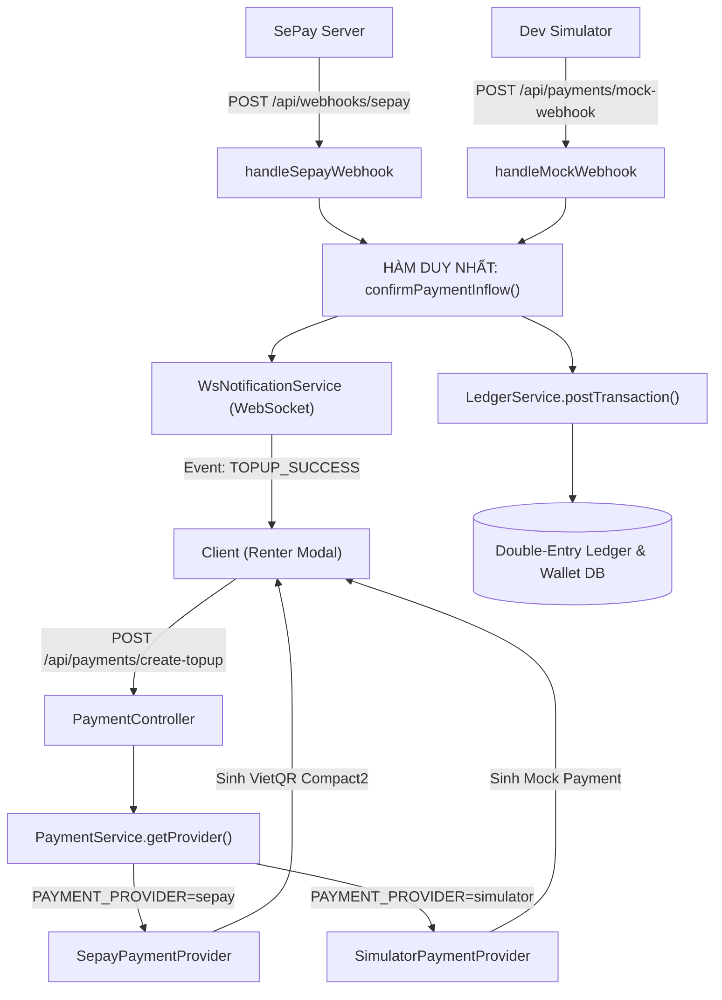

# ĐẶC TẢ KỸ THUẬT CỔNG THANH TOÁN TỰ ĐỘNG QUA WEBHOOK SEPAY (0Đ)
## HỆ THỐNG THƯƠNG MẠI ĐIỆN TỬ DỊCH VỤ GAME COMPANION (INSTASQUAD)

> **Mã tham chiếu**: `REF-TOPUP-05`, `REF-TOPUP-06` (Loại: *Nhóm phát triển thêm*)  
> **Quyết định liên quan**: **D28** (Xử lý đơn nạp muộn `LATE`)  
> **Mục tiêu kỹ thuật**: Nạp tiền tự động qua quét mã VietQR mở, chi phí 0đ, hạch toán Sổ cái kép bất biến ($\Delta = 0$), cập nhật thời gian thực qua WebSocket và phòng chống gian lận.

---

## 1. Kiến trúc Cổng thanh toán (Pluggable Payment Provider)

Hệ thống INSTASQUAD áp dụng mẫu thiết kế **Provider Pattern**, phân tách rõ ràng giao diện trừu tượng và các bản triển khai cụ thể:



### 1.1. Giao diện trừu tượng (`IPaymentProvider`)
Được định nghĩa tại [`server/src/modules/payment/payment-provider.interface.ts`](file:///c:/INSTASQUAD/INSTASQUAD/server/src/modules/payment/payment-provider.interface.ts):
- `name`: Tên định danh provider (`sepay` hoặc `simulator`).
- `createPayment(params)`: Khởi tạo đơn nạp tiền `Payment` trạng thái `PENDING`, thời hạn hiệu lực 15 phút, sinh mã nội dung chuyển khoản duy nhất `gateway_ref` và URL mã QR.

### 1.2. Biến môi trường chuyển đổi Provider (`.env`)
```bash
# Chọn provider: 'sepay' (khuyến nghị có mạng/tunnel) hoặc 'simulator' (dự phòng offline)
PAYMENT_PROVIDER=sepay

# Cấu hình tài khoản nhận tiền cá nhân của nhóm (Chi phí 0đ)
SEPAY_BANK_CODE=MBBank
SEPAY_ACCOUNT_NUMBER=0123456789
SEPAY_ACCOUNT_NAME=NGUYEN VAN A
SEPAY_WEBHOOK_API_KEY=instasquad_dev_sepay_key_2026

# Public Base URL khi chạy tunnel
PUBLIC_BASE_URL=http://localhost:4000
```

---

## 2. Đặc tả Hợp đồng SePay Webhook (SePay Contract Specification)

Tham chiếu chuẩn theo tài liệu chính thức từ [SePay Developer Docs](https://docs.sepay.vn):

### 2.1. Endpoint tiếp nhận
- **URL**: `POST /api/webhooks/sepay`
- **Content-Type**: `application/json`
- **Header xác thực**: `Authorization: Apikey <SEPAY_WEBHOOK_API_KEY>` (hoặc `X-Api-Key: <SEPAY_WEBHOOK_API_KEY>`)

### 2.2. Cấu trúc Payload Webhook từ SePay
```json
{
  "id": 900101,
  "gateway": "MBBank",
  "transactionDate": "2026-11-08 14:30:00",
  "accountNumber": "0123456789",
  "code": "FT261108123456",
  "content": "Chuyen khoan INSQHM5XXJGW nap tien",
  "transferType": "in",
  "transferAmount": 100000,
  "accumulated": 1500000,
  "subAccount": null,
  "referenceCode": "MB12345678"
}
```

### 2.3. Quy định kiểu dữ liệu các trường
| Trường | Kiểu | Bắt buộc | Mô tả |
|:---|:---:|:---:|:---|
| `id` | `number` | Có | ID giao dịch duy nhất trên hệ thống SePay. Dùng làm khóa chống trùng lặp (Idempotency). |
| `gateway` | `string` | Không | Ngân hàng diễn ra giao dịch (MBBank, Vietcombank, Techcombank...). |
| `transactionDate` | `string` | Không | Thời gian ngân hàng xử lý giao dịch. |
| `accountNumber` | `string` | Không | Số tài khoản ngân hàng nhận tiền của nhóm. |
| `code` | `string` | Không | Mã giao dịch tham chiếu của phía ngân hàng. |
| `content` | `string` | Có | Nội dung chuyển khoản. Chứa mã đơn `INSQxxxxxxxx` để tìm Payment. |
| `transferType` | `string` | Có | Hướng giao dịch: `'in'` (tiền vào) hoặc `'out'` (tiền ra). **Chỉ xử lý `'in'`; bỏ qua `'out'`.** |
| `transferAmount` | `number` | Có | Số tiền nhận được (VND nguyên dương). |
| `accumulated` | `number` | Không | Số dư tích lũy của tài khoản ngân hàng sau giao dịch. |

### 2.4. Phản hồi chuẩn (HTTP Response)
Để tuân thủ chuẩn webhook của SePay và tránh việc SePay tự động retry liên tục khi gặp lỗi nghiệp vụ (như nạp thiếu tiền):
- **HTTP Status**: Luôn trả về `200 OK`
- **Body**: `{"success": true, "status": "SUCCESS" | "UNDERPAID" | "LATE" | "UNMATCHED" | "IGNORED"}`

---

## 3. Hàm Xác nhận Tiền vào Duy nhất (`confirmPaymentInflow`)

Toàn bộ các luồng xác nhận thanh toán (dù đến từ SePay Webhook hay Mock Webhook của Simulator) đều **bắt buộc** đi qua hàm trung tâm:
`paymentService.confirmPaymentInflow(params: ConfirmPaymentInflowParams)`

### 3.1. Các bước thực thi nghiêm ngặt
1. **Khóa chống chạy đua đồng thời (Concurrency Lock)**:  
   Khóa bộ nhớ `LOCK-${external_transaction_id}` để chặn đứng việc gửi cùng 1 request hai lần trong cùng một tích tắc.
2. **Lọc chiều giao dịch**:  
   Nếu `transferType === 'out'`, bỏ qua ngay lập tức và trả về trạng thái `IGNORED`.
3. **Tìm kiếm Payment linh hoạt**:  
   - Bóc tách mã nội dung: chuẩn hóa bỏ khoảng trắng, dấu gạch nối, chuyển chữ hoa.
   - Tìm kiếm theo `gateway_ref` hoặc biểu thức chính quy `INSQ[A-Z0-9]{8}`.
4. **Kiểm tra trạng thái đã hoàn tất (Chống lặp Idempotency)**:  
   Nếu Payment đã ở trạng thái `SUCCESS` hoặc `LATE`:
   - Kiểm tra bảng cảnh báo `LedgerAuditAlert` với mã `WEBHOOK_DUPLICATE_REPLAY`.
   - Nếu đã có dòng cảnh báo, tăng `repeat_count` thêm 1 (coalescing alert).
   - Nếu chưa có, tạo mới với `repeat_count = 1`.
   - Trả về ngay `is_idempotent_replay: true` kèm số dư ví khả dụng hiện tại. **TUYỆT ĐỐI không ghi thêm bút toán nào vào Sổ cái.**
5. **Kiểm tra số tiền**:  
   - Nếu `actual_amount < payment.amount` (Nạp thiếu): Đánh dấu Payment `UNDERPAID`, tạo `LedgerAuditAlert(WEBHOOK_UNDERPAID_AMOUNT)`, không giải ngân vào ví khả dụng.
   - Nếu `actual_amount >= payment.amount` (Đủ hoặc Thừa): Giải ngân đúng số tiền thực nhận `actual_amount`.
6. **Xử lý quá hạn 15 phút (Quyết định D28 - Nạp muộn `LATE`)**:  
   - Nếu đơn nạp tiền đã quá 15 phút hoặc đã bị worker đổi sang `EXPIRED`, hệ thống **vẫn giải ngân vào ví khả dụng Renter** để bảo vệ tài sản của khách hàng, đổi trạng thái đơn sang `LATE`, đồng thời tạo `LedgerAuditAlert(WEBHOOK_LATE_PAYMENT)` để kiểm toán viên giám sát đối soát.
7. **Hạch toán Sổ cái kép nguyên tử (Atomic Double-Entry Posting)**:  
   Thực thi 1 DB transaction duy nhất thông qua `ledgerService.postTransaction`:
   - **CREDIT** `payment.wallet_id` (Ví khả dụng Renter): `+actual_amount`
   - **DEBIT** `SYSTEM_ACCOUNTS.CLEARING_WALLET_ID` (Tài khoản trung gian hệ thống): `-actual_amount`
   - `idempotency_key: "TOPUP-${payment.gateway_ref}"`
8. **Đồng bộ thời gian thực qua WebSocket**:  
   Phát thông báo WebSocket `TOPUP_SUCCESS` tới `user_id` sở hữu ví:
   ```json
   {
     "type": "TOPUP_SUCCESS",
     "payment_id": "...",
     "gateway_ref": "INSQHM5XXJGW",
     "amount": 100000,
     "status": "SUCCESS",
     "available_balance": 600000,
     "is_late": false
   }
   ```
   Client nhận được sự kiện tự động đóng modal nạp tiền, phát âm thanh hoặc thông báo thành công và cập nhật số dư hiển thị mà **không cần người dùng tải lại trang (F5)**.
   Nếu Renter đang trong luồng giữ slot chờ nạp tiền để ký quỹ, client tự động kích hoạt `POST /api/bookings/:id/hold-escrow` để ký quỹ ngay tức thì (Hình 1A Bước 8-10).

---

## 4. Bảo mật & An toàn Thông tin

1. **Xác thực API Key bằng So sánh Thời gian Hằng số (Timing-Safe Comparison)**:
   ```typescript
   verifySepayApiKey(authHeader?: string): boolean {
     // So sánh bằng crypto.timingSafeEqual trên SHA-256 hash của API Key
     const hExpected = crypto.createHash('sha256').update(env.SEPAY_WEBHOOK_API_KEY).digest();
     const hProvided = crypto.createHash('sha256').update(providedKey).digest();
     return crypto.timingSafeEqual(hExpected, hProvided);
   }
   ```
   Ngăn chặn hoàn toàn nguy cơ dò tìm độ dài hoặc ký tự của khóa bí mật qua kỹ thuật đo độ trễ thời gian mạng (Side-channel Timing Attack).
2. **Che giấu Dữ liệu Tài khoản (Account Number Masking)**:
   Trong toàn bộ các file nhật ký (Winston Logger) và cơ sở dữ liệu công khai, số tài khoản ngân hàng luôn được che bằng hàm `maskAccountNumber`:
   - Số tài khoản `0123456789` $\rightarrow$ `******6789`
   - Tuyệt đối không để lộ thông tin tài khoản ngân hàng đầy đủ trong log.
3. **Không lưu khóa thật trong mã nguồn hay Git**:
   Mọi khóa API và số tài khoản trong repository đều sử dụng giá trị mẫu an toàn (`.env.example`). Khóa thật được người vận hành cấu hình riêng biệt trong tệp `.env` môi trường chạy cục bộ.

---

## 5. Giám sát Hạn mức Gói Miễn phí (Quota Counter)

Gói SePay FREE hỗ trợ tối đa **50 giao dịch tiền vào / tháng**:
- Hệ thống xây dựng bộ đếm tại `paymentService.getMonthlyInflowMetrics()`.
- Endpoint `GET /api/payments/metrics/monthly-inflow` cung cấp dữ liệu số giao dịch đã hoàn tất (`SUCCESS` và `LATE`) trong tháng hiện tại.
- Tích hợp trực tiếp vào **Admin Dashboard** (`Card 7: Nạp SePay tháng này (0đ)`).
- Khi số giao dịch đạt ngưỡng $\ge 40/50$, hệ thống tự động hiển thị **Banner cảnh báo màu vàng** trên Admin Dashboard nhắc nhở quản trị viên.
