# INSTASQUAD — Đặc tả yêu cầu nghiệp vụ & Mô hình trạng thái (Requirements & State Machines)

Tài liệu này đóng vai trò là **Baseline yêu cầu nghiệp vụ** cho mốc **M1**, làm cơ sở cho thiết kế kiến trúc, schema database và bộ kiểm thử tự động.

---

## 1. Phân loại mức độ yêu cầu (Requirement Taxonomy)

Mọi quy tắc và hành vi hệ thống được gắn thẻ minh bạch theo 4 nhóm:
1. `[NGUỒN GỐC]` *(Source of Truth)*: Yêu cầu được nêu tường minh trong `BT3_INSTASQUAD.pdf`, `INSTASQUAD_BPMN_TKHT.pdf` hoặc workbook `INSTASQUAD_WBS_Detailed.xlsx`.
2. `[SUY LUẬN KỸ THUẬT]` *(Engineering Inferences)*: Các cơ chế kỹ thuật bắt buộc phải có để hệ thống chạy ổn định và an toàn (Transaction, Idempotency lock, Database schema bổ sung, Regex filter).
3. `[QUYẾT ĐỊNH ĐÃ CHỐT]` *(Finalized Group Decisions)*: Các điểm nghiệp vụ nguồn còn bỏ ngỏ hoặc ghi chú "Cần PO xác nhận" đã được nhóm chốt chính thức qua bộ quyết định D21–D27 (`NHÓM ĐÃ CHỐT 06/11/2026 – Charter chưa quy định`).
4. `[DEMO POLICY]` *(Chính sách Demo Sinh viên)*: Các quy ước an toàn được PO/Người dùng phê duyệt phục vụ môi trường demo học thuật, có thể cấu hình được.

---

## 2. Mô hình vai trò & Ma trận phân quyền (RBAC Matrix)

Hệ thống định nghĩa 5 vai trò tối thiểu:
- `RENTER`: Khách hàng tìm kiếm, đặt lịch, thanh toán, tham gia phiên chơi, đánh giá và gửi khiếu nại.
- `COMPANION`: Người cung cấp dịch vụ, quản lý hồ sơ, cấu hình giá, duyệt/từ chối lịch, chat, đánh giá, rút tiền.
- `CS_AGENT`: Nhân viên Chăm sóc khách hàng tiếp nhận hồ sơ khiếu nại, xem bằng chứng và ra phán quyết phán xử.
- `AUDITOR`: Kiểm toán viên tài chính theo dõi Sổ cái ghi kép, đối soát số dư và xử lý các ngoại lệ ghi sổ.
- `ADMIN`: Quản trị viên quản lý danh mục Game, Rank tier, phân quyền người dùng và cấu hình hệ thống.

### 2.1. Ma trận phân quyền theo hành động (Action-Level Access Control)

| Nhóm hành động | API / Thao tác | Renter | Companion | CS Agent | Auditor | Admin | Ràng buộc bảo mật & Dữ liệu riêng tư |
|:---|:---|:---:|:---:|:---:|:---:|:---:|:---|
| **Auth & Profile** | Đăng ký / Đăng nhập / Xem Profile bản thân | Cho phép | Cho phép | Cho phép | Cho phép | Cho phép | Dữ liệu nhạy cảm (hash mật khẩu, email riêng) không trả về public. |
| | Cập nhật hồ sơ, cấu hình giá, slot | Chặn | **Chính mình** | Chặn | Chặn | Cho phép | Chỉ Companion sở hữu hồ sơ mới được cập nhật slot và giá. |
| **Catalog** | Xem Game, Rank, danh sách Companion, Slot | Cho phép | Cho phép | Cho phép | Cho phép | Cho phép | API công khai; chỉ xem các slot có trạng thái `AVAILABLE`. |
| **Booking** | Tạo Booking (`request_key`), giữ slot | **Chính mình** | Chặn | Chặn | Chặn | Chặn | Renter không thể tạo booking giùm người khác; bắt buộc có `request_key`. |
| | Chấp nhận / Từ chối đơn trong 180s | Chặn | **Chính mình** | Chặn | Chặn | Chặn | Chỉ Companion được đặt đích danh mới có quyền Accept/Reject. |
| | Hủy đơn trước giờ hẹn | **Chính mình** | Chặn | Chặn | Chặn | Chặn | Chỉ Renter chủ đơn được hủy trước `start_time`. Sau đó bị cấm hủy. |
| **Payment & Wallet** | Nạp tiền (Top-up qua Simulator) | **Chính mình** | **Chính mình** | Chặn | Chặn | Chặn | Chỉ nạp vào ví của chính mình. |
| | Xem số dư ví và lịch sử Ledger | **Chính mình** | **Chính mình** | Chặn | **Toàn sàn** | Cho phép | Tuyệt đối không cho phép user xem ví hoặc sổ cái của user khác. |
| | Yêu cầu rút tiền (`WITHDRAW_REQUEST`) | Chặn | **Chính mình** | Chặn | Chặn | Chặn | Chỉ Companion được tạo yêu cầu rút; khóa số dư ngay khi tạo. |
| | Duyệt / Từ chối rút tiền | Chặn | Chặn | Chặn | Cho phép | Cho phép | Bắt buộc vai trò Auditor/Admin; ghi audit log khi duyệt/từ chối. |
| **Session & Chat** | Vào phòng chat của phiên | **Người trong đơn** | **Người trong đơn** | **Khi có khiếu nại** | Chặn | Cho phép | Chặn hoàn toàn truy cập chéo giữa các booking khác nhau. |
| | Gửi tin nhắn text | **Người trong đơn** | **Người trong đơn** | Chặn | Chặn | Chặn | Chạy qua bộ lọc regex chặn SĐT, URL, STK (BR-20). |
| | Xác nhận nghiệm thu trong 15m | **Chính mình** | Chặn | Chặn | Chặn | Chặn | Chỉ Renter của đơn hàng được bấm "Hoàn tất". |
| **RMA & Dispute** | Gửi khiếu nại ("Báo sự cố") + Bằng chứng | **Chính mình** | Chặn | Chặn | Chặn | Chặn | Chỉ Renter trong cửa sổ 15m; Escrow lập tức chuyển sang `FROZEN`. |
| | Bổ sung bằng chứng giải trình | **Người trong đơn** | **Người trong đơn** | Chặn | Chặn | Chặn | Cho phép cả hai bên nộp ảnh/giải trình trước hạn chót. |
| | Xem hồ sơ khiếu nại & Ra phán quyết | Chặn | Chặn | Cho phép | Cho phép | Cho phép | User thường bị chặn gọi API phán quyết; CS bắt buộc nhập lý do. |
| **Review** | Gửi đánh giá 1–5 sao | **Người trong đơn** | **Người trong đơn** | Chặn | Chặn | Chặn | Mỗi bên chỉ được gửi đúng 1 lần; không có quyền sửa/xóa (D17). |
| **Audit & Ledger** | Đối soát sổ cái, xử lý ngoại lệ treo | Chặn | Chặn | Chặn | Cho phép | Cho phép | Auditor kiểm tra cân bằng kép; xử lý cảnh báo `LEDGER_AUDIT_ALERT`. |

---

## 3. Đặc tả máy trạng thái (State Machines)

### 3.1. Máy trạng thái Đặt lịch (`Booking State Machine`)

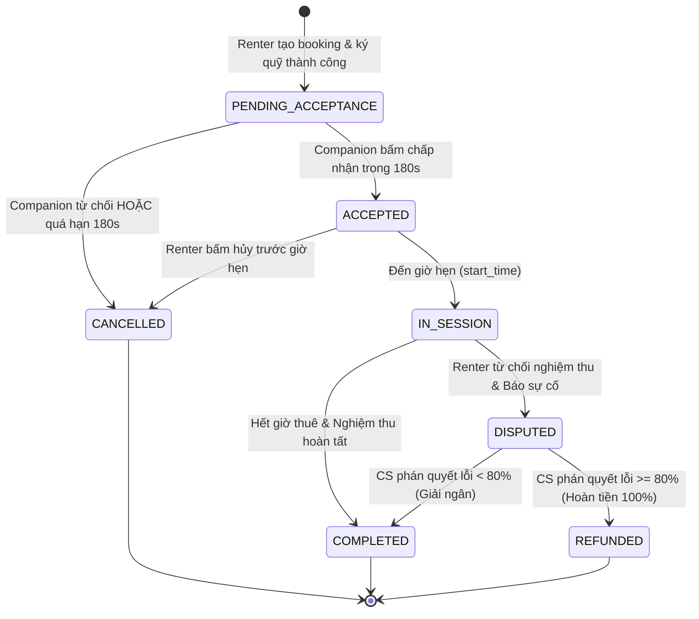

- **Các trạng thái**:
  - `PENDING_ACCEPTANCE`: Đã ký quỹ, đang đếm ngược 180s chờ Companion phản hồi.
  - `ACCEPTED`: Companion đã nhận đơn; chờ đến giờ hẹn phiên chơi.
  - `IN_SESSION`: Phiên chơi đang diễn ra (phòng chat mở).
  - `COMPLETED`: Đơn hoàn tất trọn vẹn, tiền đã giải ngân 88/12.
  - `CANCELLED`: Đơn bị hủy (bởi Companion từ chối, timeout 180s, hoặc Renter hủy trước giờ).
  - `DISPUTED`: Đơn đang trong tiến trình khiếu nại, Escrow bị đóng băng.
  - `REFUNDED`: Đơn hoàn tất việc hoàn trả tiền cho Renter sau phán quyết khiếu nại.
- **Bảng chuyển trạng thái chi tiết**:

| Từ trạng thái | Đến trạng thái | Trigger (Tác nhân / Sự kiện) | Điều kiện tiên quyết | Tác động tài chính (Ledger / Escrow) | Lịch sử & Audit | Chuyển trạng thái bị CẤM |
|:---|:---|:---|:---|:---|:---|:---|
| `[*] (None)` | `PENDING_ACCEPTANCE` | Renter bấm gửi Booking | Slot hợp lệ, Renter đủ số dư, tổng giờ Companion $\le 10$h. | Escrow: `HELD`. Debit ví khả dụng Renter, Credit ví ký quỹ Renter. | Ghi `BOOKING_STATUS_HISTORY` (from: NULL, to: PENDING). | Chuyển thẳng sang ACCEPTED khi chưa ký quỹ. |
| `PENDING_ACCEPTANCE` | `ACCEPTED` | Companion bấm "Chấp nhận" | Thời gian phản hồi $\le 180$s kể từ lúc tạo đơn. | Escrow giữ nguyên `HELD`. | Ghi status history; tạo bản ghi `Session` và phòng chat. | Chuyển sang ACCEPTED khi đã quá 180s. |
| `PENDING_ACCEPTANCE` | `CANCELLED` | Companion bấm "Từ chối" HOẶC Hết 180s | Quá hạn 180s hoặc hành động từ chối chủ động. | Escrow: `REFUNDED`. Hoàn 100% tiền ký quỹ về ví khả dụng Renter. | Ghi status history; nếu quá hạn: trừ 3 điểm TrustScore vào `TRUST_SCORE_LOG`. | Hủy nhưng không hoàn tiền ký quỹ. |
| `ACCEPTED` | `IN_SESSION` | Hệ thống kích hoạt đến giờ hẹn | `now() >= booking.start_time` và chưa bị hủy. | Không biến động số dư. | Ghi status history; kích hoạt trạng thái Session `ACTIVE`. | Chuyển sang IN_SESSION trước `start_time`. |
| `ACCEPTED` | `CANCELLED` | Renter bấm "Hủy đơn" | `now() < booking.start_time`. | **$\ge 30$m**: Hoàn 100% về ví Renter.<br>**10–29m**: Hoàn 70% ví Renter, chuyển 30% ví Companion.<br>**$< 10$m**: Phạt 100% (88% Companion, 12% Sàn). | Ghi status history, lý do hủy và biên bản hạch toán phạt. | Hủy sau khi `now() >= start_time`. |
| `IN_SESSION` | `COMPLETED` | Renter nghiệm thu "Hoàn tất" HOẶC Timeout 15m | Phiên đã kết thúc (`now() >= end_time`) và không có báo sự cố. | Escrow: `RELEASED`. Giải ngân 88% cho Companion, 12% cho Sàn (`PLATFORM_REVENUE`). | Ghi status history, tính lại TrustScore sau phiên. | Chuyển sang COMPLETED khi đang có khiếu nại mở. |
| `IN_SESSION` | `DISPUTED` | Renter bấm "Báo sự cố" | Đang trong cửa sổ nghiệm thu 15m, có lý do & bằng chứng. | Escrow: `FROZEN`. Đóng băng toàn bộ tiền ký quỹ. | Ghi status history, tạo `DisputeCase`. | Báo sự cố sau khi đã bấm "Hoàn tất". |
| `DISPUTED` | `REFUNDED` | CS ra phán quyết lỗi $\ge 80\%$ | CS Agent submit kết luận có lý do. | Escrow: `REFUNDED`. Hoàn 100% tiền ký quỹ cho Renter; phạt thêm 20% ví Companion. | Ghi status history, ghi `DisputeDecision`, trừ điểm uy tín. | Phán quyết bởi user không có quyền CS/Admin. |
| `DISPUTED` | `COMPLETED` | CS ra phán quyết lỗi $< 80\%$ | CS Agent submit kết luận có lý do. | Escrow: `RELEASED`. Giải ngân 88% cho Companion, 12% cho Sàn. | Ghi status history, ghi `DisputeDecision`, đóng case. | Giải phóng tiền nhưng không ghi nhận doanh thu sàn. |

---

### 3.2. Máy trạng thái Giữ chỗ Khung giờ (`Slot Hold State Machine`)

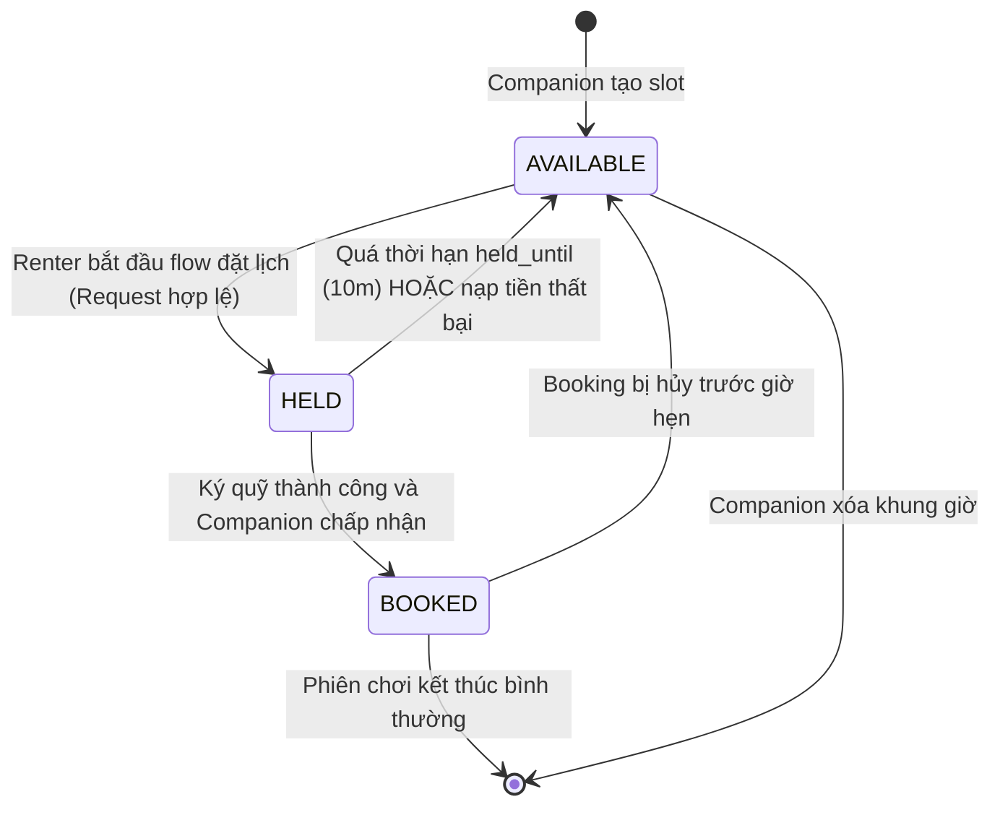

- **Bảng chuyển trạng thái**:
  - `AVAILABLE` $\rightarrow$ `HELD`: Trigger bởi `POST /api/bookings`. Điều kiện: Slot đang `AVAILABLE`. Side effect: Gán `held_until = now() + 10m`. Chặn người khác đặt.
  - `HELD` $\rightarrow$ `AVAILABLE`: Trigger bởi Timer quét hết hạn slot (`now() > held_until`) hoặc Renter từ chối nạp tiền. Slot mở lại cho người khác.
  - `HELD` $\rightarrow$ `BOOKED`: Trigger khi Companion chấp nhận đơn. Slot chính thức khóa chặt cho phiên chơi.
  - `BOOKED` $\rightarrow$ `AVAILABLE`: Trigger khi đơn bị hủy hợp lệ trước giờ hẹn. Khung giờ được mở lại để người khác có thể thuê.

---

### 3.3. Máy trạng thái Cổng thanh toán (`Payment State Machine`)

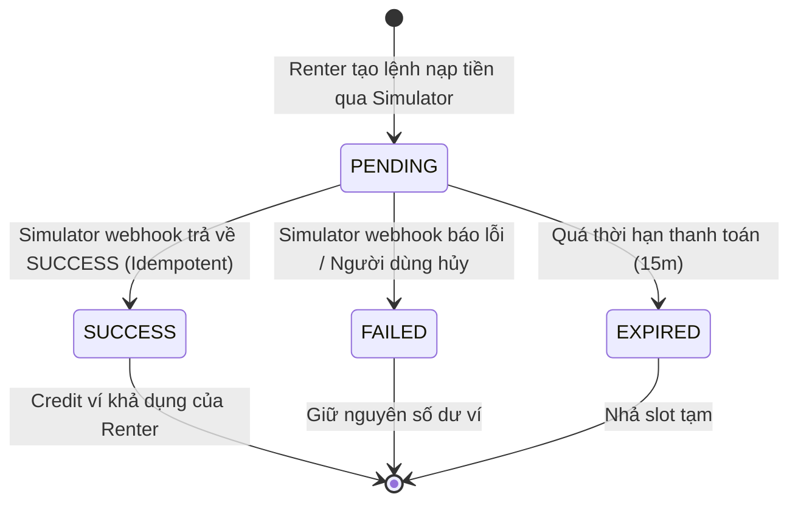

- **Quy tắc an toàn**: Khi nhận webhook `SUCCESS`, hệ thống kiểm tra `payment.status == PENDING`. Nếu webhook bị gửi lại lần 2 (cùng `gateway_ref`), hệ thống trả về HTTP 200 ngay mà không cộng tiền lần thứ hai (Idempotent Webhook).

---

### 3.4. Máy trạng thái Ký quỹ (`Escrow State Machine`)

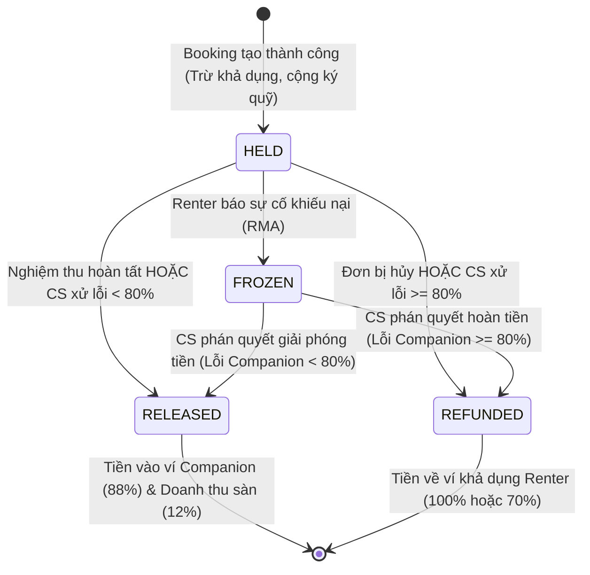

- **Quy tắc cấm kỵ**: Tuyệt đối **CẤM** chuyển trạng thái từ `FROZEN` trực tiếp sang giải ngân tự động mà không có chữ ký của `CS_AGENT` kèm lý do phán quyết.

---

### 3.5. Máy trạng thái Khiếu nại & Tranh chấp (`Dispute State Machine`)

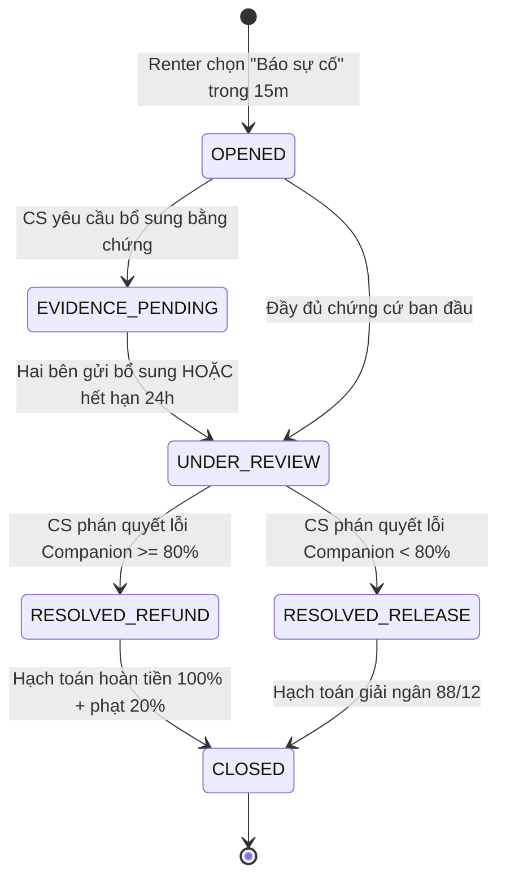

- **Audit bắt buộc**: Mỗi khiếu nại đóng lại phải lưu: `cs_agent_id`, `companion_fault_percent`, `decision_reason`, `resolved_at`, `ledger_txn_id`.

---

### 3.6. Máy trạng thái Phiên chơi & Giao tiếp (`Session State Machine`)

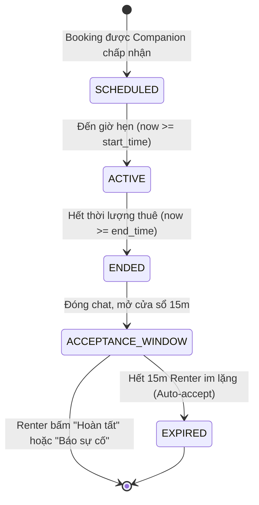

- **Nguyên tắc đóng tự động**: Phiên chơi kết thúc khi đồng hồ đếm ngược hết giờ thuê, độc lập với việc 2 người dùng có còn online hay không. Không cho phép phiên bị treo vô tận.

---

### 3.7. Máy trạng thái Yêu cầu Rút tiền (`Withdrawal State Machine`)

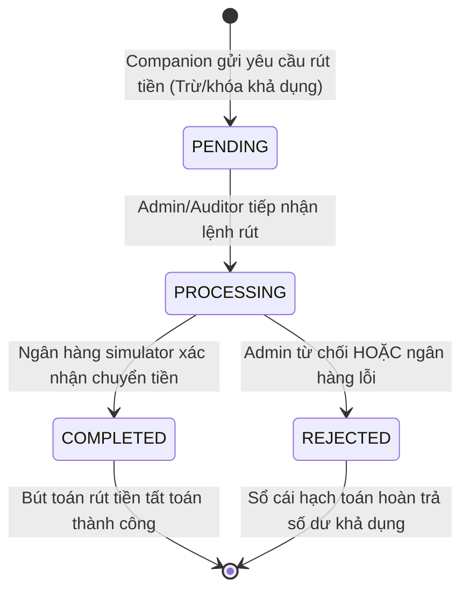

- **Bảo toàn số dư**: Khi Companion bấm yêu cầu rút $X$ VND, hệ thống lập tức khóa $X$ VND để không thể đặt đơn hoặc rút lần thứ 2. Nếu `REJECTED`, sinh bút toán `LEDGER_ENTRY` hoàn trả lại $X$ VND vào `available_balance`.

---

### 3.8. Máy trạng thái Đánh giá (`Review State Machine`)

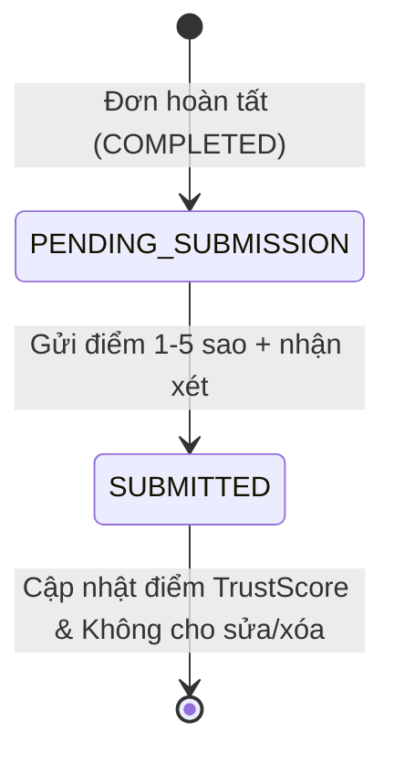

- **Tính bất biến**: Review sau khi gửi có trạng thái `SUBMITTED` vĩnh viễn, không hỗ trợ chuyển đổi trạng thái hay chỉnh sửa nội dung.

---

## 4. Sơ đồ tương tác tuần tự cho các kịch bản cốt lõi (Mermaid Sequences)

### 4.1. Kịch bản 1: Đặt lịch, Ký quỹ và Chấp nhận thành công (Happy Path)

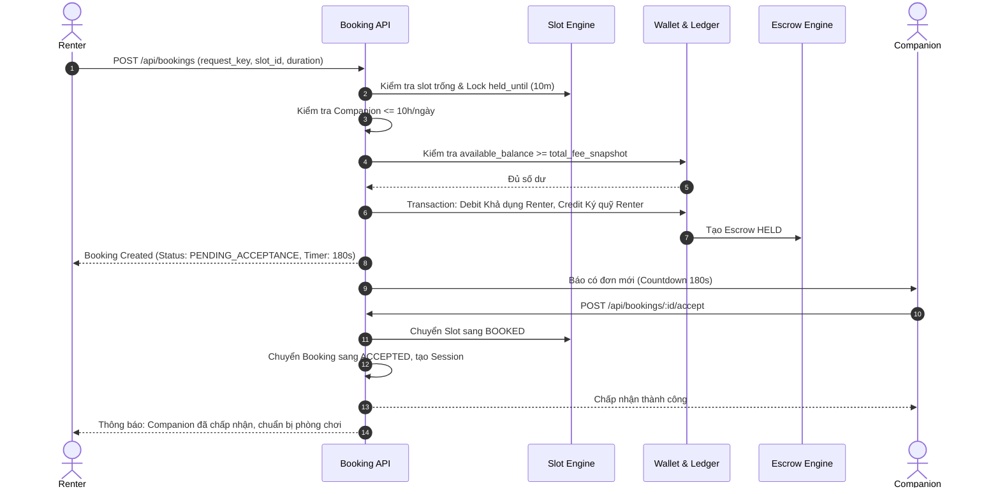

---

### 4.2. Kịch bản 2: Gửi yêu cầu lặp lại (Duplicate Booking Request / Idempotency)

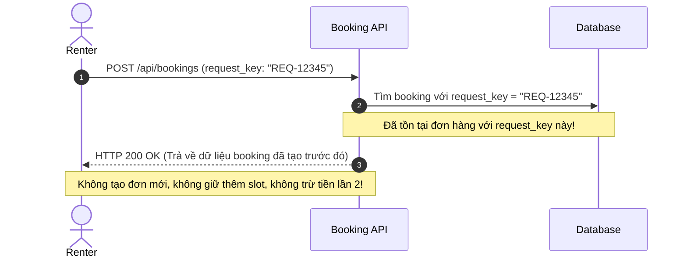

---

### 4.3. Kịch bản 3: Hết hạn giữ chỗ slot (Slot Hold Expiry / Concurrency Race)

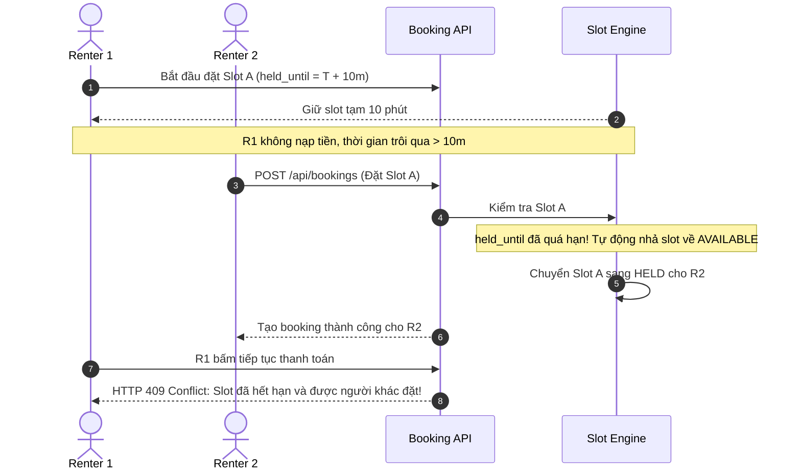

---

### 4.4. Kịch bản 4: Companion quá hạn 180 giây không phản hồi (Timeout Auto-Refund)

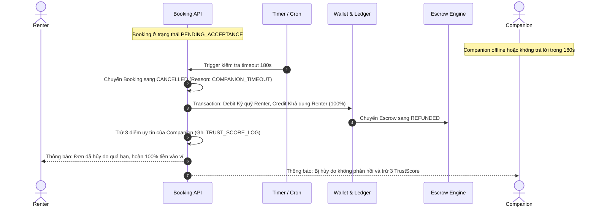

---

### 4.5. Kịch bản 5: Renter hủy đơn trước giờ hẹn theo các ngưỡng thời gian

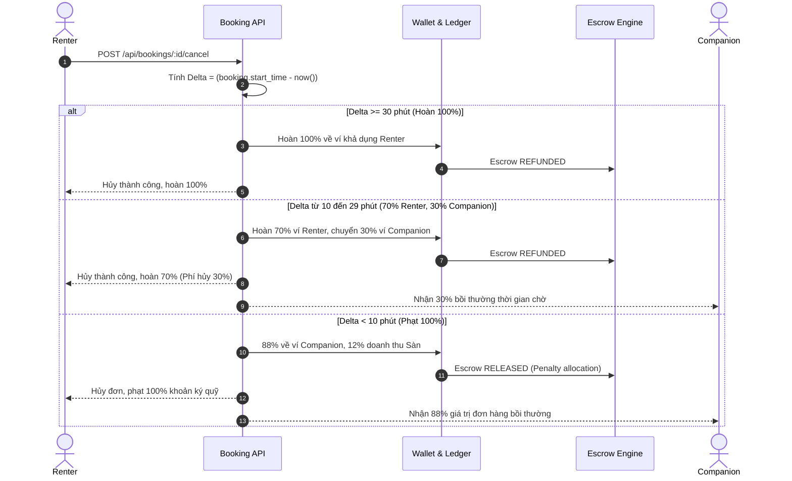

---

### 4.6. Kịch bản 6: Thực hiện phiên, Nghiệm thu và Giải ngân 88/12

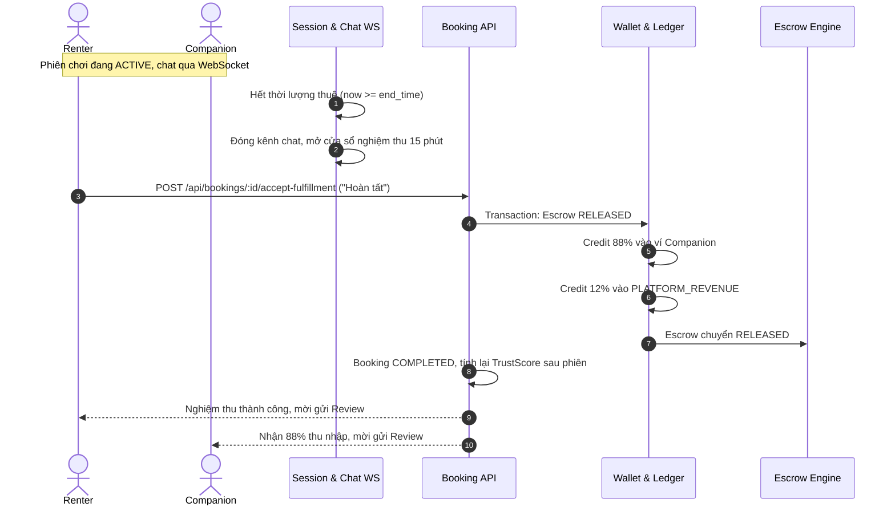

---

### 4.7. Kịch bản 7: Khiếu nại (RMA), Đóng băng Escrow & CS Phán quyết

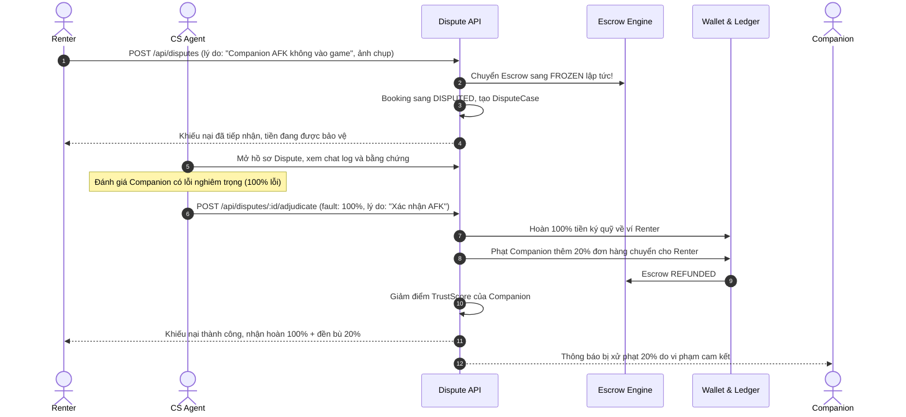

---

### 4.8. Kịch bản 8: Lỗi ghi sổ Sổ cái & Rollback an toàn (Ledger Failure Recovery)

```mermaid
sequenceDiagram
    autonumber
    actor User as Client
    participant API as Financial Service
    participant DB as Prisma Transaction
    participant ALT as Audit Alert

    User->>API: Kích hoạt giao dịch tài chính
    API->>DB: prisma.$transaction(async (tx) => { ... })
    DB->>DB: Bước 1: Trừ tiền ví A (OK)
    DB->>DB: Bước 2: Tạo dòng Ledger Entry (Gặp lỗi Constraint / DB Timeout!)
    Note over DB: Exception ném ra! Transaction tự động ROLLBACK!
    DB-->>API: Transaction Failed
    API->>ALT: Ghi nhận sự cố vào LEDGER_AUDIT_ALERT
    API-->>User: HTTP 500: Giao dịch không thành công, số dư giữ nguyên!
    Note over User,API: Số dư ví không bị trừ, Escrow giữ nguyên, không sai lệch tiền!
```

---

### 4.9. Kịch bản 9: Companion Rút tiền bị Từ chối (Withdrawal Rejected)

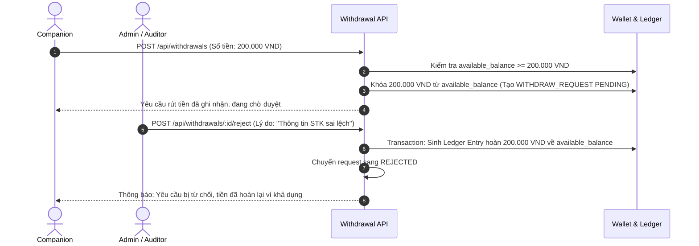
