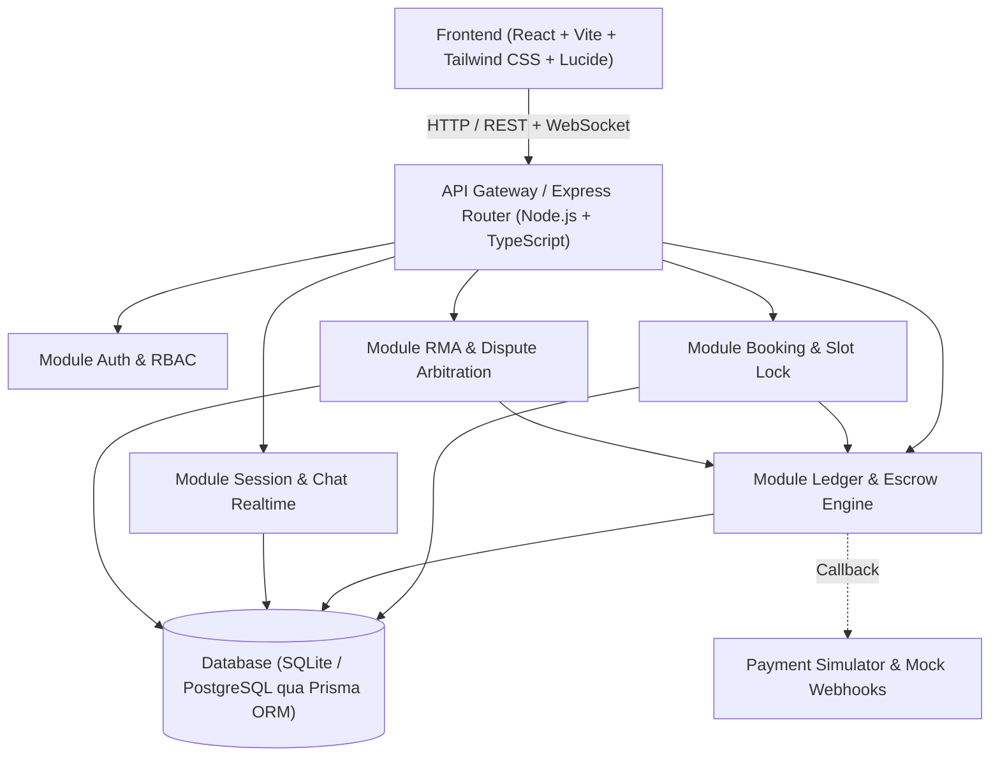

# INSTASQUAD — Scope Baseline & Phân loại phạm vi MVP

Tài liệu này xác lập đường cơ sở phạm vi (Scope Baseline) cho đồ án sinh viên **INSTASQUAD — E-Commerce Game Companion Platform**, dựa trên 4 nguồn tài liệu chính thức:
1. `docs/source/INSTASQUAD_WBS_Detailed.xlsx` (195 WBS items, 70 Acceptance Tests, 18 PO Decisions, 28 Business Rules).
2. `docs/source/BT3_INSTASQUAD.pdf` (Sơ đồ ERD chi tiết & Class Diagram cho 2 luồng cốt lõi).
3. `docs/source/INSTASQUAD_BPMN_TKHT.pdf` (Quy trình nghiệp vụ chi tiết: Checkout Flow, Fulfillment, RMA).
4. `docs/source/INSTASQUAS_REQUIREMENTS.pdf` (Yêu cầu chức năng, phi chức năng và 5 Use Cases).

---

## 1. Quyết định công nghệ tối ưu nhất (Optimal Technology Decision)

Dựa trên tiêu chí: **Không phát sinh chi phí**, **không phụ thuộc cloud/dịch vụ ngoài**, **chạy local mượt mà trên môi trường sinh viên (Windows / Node v24 / npm 11)**, **dễ giải thích kiến trúc và demo trực quan khi bảo vệ**, kiến trúc tối ưu được lựa chọn là:

### 1.1. Kiến trúc tổng thể: Modular Monolith

### 1.2. Tech Stack chi tiết và lý do lựa chọn

| Thành phần | Lựa chọn tối ưu | Lý do kỹ thuật & Đánh giá phương án | Trade-off & Giải pháp dự phòng |
|:---|:---|:---|:---|
| **Frontend** | **React 18 + Vite + Tailwind CSS + Lucide React** | - Khởi động cực nhanh, bundle gọn nhẹ, hot reload tức thì. - Xây dựng UI linh hoạt cho 3 phân hệ: Renter, Companion, Admin/CS. - Sử dụng Tailwind CSS giúp tinh chỉnh giao diện nhanh chóng mà không cần tải thư viện UI cồng kềnh. | Cần cấu hình TypeScript chặt chẽ để khớp chính xác DTO từ backend. |
| **Backend** | **Node.js + Express (TypeScript)** | - Stack đồng nhất TypeScript end-to-end. - Phù hợp hoàn hảo với Node v24 hiện có trên máy. - Cấu trúc Modular Monolith: code phân lớp rõ ràng (`controllers`, `services`, `repositories`, `domain/models`), dễ dàng kiểm thử đơn vị và tích hợp. | So với NestJS: Express nhẹ hơn, ít boilerplate hơn, dễ giải thích trong buổi bảo vệ hơn. |
| **Database & ORM** | **Prisma ORM + SQLite (Mặc định local)** *(Tùy chọn PostgreSQL khi có Docker)* | - **SQLite**: 100% zero-config, không cần cài server database bên ngoài, không lo lỗi kết nối, file DB nằm ngay trong project, chuyển giao máy khác là chạy ngay. - **Prisma ORM**: Đảm bảo Type-safety, quản lý migrations minh bạch, hỗ trợ `prisma.$transaction` để bảo vệ các thao tác tài chính. - Toàn bộ schema Prisma được thiết kế tương thích cả SQLite và PostgreSQL (chỉ cần đổi `provider`). | SQLite có giới hạn về concurrent write so với Postgres, nhưng ở phạm vi đồ án sinh viên và test suite tự động, SQLite hoàn toàn đáp ứng trọn vẹn và an toàn. |
| **Realtime Chat** | **WebSocket cục bộ (`ws` hoặc `Socket.io`)** | - Tích hợp trực tiếp vào Express server, không tốn phí, không cần bên thứ 3 (Pusher/Firebase). - Phục vụ chat text phòng phiên chơi theo đúng yêu cầu đề bài. | Không hỗ trợ voice call WebRTC thật (được thay bằng audio metadata/mock theo đúng chỉ thị). |
| **Testing** | **Vitest + Supertest** | - Chạy test song song siêu nhanh, tương thích TypeScript/Vite mà không cần setup Jest phức tạp. - Viết trọn vẹn 70 Test Cases từ TC01 đến TC70. | Không cần test E2E nặng như Cypress/Playwright cho CI, chỉ tập trung API & Core Logic. |
| **Payment & Payout** | **Payment Simulator nội bộ** | - Mô phỏng cổng VNPay/MoMo với đủ 3 trạng thái: `PENDING`, `SUCCESS`, `FAILED`. - Tự sinh mã giao dịch và gọi webhook callback với chữ ký bảo mật mô phỏng. - Rút tiền mô phỏng: `PENDING` → `PROCESSING` → `COMPLETED` / `REJECTED`. | Ghi rõ nhãn "MOCK SIMULATOR" trên toàn bộ giao diện và log. |

---

## 2. Tổng hợp 4 luồng nghiệp vụ gốc từ tài liệu

### 2.1. Luồng A — Đặt lịch & Ký quỹ (Checkout Flow - BPMN 1A, 1B, 1C & BT3 Luồng 1)
1. **Tìm kiếm & Chọn Slot**: Renter duyệt Companion theo Game, Rank, Giá, xem `SLOT_CALENDAR`.
2. **Kiểm tra hợp lệ**:
   - Chống đặt trùng: Request mang `request_key` duy nhất (Idempotency).
   - Kiểm tra slot trống: Khóa tạm thời slot (`held_until`).
   - Giới hạn sức khỏe Companion: Kiểm tra tổng số giờ đã nhận trong ngày + số giờ mới không vượt quá 10 giờ/ngày.
3. **Chốt phí & Số dư**:
   - Chốt tổng tiền vào `total_fee_snapshot` (không thay đổi dù Companion tăng giá sau đó).
   - Kiểm tra `available_balance >= total_fee_snapshot`.
   - Nếu thiếu tiền: Điều hướng sang cổng nạp Payment Simulator.
4. **Ký quỹ (Escrow Lock)**:
   - Thực hiện qua 1 giao dịch duy nhất: Trừ `available_balance` của Renter, cộng `escrow_balance`, tạo bản ghi `ESCROW` trạng thái `HELD`.
   - Ghi 2 bút toán đối ứng vào `LEDGER_ENTRY`.
5. **Companion phản hồi trong 180 giây**:
   - Đồng hồ đếm ngược 180s.
   - **Chấp nhận**: Chuyển booking sang `ACCEPTED`, tạo phòng Session/Chat, giữ nguyên Escrow `HELD`.
   - **Từ chối / Quá 180s**: Tự hủy booking (`CANCELLED`), hoàn 100% tiền ký quỹ về `available_balance` của Renter qua Ledger. Nếu quá hạn (Timeout): trừ 3 điểm `TrustScore` của Companion (ghi vào `TRUST_SCORE_LOG`).
6. **Renter hủy trước giờ hẹn**:
   - **Còn >= 30 phút**: Hoàn 100% tiền ký quỹ về ví Renter (`ESCROW = REFUNDED`).
   - **Còn 10 – 29 phút**: Hoàn 70% về ví Renter, chuyển 30% cho Companion bồi thường thời gian chờ (ghi 2 dòng Ledger).
   - **Còn < 10 phút**: Renter bị phạt 100% tiền ký quỹ.

### 2.2. Luồng B — Thực hiện phiên dịch vụ & Nghiệm thu (Fulfillment - BPMN 2A, 2B)
1. **Kích hoạt Session**: Đến giờ hẹn, kích hoạt trạng thái phiên chơi, mở kênh chat text nội bộ, khởi động timer thời lượng thuê.
2. **Kết thúc phiên**: Hết thời gian thuê, hệ thống tự động đóng phiên (không bị treo kể cả khi một bên offline).
3. **Cửa sổ nghiệm thu 15 phút**:
   - Đóng kênh chat, gửi yêu cầu Renter xác nhận nghiệm thu trong vòng 15 phút.
   - **Renter bấm "Hoàn tất"**: Kích hoạt giải ngân.
   - **Renter không phản hồi sau 15 phút**: Kích hoạt chính sách tự động nghiệm thu (Demo Policy / PO Rule) để tránh treo tiền vô thời hạn.
4. **Giải ngân 88/12**:
   - `ESCROW` chuyển sang `RELEASED`.
   - 88% tổng phí giải ngân vào `available_balance` của Companion.
   - 12% tổng phí ghi nhận vào doanh thu nền tảng (`PLATFORM_REVENUE`).
   - Ghi các bút toán kép vào `LEDGER_ENTRY`.
5. **Đánh giá hai chiều & Tính lại TrustScore**:
   - Renter đánh giá Companion (1–5 sao + nhận xét) và ngược lại (mỗi bên chỉ đánh giá tối đa 1 lần/booking).
   - Hệ thống tính lại điểm uy tín `TrustScore` theo công thức:
     $$\text{TrustScore} = 0.40 \times \text{Rating}_{100} + 0.40 \times \text{CompletionRate}_{\%} - 1.20 \times \text{DisputeRate}_{\%} - \text{Penalties}$$
   - Giới hạn trong đoạn $[0, 100]$. Nếu điểm $< 40$, tài khoản Companion bị chuyển sang trạng thái "Tạm khóa".

### 2.3. Luồng C — Khiếu nại & Tranh chấp (RMA - BPMN 2C)
1. **Kích hoạt tranh chấp**: Trong cửa sổ 15 phút nghiệm thu, Renter chọn "Báo sự cố", nhập lý do và bằng chứng.
2. **Đóng băng tức thì**: Hệ thống lập tức chuyển `ESCROW` sang trạng thái `FROZEN`, không ai được rút hay giải ngân. Booking chuyển sang `DISPUTED`.
3. **Tiếp nhận & Kiểm tra bằng chứng**: CS Agent tiếp nhận hồ sơ trong hàng đợi (mục tiêu SLA trung bình < 45 phút). Cho phép yêu cầu bổ sung bằng chứng trong một thời hạn quy định.
4. **CS Phán quyết theo tỷ lệ lỗi của Companion**:
   - **Lỗi Companion >= 80%**: Hoàn 100% tiền ký quỹ về ví Renter (`REFUNDED`), đồng thời phạt Companion thêm 20% giá trị đơn hàng (ghi nhận trừ tiền/công nợ và giảm điểm uy tín).
   - **Lỗi Companion < 80%**: Giải ngân cho Companion theo tỷ lệ chuẩn 88/12 (`RELEASED`).
5. **Đóng khiếu nại**: Cập nhật trạng thái `DISPUTE_CLOSED`, ghi audit log phán quyết, tính lại `TrustScore`.

### 2.4. Luồng D — Quản trị tài chính & Sổ cái (Ledger Core & BT3 Luồng 2)
1. **Nguyên tắc Sổ cái bất biến (Immutable Ledger)**: Số dư ví không bao giờ được phép UPDATE trực tiếp. Mọi biến động đều phát sinh qua `LEDGER_TRANSACTION` và cặp `LEDGER_ENTRY` ghi kép (Double-Entry Debit/Credit), lưu kèm `balance_after`.
2. **Cổng nạp tiền (Top-up)**: Giao dịch thanh toán qua simulator có trạng thái `PENDING` → `SUCCESS` / `FAILED`. Webhook có Idempotency Key chống cộng tiền trùng.
3. **Rút tiền (Withdrawal Lifecycle)**:
   - Companion tạo yêu cầu rút tiền `WITHDRAW_REQUEST`.
   - Trừ/khóa số dư khả dụng ngay khi tạo yêu cầu.
   - Trạng thái luân chuyển: `PENDING` → `PROCESSING` → `COMPLETED` / `REJECTED`.
   - Nếu `REJECTED`: Hoàn trả số dư khả dụng về ví và ghi sổ cái phục hồi.
4. **Cơ chế xử lý lỗi ghi sổ (Ledger Rollback & Circuit Breaker)**: Khi có lỗi phát sinh giữa chừng trong giao dịch tài chính, toàn bộ thao tác trong transaction bị ROLLBACK, tiền giữ nguyên trạng thái an toàn, phát tín hiệu cảnh báo cho kiểm toán viên (Auditor).

---

## 3. Bảng phân loại phạm vi MVP (Scope Classification Matrix)

| Nhóm phạm vi | Tiêu chí định nghĩa | Các hạng mục tính năng cụ thể |
|:---|:---|:---|
| **REQUIRED** *(Bắt buộc phải làm, kiểm thử kỹ)* | Các luồng tối thiểu để demo end-to-end hoàn chỉnh từ đặt lịch, thanh toán, thực hiện đến hoàn thành/tranh chấp, và các nguyên tắc bảo vệ tài chính cốt lõi. | 1. Quản lý danh mục game, rank tier, hồ sơ Companion, cấu hình slot lịch rảnh. 2. Chống đặt trùng slot (`request_key` idempotency, slot `held_until`). 3. Kiểm tra trần 10 giờ/ngày của Companion. 4. Snapshot tổng phí booking (`total_fee_snapshot`). 5. Cơ chế Escrow (HELD, FROZEN, RELEASED, REFUNDED). 6. Hệ thống Sổ cái ghi kép (`LEDGER_TRANSACTION`, `LEDGER_ENTRY`) kiểm soát `available_balance` & `escrow_balance`. 7. Đếm ngược 180s cho Companion phản hồi (Accept / Reject / Timeout auto-refund + phạt -3 TrustScore). 8. Phân nhánh hủy booking trước giờ hẹn (100% / 70-30% / 100% penalty). 9. Quản lý phiên chơi Session, đồng hồ đếm ngược, phòng chat text trao đổi. 10. Cửa sổ nghiệm thu 15 phút, giải ngân 88/12. 11. Khiếu nại RMA, đóng băng Escrow `FROZEN`, CS phán quyết với 2 nhánh lỗi (>=80% và <80%). 12. Đánh giá 2 chiều (1–5 sao), công thức TrustScore chuẩn, khóa tài khoản nếu điểm < 40. 13. Vòng đời yêu cầu rút tiền (WITHDRAW_REQUEST: PENDING/PROCESSING/COMPLETED/REJECTED). 14. Lịch sử trạng thái booking `BOOKING_STATUS_HISTORY` và audit trail. |
| **MOCKED** *(Thay bằng mô phỏng cục bộ)* | Các dịch vụ bên ngoài, dịch vụ trả phí hoặc hạ tầng phức tạp được thay bằng simulator nội bộ có độ trung thực cao. | 1. **Payment Gateway Simulator**: Mô phỏng VNPay / MoMo với UI chọn kết quả test (SUCCESS / FAILED / TIMEOUT) và webhook callback có chữ ký mô phỏng. 2. **Bank Payout Simulator**: Mô phỏng giải ngân ngân hàng khi rút tiền (không gọi API VietQR/NAPAS thật). 3. **Chat Room & Evidence Mock**: Chat text thời gian thực qua WebSocket nội bộ; file bằng chứng hỗ trợ upload file ảnh demo kích thước nhỏ hoặc metadata mẫu. 4. **Scheduler Mock**: Trình kích hoạt thời gian linh hoạt (có nút Fast-Forward thời gian / Trigger Cron để demo nhanh các mốc 180s, 30m, 10m, 15m mà không cần chờ đồng hồ thực). 5. **eKYC & Email Notification**: Mock xác thực CCCD/Gương mặt và mock gửi email thông báo qua console/in-app alert. |
| **DEFERRED** *(Hoãn lại, ngoài phạm vi MVP đồ án)* | Các tính năng phức tạp, tốn kém hoặc không đóng góp vào việc chứng minh mục tiêu học thuật của đồ án. | 1. Tích hợp gọi thoại/video WebRTC trực tiếp (chi phí băng thông, STUN/TURN server). 2. Kiến trúc microservices, Kubernetes, Kafka/RabbitMQ. 3. Redis cluster, hệ thống caching phân tán. 4. Dịch vụ giám sát observability trả phí (Datadog, New Relic). 5. Kho bãi, giỏ hàng nhiều món, giao vận hàng vật lý (Đã xác định ngoài phạm vi đồ án theo BR-27). 6. Cổng thanh toán tiền thật có KYC ngân hàng doanh nghiệp. |
| **DEMO_POLICY** *(Chính sách giả định thống nhất để demo)* | Các khoảng trống nghiệp vụ mà tài liệu nguồn chưa chốt con số cụ thể, cần chính sách rõ ràng, an toàn để code và test. | 1. **TTL Giữ slot tạm**: Quy định cố định **10 phút** (`held_until = now() + 10m`). 2. **Tự động nghiệm thu sau 15 phút im lặng**: Nếu Renter không phản hồi sau 15 phút, tự động coi là nghiệm thu thành công và ghi log lý do `SYSTEM_TIMEOUT`. 3. **Nguồn trừ phạt 20% khi Companion lỗi >=80%**: Trừ vào `available_balance` của Companion. Nếu không đủ số dư, ghi nhận trạng thái nợ phạt (`PENALTY_DEBT`), không làm âm số dư ví vật lý. 4. **Phân bổ phạt khi Renter hủy < 10 phút**: 88% tiền phạt chuyển cho Companion để đền bù tổn thất thời gian, 12% ghi nhận doanh thu nền tảng (áp dụng thống nhất tỷ lệ 88/12). 5. **Không cho phép sửa/xóa Review**: Đánh giá sau khi gửi là bất biến nhằm bảo vệ tính toàn vẹn của TrustScore. 6. **Bộ lọc chat**: Áp dụng regex chặn số điện thoại Việt Nam, link URL (`http/https`), số tài khoản ngân hàng (dãy số 9-16 chữ số). |

---

## 4. Các nhánh lỗi bắt buộc phải có trong code và kiểm thử (Non-Negotiable Failure Paths)

Hệ thống cam kết **không bỏ qua bất kỳ nhánh lỗi nào** sau đây:
1. **Request đặt lịch lặp lại (Duplicate Booking Request)**: Gửi cùng `request_key` chỉ trả về booking đã tạo, không tạo mới, không trừ tiền hai lần.
2. **Xung đột giữ chỗ Slot (Slot Race Condition)**: Hai Renter cùng đặt một khung giờ của Companion $\rightarrow$ người đến sau nhận lỗi `SLOT_ALREADY_HELD` hoặc `SLOT_BOOKED`.
3. **Thanh toán nạp tiền lặp (Duplicate Payment Webhook)**: Simulator gửi webhook callback 2 lần cho cùng một mã giao dịch $\rightarrow$ chỉ cộng tiền ví đúng 1 lần (Idempotent).
4. **Số dư không đủ và Hủy do không nạp tiền**: Renter không đủ tiền và từ chối nạp $\rightarrow$ slot được nhả, không phát sinh giao dịch ví.
5. **Thất bại trong giao dịch ghi sổ (Ledger Transaction Failure)**: Bất kỳ lỗi nào xảy ra trong quá trình ghi sổ $\rightarrow$ toàn bộ transaction bị rollback, trạng thái ví không bị sai lệch nửa vời.
6. **Companion quá hạn 180s không trả lời**: Hết thời gian $\rightarrow$ tự động hủy booking, tự động hoàn tiền 100% về ví Renter, Companion bị trừ 3 điểm TrustScore.
7. **Biên thời gian khi Renter hủy đơn**: Kiểm thử chặt chẽ 3 mốc:
   - Trước giờ hẹn $\ge 30$ phút $\rightarrow$ Hoàn 100%.
   - Trước giờ hẹn $10 - 29$ phút $\rightarrow$ Hoàn 70%, đền bù Companion 30%.
   - Trước giờ hẹn $< 10$ phút $\rightarrow$ Phạt 100%.
8. **Đóng băng Escrow ngay khi mở khiếu nại**: Ngay khi Renter bấm khiếu nại, tiền ký quỹ lập tức chuyển sang `FROZEN`, vô hiệu hóa mọi lệnh giải ngân tự động.
9. **Đánh giá trùng lặp (Duplicate Review Prevention)**: Một người dùng không thể gửi đánh giá lần thứ hai cho cùng một booking.
10. **Rút tiền vượt số dư hoặc bị Admin từ chối**: Companion yêu cầu rút số tiền lớn hơn số dư khả dụng $\rightarrow$ từ chối ngay. Yêu cầu rút hợp lệ bị Admin từ chối (`REJECTED`) $\rightarrow$ hoàn trả số dư khả dụng về ví nguyên vẹn.

---

## 5. Bộ dữ liệu hạt giống tối thiểu để bảo vệ đồ án (Minimal Seed Data Baseline)

Để đảm bảo buổi demo chạy mượt mà, thuyết phục và đầy đủ chứng cứ truy vết, cơ sở dữ liệu sẽ được cấu hình sẵn bộ Seed Data chuẩn:

- **Users (Tài khoản mẫu đủ vai trò)**:
  - `renter1@instasquad.test` (Renter có sẵn số dư 500.000 VND).
  - `renter2@instasquad.test` (Renter ví 0 VND để demo luồng nạp tiền thiếu số dư).
  - `companion1@instasquad.test` (Companion uy tín cao, TrustScore 95).
  - `companion2@instasquad.test` (Companion mới, TrustScore 80).
  - `cs_agent@instasquad.test` (Nhân viên CS có quyền xem bằng chứng và phán quyết RMA).
  - `auditor@instasquad.test` (Kiểm toán viên tài chính có quyền tra cứu Sổ cái Ledger và xử lý ngoại lệ).
  - `admin@instasquad.test` (Quản trị viên hệ thống).
- **Game Catalog**:
  - `LMHT` (Liên Minh Huyền Thoại) — Thể loại MOBA.
  - `VALORANT` — Thể loại FPS.
  - `TFT` (Đấu Trường Chân Lý) — Thể loại Auto-battler.
- **Skill Rank Tiers**: Bảng phân hạng chi tiết cho từng game (Vàng, Bạch Kim, Kim Cương, Thách Đấu) kèm trọng số rank.
- **Companion Profiles & Slot Calendar**:
  - Hồ sơ năng lực, giá theo giờ (ví dụ: 100.000 VND/giờ, 150.000 VND/giờ).
  - Khung giờ rảnh hôm nay và ngày mai để thực hiện demo đặt lịch tức thì.
- **Ví tiền & Bút toán khởi tạo**: Các ví tiền được gán số dư thông qua bút toán nạp tiền hệ thống ban đầu, đảm bảo tính toàn vẹn của sổ cái ngay từ thời điểm khởi tạo.
