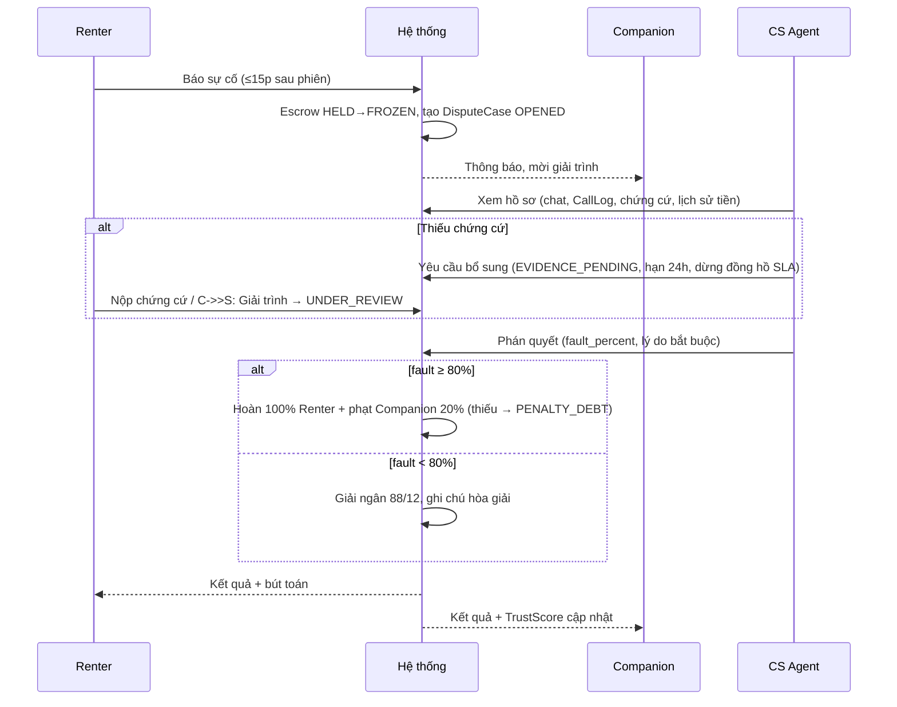

# INSTASQUAD — Hợp đồng Dịch vụ, Điều khoản Sử dụng & Cơ chế Giải quyết Tranh chấp

> Phiên bản điều khoản: **`TOS-2026.11`** (hiệu lực 2026-11-18). Mã phiên bản này được lưu trong bảng `terms_acceptances` mỗi khi người dùng chấp thuận.
> **Lưu ý học thuật:** đây là văn bản mẫu cho đồ án sinh viên, chưa được luật sư thẩm định. Các điều khoản dẫn chiếu pháp luật Việt Nam (Bộ luật Dân sự 2015, Luật Thương mại điện tử/Nghị định 52/2013/NĐ-CP và 85/2021/NĐ-CP, Nghị định 13/2023/NĐ-CP về bảo vệ dữ liệu cá nhân) mang tính định hướng. Nhãn: `DEMO_POLICY`.

## Phần A — Hợp đồng Dịch vụ Ba bên

### A.1 Các bên

| Bên | Vai trò | Nghĩa vụ chính |
|---|---|---|
| **Nền tảng INSTASQUAD** ("Sàn") | Trung gian thương mại điện tử, giữ tiền ký quỹ, ghi sổ, giải quyết tranh chấp | Vận hành Escrow minh bạch; ghi sổ cái ghi kép; xử lý khiếu nại trong SLA 45 phút (không tính thời gian chờ chứng cứ); bảo mật dữ liệu. |
| **Renter** (Người thuê) | Đặt lịch và thanh toán dịch vụ đồng hành | Nạp đủ tiền ký quỹ trước khi đặt; tham gia phiên đúng giờ; nghiệm thu trong 15 phút; khiếu nại trung thực. |
| **Companion** (Người cung cấp dịch vụ) | Cung cấp dịch vụ chơi game / trò chuyện / giải trí trực tuyến | Phản hồi đơn trong 180 giây; có mặt đúng giờ; cung cấp dịch vụ đúng mô tả (rank, nội dung); không giao dịch ngoài sàn. |

### A.2 Đối tượng hợp đồng
Dịch vụ đồng hành **trực tuyến** theo khung giờ (slot) đã chọn, thuộc một trong hai nhóm:
- `GAME`: chơi cùng, leo rank, hướng dẫn kỹ năng.
- `SOCIAL` (D35): Tâm sự/trò chuyện, Xem phim cùng, Nghe nhạc cùng, Party game nhẹ.

**Loại trừ tuyệt đối:** gặp mặt ngoài đời qua sàn, dịch vụ hẹn hò/tình dục trá hình, bán tài khoản game, cày thuê vi phạm điều khoản nhà phát hành, mọi nội dung vi phạm pháp luật.

### A.3 Hình thành hợp đồng
Hợp đồng giữa Renter và Companion được xác lập khi **đồng thời**: (1) Escrow chuyển `HELD` thành công; (2) Companion bấm **Chấp nhận** trong 180 giây. Giá dịch vụ là `total_fee_snapshot` tại thời điểm đặt — thay đổi giá sau đó không ảnh hưởng đơn đã đặt.

### A.4 Cơ chế Ký quỹ (Escrow) và Phân chia 88/12

| Sự kiện | Dòng tiền | Ghi sổ |
|---|---|---|
| Đặt lịch | Renter `AVAILABLE` → Renter `ESCROW` | 1 giao dịch `ESCROW_HOLD`, 2 bút toán đối ứng |
| Hoàn tất / tự nghiệm thu sau 15p | Escrow → **88%** Companion + **12%** Sàn | `ESCROW_RELEASE`; phí sàn = `floor(tổng × 0,12)`, Companion = `tổng − phí sàn` (không mất/sinh tiền do làm tròn) |
| Companion từ chối / quá 180s | Escrow → 100% Renter | `ESCROW_REFUND` |
| Renter hủy ≥30p trước giờ | 100% Renter | `ESCROW_REFUND` |
| Renter hủy 10–<30p | 70% Renter, 30% Companion (không trừ hoa hồng) | `CANCEL_PENALTY` |
| Renter hủy <10p | Phạt 100%: 88% Companion, 12% Sàn (D21) | `CANCEL_PENALTY` |
| Khiếu nại | Escrow `FROZEN` cho đến khi CS phán quyết | — |

Ví dụ: đơn 200.000 đ hoàn tất → Companion 176.000 đ, Sàn 24.000 đ. Đơn 99.999 đ → Sàn `floor(11.999,88)` = 11.999 đ, Companion 88.000 đ.

### A.5 Thanh toán & Rút tiền
- Nạp tiền qua cổng mô phỏng (`MOCKED`); mỗi callback có mã idempotency, gửi lặp không cộng tiền hai lần.
- Companion rút tiền: tạo yêu cầu → tiền bị **giữ (reserve)** qua sổ cái → Admin duyệt `COMPLETED` hoặc từ chối `REJECTED` (hoàn reserve bằng bút toán). Không thu thập số tài khoản thật; chỉ lưu dạng che (`****1234`).

### A.6 Chấm dứt
Sàn có quyền tạm khóa/khóa vĩnh viễn tài khoản theo Phần C. Số dư khả dụng hợp lệ của người bị khóa vẫn được xử lý rút tiền sau khi hoàn tất điều tra (trừ trường hợp gian lận, chờ cơ quan có thẩm quyền).

---

## Phần B — Điều khoản Sử dụng (tóm tắt ràng buộc)

1. **Tuổi & danh tính:** người dùng ≥18 tuổi; Companion bắt buộc eKYC (CCCD + selfie, mã hóa AES-256-GCM lưu trữ).
2. **Không giao dịch ngoài sàn (Non-Circumvention):** cấm trao đổi SĐT, link mạng xã hội, số tài khoản để giao dịch riêng. Chat tự động che các mẫu này (BR-20) và ghi nội dung gốc phục vụ kiểm toán.
3. **Phòng chat chỉ mở sau ký quỹ** (D20); chỉ hai bên của đơn và CS được ủy quyền xem.
4. **Dữ liệu cá nhân:** thu thập tối thiểu; không ghi âm cuộc gọi mặc định (D31); người dùng có quyền yêu cầu truy cập/xóa dữ liệu theo NĐ 13/2023.
5. **Đánh giá:** mỗi bên đánh giá một lần/đơn, không sửa/xóa; cấm đánh giá đổi quà hoặc đe dọa.
6. **Chấp thuận phiên bản:** khi điều khoản đổi phiên bản, người dùng phải chấp thuận lại trước giao dịch tiếp theo. Hệ thống lưu `user_id`, `terms_version`, `accepted_at`, `ip_hash`, `channel` (WEB/MOBILE).

---

## Phần C — Bảng Hành vi Vi phạm & Chế tài

> Thực thi: CS Agent ghi nhận qua `POST /api/legal/violations`, hệ thống tự áp dụng trừ TrustScore (có `TrustScoreLog`) và khóa tài khoản theo cột "Khóa". **Chế tài tiền chỉ thực hiện qua phán quyết khiếu nại (Phần D)** để mọi dòng tiền đều đi qua Ledger có phán quyết và lý do — module vi phạm không trực tiếp trừ tiền.

| Mã | Hành vi | Đối tượng | Mức | TrustScore | Khóa tài khoản | Chế tài tiền (qua Dispute) |
|:-:|---|---|:-:|:-:|---|---|
| V01 | Chia sẻ liên lạc / lôi kéo giao dịch ngoài sàn | Cả hai | MEDIUM | −10 | Lần 2: 7 ngày · Lần 3: vĩnh viễn | — |
| V02 | Vắng mặt (no-show) không báo | Companion | HIGH | −15 | Lần 3 trong 30 ngày: 7 ngày | Hoàn 100% Renter + phạt 20% (lỗi ≥80%) |
| V03 | Không phản hồi đơn trong 180s | Companion | LOW | −3 (tự động) | — | Hoàn 100% Renter |
| V04 | Quấy rối, xúc phạm, nội dung khiêu dâm | Cả hai | CRITICAL | −20 | 30 ngày; tái phạm: vĩnh viễn | Hoàn 100% + phạt 20% nếu là Companion |
| V05 | Gian lận thanh toán / chargeback giả / đa tài khoản lạm dụng | Cả hai | CRITICAL | −30 | Vĩnh viễn (`BANNED`) | Đóng băng xử lý theo kiểm toán viên |
| V06 | Khai sai rank/kỹ năng | Companion | MEDIUM | −5 | — | Theo tỷ lệ lỗi CS xác định |
| V07 | Khiếu nại sai sự thật lặp lại | Renter | MEDIUM | — | Lần 3: 7 ngày | Giải ngân 88/12 cho Companion |
| V08 | Dịch vụ SOCIAL biến tướng (hẹn hò/tình dục trá hình, gặp ngoài đời) | Cả hai | CRITICAL | −30 | Vĩnh viễn | Hoàn 100% Renter nếu Companion vi phạm |

TrustScore < 40 → Companion tự động `SUSPENDED` và `OFFLINE`, không nhận đơn mới (đã có trong code).

---

## Phần D — Quy trình Giải quyết Tranh chấp (RMA/Dispute) của CS

| Bước | SLA | Ghi nhận |
|---|---|---|
| Tiếp nhận & đóng băng | Tức thì | `escrows.status=FROZEN`, `dispute_cases` |
| Phân công & xem hồ sơ | ≤ 10 phút | AuditLog |
| Yêu cầu bổ sung chứng cứ | Hạn 24 giờ; đồng hồ SLA tạm dừng | `evidence_deadline`, `paused_sla_ms` |
| Phán quyết | Mục tiêu trung bình < 45 phút | `dispute_decisions` (cs_agent_id, fault_percent, refund, penalty, reason) |
| Phúc khảo | Trong 48 giờ sau phán quyết, gửi email CS; Admin xem xét thủ công (`DEFERRED` trên hệ thống) | — |

Nguyên tắc: một booking chỉ có một dispute; tiền đứng yên trong suốt quá trình; posting thất bại → không đóng case, tạo `LedgerAuditAlert`.
