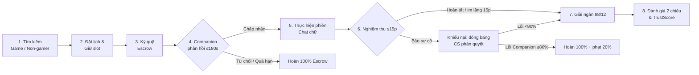

# INSTASQUAD — Quy trình Thống nhất (Unified Workflow) Web & Mobile

> Phiên bản 1.0 · 2026-11-18 · Áp dụng đồng nhất cho **Web (Desktop + CS/Admin Portal)** và **Mobile App (Flutter iOS/Android)**.
> Cả hai client gọi **cùng một Backend REST API** và **cùng một CSDL SQL Server**; client không bao giờ là nơi quyết định trạng thái hoặc số tiền.
> Nguồn: `docs/source/INSTASQUAD_BPMN_TKHT.pdf` (Hình 1A–1C, 2A–2C), `docs/FINANCIAL_RULES.md`, `docs/DEMO_POLICY.md`, `docs/DECISION_LOG.md` (D01–D37).

## 0. Tổng quan 8 bước

| # | Bước | Actor | API chính | Màn hình Web | Màn hình Mobile | Quy tắc bắt buộc |
|:-:|---|---|---|---|---|---|
| 1 | Tìm kiếm | Renter | `GET /api/games?category=GAME|SOCIAL`\|SOCIAL`, `GET /api/companions` | Catalog + bộ lọc | `DiscoverScreen` (tab Game / Trò chuyện) | Chỉ hiển thị Companion `ACTIVE`, TrustScore ≥ 40. |
| 2 | Đặt lịch & Giữ slot | Renter | `GET /api/companions/:id/slots`, `POST /api/bookings` (header `request_key`) | Modal chọn slot | `CompanionDetailScreen` → `BookingSheet` | BR-01 idempotency `request_key`; slot rời rạc, khóa bằng `UPDATE … WHERE status='AVAILABLE'` (chỉ 1 request thắng); giữ chỗ TTL 10 phút; trần 10h/ngày (UTC+7); chốt `total_fee_snapshot`. |
| 3 | Ký quỹ Escrow | Renter | `POST /api/bookings/:id/hold-escrow`; thiếu tiền → `POST /api/payments/simulate` | Ví / nạp tiền mô phỏng | `WalletScreen` | Ledger: DEBIT `AVAILABLE` Renter, CREDIT `ESCROW` Renter trong 1 transaction; Escrow `HELD` chỉ khi posting thành công. Payment Simulator SUCCESS/FAILED/PENDING (MOCKED). |
| 4 | Phản hồi 180s | Companion | `POST /api/bookings/:id/accept\|reject`; worker gọi timeout | Dashboard Companion (đồng hồ đếm ngược) | `BookingDetailScreen` (Companion) | Hết 180s → tự hủy, hoàn 100%, Companion −3 TrustScore. Accept/Reject/Timeout/Cancel tranh chấp → chỉ 1 kết quả commit. |
| 4b | Hủy trước giờ | Renter | `POST /api/bookings/:id/cancel` | Booking của tôi | `BookingDetailScreen` | ≥30p: hoàn 100%; 10–<30p: 70% Renter / 30% Companion; <10p: phạt 100% chia 88/12 (D21, DEMO_POLICY); đã bắt đầu → cấm hủy, chuyển khiếu nại. |
| 5 | Thực hiện phiên | Renter, Companion | `POST /api/sessions/:id/start\|end`, `GET/POST /api/sessions/:id/messages` | Phòng phiên | `SessionRoomScreen` | Chat chữ lưu DB, regex che SĐT/URL/STK (BR-20). Mỗi Booking 1 Session. |
| 6 | Nghiệm thu 15p / Khiếu nại | Renter | `POST /api/bookings/:id/accept-fulfillment` hoặc `/report-issue` | Phòng phiên / Booking | `SessionRoomScreen` → `ReportIssueSheet` | Báo sự cố → Escrow `FROZEN` ngay; Renter im lặng 15p → tự nghiệm thu (D24). Không thể vừa settlement vừa dispute. |
| 6b | Phán quyết CS | CS Agent | `GET /api/cs/disputes`, `POST /api/cs/disputes/:id/decision` | CS Portal (chỉ Web) | — | Bắt buộc lý do; lỗi ≥80% → hoàn 100% + phạt Companion 20% (D22); <80% → giải ngân 88/12 (D23). Hạn bổ sung chứng cứ 24h, SLA 45p (D25). |
| 7 | Giải ngân 88/12 | Hệ thống | settlement service (idempotency `SETTLE-BOOKING-{id}`) | Biến động số dư | `WalletScreen` → Lịch sử | Phí nền tảng = `floor(total × 12%)`; Companion = `total − phí` → tổng luôn bảo toàn. Lỗi → retry 1/5/15 phút (D26). |
| 8 | Đánh giá & TrustScore | Cả hai | `POST /api/reviews`, `GET /api/companion/trust-score` | Form đánh giá | `ReviewScreen` | 1 review/người/booking, bất biến. TrustScore = 0.40·Rating100 + 0.40·CompletionRate − 1.20·DisputeRate − DirectPenalties, kẹp [0,100]; <40 → `SUSPENDED`. |

## 1. Điều kiện tiên quyết (áp dụng cả Web và App)

1. **Chấp thuận Điều khoản:** trước lần đặt lịch đầu tiên (Renter) hoặc trước khi mở nhận đơn (Companion), người dùng phải chấp thuận phiên bản điều khoản hiện hành (`GET /api/legal/terms`, `POST /api/legal/accept`). Xem [`TERMS_AND_CONTRACTS.md`](TERMS_AND_CONTRACTS.md).
2. **Companion:** hồ sơ `ACTIVE`, eKYC `VERIFIED`, đã thiết lập giá và slot.
3. **Ví:** mỗi user có 1 ví; số dư chỉ thay đổi qua Ledger (ghi kép, `debit = credit`).

## 2. State machine rút gọn (dùng chung)

| Thực thể | Trạng thái | Chuyển hợp lệ |
|---|---|---|
| Slot | `AVAILABLE → HELD → BOOKED`; `HELD → AVAILABLE` (hết TTL/hủy) | |
| Booking | `PENDING_ACCEPTANCE → ACCEPTED → IN_SESSION → COMPLETED`; `PENDING_ACCEPTANCE → CANCELLED` (reject/timeout/hủy); `ACCEPTED → CANCELLED` (hủy trước giờ); `IN_SESSION → DISPUTED → COMPLETED\|REFUNDED` | |
| Escrow | `HELD → RELEASED \| REFUNDED`; `HELD → FROZEN → RELEASED \| REFUNDED` | |
| Payment | `PENDING → SUCCESS \| FAILED \| EXPIRED`; `EXPIRED → LATE` (D28) | |
| Dispute | `OPENED → EVIDENCE_PENDING ↔ UNDER_REVIEW → RESOLVED → CLOSED` | |
| Withdrawal | `PENDING → PROCESSING → COMPLETED \| REJECTED` (MOCKED) | |

Mọi chuyển trạng thái Booking ghi `booking_status_history` (actor, lý do, thời điểm).

## 3. Đồng nhất trải nghiệm Web ↔ App

| Khía cạnh | Quy ước chung |
|---|---|
| Nhãn trạng thái | Dùng cùng bảng nhãn tiếng Việt (`server/src/common/bookingStates.ts` ↔ `client/src/common/bookingStates.ts` ↔ `mobile/lib/core/booking_states.dart`). |
| Định dạng tiền | Số nguyên VND, dấu chấm phân cách nghìn, hậu tố `đ` (ví dụ `176.000 đ`). Client không tự tính 88/12; chỉ hiển thị số server trả về. |
| Đồng hồ | Đếm ngược 180s / 15p tính từ `response_deadline` / `confirm_deadline` server trả về, không dùng giờ máy client để quyết định. |
| Lỗi nghiệp vụ | Hiển thị `error.message` tiếng Việt từ server (`SLOT_NOT_AVAILABLE`, `INSUFFICIENT_BALANCE`, `COMPANION_RESPONSE_TIMEOUT`, …). |
| Phân vai | Web: Renter, Companion, CS Agent, Auditor, Admin. Mobile: Renter, Companion (CS/Admin chỉ trên Web Portal). |
| Deep Link | `instasquad://…` và `https://<domain>/app/…` mở đúng màn hình App; nếu chưa cài App → trang Landing/Redirect `/go/…` (xem `NON_GAMER_GROWTH_STRATEGY.md` §4). |

## 4. Nhãn REQUIRED / MOCKED / DEMO_POLICY / DEFERRED

| Hạng mục | Nhãn |
|---|---|
| Booking, slot lock, Escrow, Ledger ghi kép, 180s, hủy 30/10, nghiệm thu 15p, dispute freeze, 88/12, review, TrustScore | REQUIRED |
| Cổng thanh toán (Payment Simulator / SePay sandbox), payout rút tiền, email | MOCKED |
| Phạt <10p chia 88/12 (D21), phạt 20% từ ví khả dụng + `PENALTY_DEBT` (D22), lỗi <80% (D23), tự nghiệm thu (D24), 24h chứng cứ (D25), dịch vụ SOCIAL (D35) | DEMO_POLICY |
| Ghi âm cuộc gọi (D31), build phát hành App Store/Play Store (D36) | DEFERRED |
