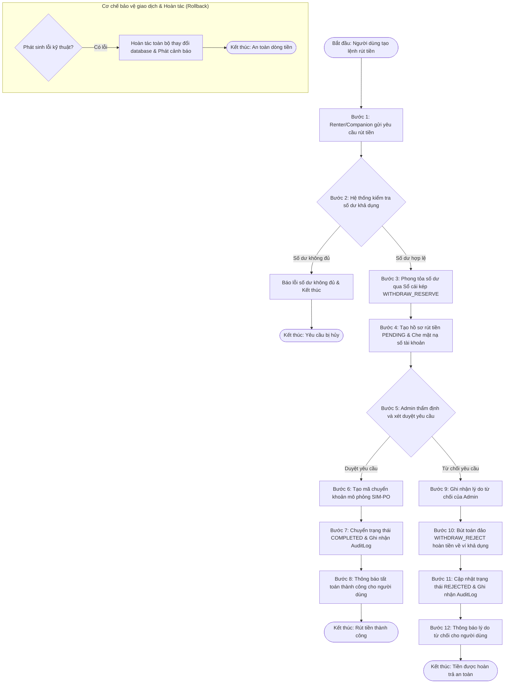

# QUY TRÌNH RÚT TIỀN & GIẢI NGÂN SỐ DƯ (LUỒNG NGHIỆP VỤ PHỤ MỞ RỘNG)

Tài liệu này chuẩn hóa quy trình rút tiền thu nhập và số dư khả dụng của người dùng (Renter / Companion), cơ chế phong tỏa số dư khả dụng qua Sổ cái kép, quy trình kiểm duyệt duy nhất của Quản trị viên (ADMIN) và cơ chế hoàn tiền tự động khi từ chối theo chuẩn thiết kế hệ thống INSTASQUAD.

> [!NOTE]
> Đây là luồng nghiệp vụ phụ mở rộng hỗ trợ tất toán số dư, hoạt động độc lập với **UC03: Đặt lịch & Escrow Payment** (quy trình chính theo INSTASQUAS_REQUIREMENTS.pdf trang 7-8 và BPMN Hình 1A/1B).

---

## 1. Sơ đồ quy trình nghiệp vụ (BPMN Mermaid)

---

## 2. Bảng mô tả chi tiết các bước thực hiện (Khuôn mẫu Bảng Hình 1A)

| Bước | Tác nhân | Công việc | Đầu vào | Đầu ra | Mô tả chi tiết (Đối chiếu mã nguồn thực tế) |
| :---: | :--- | :--- | :--- | :--- | :--- |
| **1** | Renter / Companion | Tạo lệnh rút tiền và điền thông tin tài khoản | Số tiền cần rút (VND), Tên ngân hàng, Số tài khoản ngân hàng, Khóa tránh trùng lặp | Yêu cầu rút tiền được gửi đến máy chủ | Người dùng truy cập mục Ví trên giao diện cá nhân, nhập số tiền muốn rút từ số dư khả dụng và thông tin tài khoản nhận tiền. Hệ thống sinh mã chống trùng lặp để bảo vệ giao dịch (`POST /api/wallet/withdraw` hoặc `POST /api/withdrawals`). |
| **2** | Hệ thống | Kiểm tra tính hợp lệ và số dư khả dụng | Số tiền yêu cầu, Ví người dùng trong cơ sở dữ liệu | Kết quả kiểm tra (Hợp lệ / Không đủ số dư) | Hệ thống đối chiếu số tiền yêu cầu với số dư khả dụng hiện có trong ví (`wallet.available_balance`). Nếu số dư nhỏ hơn số tiền yêu cầu, hệ thống từ chối ngay và báo lỗi rõ ràng cho người dùng (`INSUFFICIENT_BALANCE`). |
| **3** | Hệ thống | Phong tỏa số tiền rút qua Sổ cái kép | Số tiền yêu cầu, ID ví người dùng, ID ví trung gian hệ thống | Giao dịch sổ cái kép loại `WITHDRAW_RESERVE` | Khi số dư hợp lệ, hệ thống thực hiện ngay bút toán ghi nợ ví khả dụng của người dùng và ghi có ví trung gian giữ hộ của hệ thống (`CLEARING_WALLET_ID`). Số dư khả dụng giảm ngay lập tức để tránh rút trùng lặp, trong khi phương sai sổ cái luôn bảo toàn tuyệt đối ($\text{Variance} = 0$). |
| **4** | Hệ thống | Che mặt nạ tài khoản và lưu hồ sơ rút tiền | Dữ liệu ngân hàng, Số tài khoản thô, ID giao dịch sổ cái | Bản ghi yêu cầu rút tiền với trạng thái `PENDING` | Hệ thống tự động che mặt nạ số tài khoản ngân hàng (chỉ lưu 4 chữ số cuối, ví dụ `*******1234`) để bảo vệ dữ liệu cá nhân theo tiêu chuẩn an toàn thông tin. Tạo bản ghi hồ sơ rút tiền và nhật ký kiểm toán (`AuditLog`). |
| **5** | Admin (Quản trị viên) | Tiếp nhận và xem xét thẩm định hồ sơ rút tiền | Danh sách yêu cầu rút tiền ở trạng thái `PENDING` | Quyết định phê duyệt hoặc từ chối | Duy nhất Quản trị viên (ADMIN) có thẩm quyền xem xét và phê duyệt hoặc từ chối (khớp với phân quyền `authorizeRole(['ADMIN'])` tại `server/src/modules/wallet/wallet.controller.ts` và `server/src/modules/withdrawal/withdrawal.controller.ts`). |
| **6** | Admin | Phê duyệt và tạo mã chi tiền mô phỏng | ID hồ sơ rút tiền, Thông tin tài khoản nhận | Mã chi tiền mô phỏng (dạng `SIM-PO-...`) | Khi Admin đồng ý chi tiền, hệ thống sinh mã chuyển tiền mô phỏng (chữ "PO" viết tắt của Payout) gắn liền với tên ngân hàng và thời điểm xử lý (ví dụ: `SIM-PO-MBBANK-K9X...`). Hệ thống không liên kết cổng thanh toán ngoài thực tế để tránh phát sinh chi phí và rủi ro. |
| **7** | Hệ thống | Hoàn tất hồ sơ rút tiền và ghi nhận kiểm toán | Mã chi tiền `SIM-PO`, ID Admin duyệt | Bản ghi cập nhật trạng thái `COMPLETED` | Hồ sơ được cập nhật sang trạng thái hoàn tất (`COMPLETED`), ghi nhận thời điểm hoàn tất và người duyệt. Tạo bản ghi kiểm toán `WITHDRAW_SETTLE` trong bảng `AuditLog`. |
| **8** | Hệ thống | Gửi thông báo kết quả cho người dùng | ID người dùng, Số tiền, Thời gian | Thông báo trên giao diện ứng dụng và nhật ký ví | Hệ thống gửi thông báo bằng tiếng Việt tự nhiên thông báo số tiền đã được chuyển thành công, hiển thị mã giao dịch rút gọn và cập nhật lịch sử biến động số dư. |
| **9** | Admin | Từ chối yêu cầu và nhập lý do | ID hồ sơ rút tiền, Nội dung lý do từ chối | Quyết định từ chối có kèm lý do văn bản | Trường hợp thông tin tài khoản không hợp lệ, tên chủ tài khoản sai lệch hoặc phát hiện gian lận, Admin chọn từ chối và bắt buộc nhập lý do bằng tiếng Việt rõ ràng (tối thiểu 10 ký tự). |
| **10** | Hệ thống | Thực hiện bút toán đảo hoàn trả tiền | Số tiền đã phong tỏa, ID ví người dùng, ID ví trung gian | Giao dịch sổ cái kép loại `WITHDRAW_REJECT` | Hệ thống tự động kích hoạt bút toán đảo: ghi có trả lại đúng số tiền vào ví khả dụng của người dùng và ghi nợ giảm số dư ví trung gian giữ hộ. Tuyệt đối không chỉnh sửa số dư thô bằng câu lệnh trực tiếp. |
| **11** | Hệ thống | Cập nhật hồ sơ từ chối và ghi nhật ký | Lý do từ chối, ID Admin xử lý | Bản ghi cập nhật trạng thái `REJECTED` | Cập nhật hồ sơ rút tiền sang trạng thái `REJECTED`, lưu trữ lý do từ chối và Admin xử lý. Ghi nhận hành động `WITHDRAW_REJECT` vào sổ nhật ký kiểm toán. |
| **12** | Hệ thống | Thông báo lý do từ chối cho người dùng | ID người dùng, Lý do từ chối, Số tiền hoàn lại | Thông báo giải thích kèm hướng dẫn thao tác lại | Thông báo thông tin lý do từ chối cho người dùng, khẳng định số tiền đã được hoàn trả nguyên vẹn về ví khả dụng và hướng dẫn kiểm tra lại thông tin ngân hàng. |
| **X** | Hệ thống | Cơ chế hoàn tác khi xảy ra lỗi bất ngờ | Ngoại lệ phần mềm, Sự cố ngắt kết nối database | Lệnh hủy giao dịch (`Rollback`) và cảnh báo hệ thống | Toàn bộ các thao tác trong Bước 3-4 và Bước 10-11 đều được đóng gói trong khối giao dịch nguyên tử (`$transaction`). Nếu phát sinh bất kỳ lỗi kỹ thuật nào, toàn bộ dữ liệu lập tức trở về trạng thái ban đầu, số dư không bao giờ bị lệch. |

---

## 3. Đối chiếu triển khai mã nguồn thực tế

Quy trình trên được triển khai tại:
- **Tạo yêu cầu và phong tỏa:** [`WithdrawalService.requestWithdrawal`](../server/src/modules/withdrawal/withdrawal.service.ts#L15-L129)
- **Chuyển trạng thái xử lý:** [`WithdrawalService.processWithdrawal`](../server/src/modules/withdrawal/withdrawal.service.ts#L135-L182)
- **Phê duyệt hoàn tất (sinh mã PO):** [`WithdrawalService.completeWithdrawal`](../server/src/modules/withdrawal/withdrawal.service.ts#L188-L256)
- **Từ chối và bút toán hoàn trả:** [`WithdrawalService.rejectWithdrawal`](../server/src/modules/withdrawal/withdrawal.service.ts#L262-L343)
- **Bảo toàn Sổ cái kép:** [`LedgerService.postTransaction`](../server/src/modules/ledger/ledger.service.ts)
